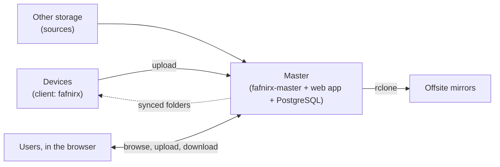

# fafnirx

Collect the files of your devices on a server you own, keep every version, browse them from anywhere, and copy them
offsite. Backups flow one way: devices → master → mirrors. The master never changes a file on a device, and a device
cannot read or list what the master holds, except the shared folders and master folders it is let into, and its own user's folders, which sync both ways.



## Features

- **Client** (Windows, macOS, Linux): watches folders, uploads changes (resumable, verified, content already on the master is not sent again), tray icon,
  self-update from GitHub releases. **Android:** [fafnirx-android](https://github.com/jameelhamdan/fafnirx-android).
- **Folders**: a folder that belongs to a user (or is a folder of the master files), not to a device, kept in sync both ways by
  any of their devices. One list for yours, those shared with you and the master folders; other users get access to yours only when
  the owner adds them. A folder can also be shown as an album.
- **Master**: one Rust binary with the web app built in. Files are stored as plain files in
  `files/users/<user>/<name>/<path>` (a directory a device sends: `files/users/<user>/<device>/<directory>/<path>`); the newest 5 versions are kept, deleted files are removed after 30 days (both configurable).
- **File browser**: search, filter, sort, preview, version history, zip download, drag-and-drop upload, delete and restore.
  Photos and videos can be opened in the viewer and rated or favorited from here.
- **Photo and video library** over the same files: timeline, favorites, archive, trash, albums (a shortcut to a folder),
  tags, ratings, corrected dates and places. Originals are never changed.
- **Video player** with subtitles and adaptive quality, as the optional [video module](docs/video.md), installed from the web app, so a server without videos carries no ffmpeg.
- **Sources and mirrors**: Google Drive and any other [rclone](https://rclone.org) storage in, web files and feeds with the optional [fetch module](docs/sources.md#web-files-and-feeds) and more kinds of source with [plugins](docs/plugins.md); any rclone remote out.
- **Users and roles**: administrator, normal, read-only. Six languages (English, Spanish, Chinese, Arabic, Russian, Japanese).

## Quick start

```sh
mkdir fafnirx && cd fafnirx
curl -fsSLO https://raw.githubusercontent.com/jameelhamdan/fafnirx/master/docker/docker-compose.yml
printf 'FAFNIRX_ADMIN_PASSWORD=choose-one\nFAFNIRX_DB_PASSWORD=another-one\n' > .env
docker compose up -d
```

Open `http://<server>:8080`, log in as `admin`, add a device (its token is shown once). On the device (Linux, macOS; Windows has
`get.ps1` and a setup, see [Installation](docs/installation.md#2-a-client)):

```sh
curl -fsSL https://raw.githubusercontent.com/jameelhamdan/fafnirx/master/installer/get.sh | sh -s --     --server <server> --folder ~/Documents       # asks for the token
```

## Performance

A 1-core machine with 512 MB for the whole stack runs it; 2 cores and 1 GB is comfortable. Measurements and tuning:
[Deployment](docs/deployment.md#sizing-and-tuning).

## Documentation

| | |
| --- | --- |
| [Overview](docs/overview.md) | What it does, how a file travels, the rules |
| [Installation](docs/installation.md) | Master and clients, configuration reference |
| [Usage](docs/usage.md) | Web app, library, processing, change log, client |
| [Sources](docs/sources.md) | Pull files in from storage, Google Drive, web addresses and feeds |
| [Mirrors](docs/mirrors.md) | Offsite backups (encrypted) and replicas |
| [Modules](docs/modules.md) | Optional add-on containers: what they are for, how to turn one on |
| [Video module](docs/video.md) | Video playback, subtitles, details and poster frames |
| [Plugins](docs/plugins.md) | Writing a plugin for a new kind of source |
| [Deployment](docs/deployment.md) | Storage, proxy, tunnel, backups, security checklist |
| [Architecture](docs/architecture.md) | Components, data model, IDs, locking, API |
| [Development](docs/development.md) | Build, test, extend, release |

## Repository

| Path | What |
| --- | --- |
| `crates/master` | `fafnirx-master`: device API, web API, file store, background work |
| `crates/client` | `fafnirx`: client, tray, self-update |
| `crates/db` | Typed queries, generated at build time from `queries/*.sql` |
| `crates/common` | Hashing, chunking, path rules, gRPC types |
| `crates/module-api`, `fetch-api`, `module-kit` | The contract between the master and its modules, and what modules share |
| `modules` | Optional features as services: `video/service` is `fafnirx-video` (HLS, details, poster frames), `fetch/service` is `fafnirx-fetch` (web sources) |
| `frontend` | Web app (React, shadcn/ui), built into the master |
| `proto`, `installer`, `tests`, `docs` | Device contract, installers, end-to-end tests, documentation |

MIT licensed: [LICENSE](LICENSE), [third-party notices](THIRD_PARTY_LICENSES.md). Written with
[Claude](https://claude.com/claude-code) under human direction and review.

fafnirx is provided as is, without warranty. You are responsible for your storage and backups; keep tested copies of
anything that matters (3 copies, 2 kinds of storage, 1 offsite) and check that you can restore from them.
