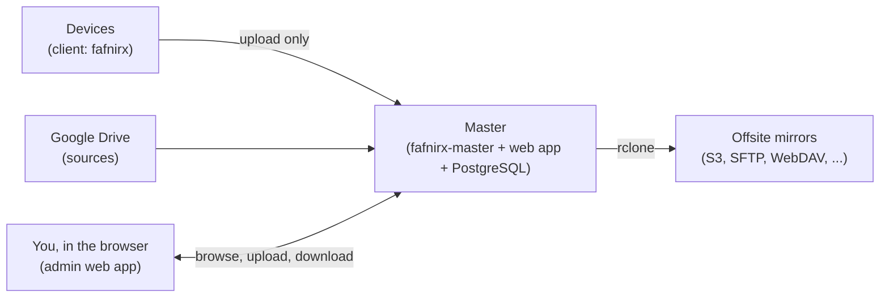

# fafnirx

Collect the files of your computers and phones on a server you own, keep every version, browse them from anywhere,
and copy them offsite. Data flows one way: devices → master → mirrors. A device can add data to the master; it can
never read, list or delete what the master holds.



## What you get

- **A client** for Windows, macOS and Linux that watches the folders you choose, uploads what changes (resumable,
  verified, deduplicated) and runs by itself from then on. A tray icon shows what it is doing.
- **A master**, one Rust binary with the web app built in, that stores every file as a normal file under
  `files/<device>/<path>`, keeps the newest 5 versions of each, and removes deleted files only after a retention
  period (30 days by default).
- **A file browser** in the web app: browse, search, filter by type, sort, preview photos with their EXIF data, see
  every version of a file, download one file or many (as a zip), upload by dragging files and folders in, delete
  and restore. Folders show their size. It updates live as devices upload.
- **A photo library** on the same files, without moving them: a timeline by month and day with a scrubber (on a phone
  too), thumbnails and previews of photos and videos, favorites, archive, trash, albums, a map of where pictures were
  taken, and tags, ratings, descriptions and corrected dates and places. Originals are never changed.
- **Sources and mirrors**: collect Google Drive folders on a schedule; copy everything to any storage rclone supports.
- **A network drive**: `data/files/` is a plain tree you can share over SMB or NFS and write to; the master notices.
- **Remote access** without a VPN through a Cloudflare tunnel, or plain HTTP on your own network.

## Quick start

On the server (Docker):

```sh
git clone https://github.com/jameelhamdan/fafnirx.git fafnirx && cd fafnirx
printf 'FAFNIRX_ADMIN_PASSWORD=choose-one\nFAFNIRX_DB_PASSWORD=another-one\n' > .env
docker compose up -d --build
```

Open `http://<server>:8080`, log in, and add a device. It shows the command to run on that device:

```sh
fafnirx enroll --server http://<server>:7443      # asks for the token
fafnirx add-folder ~/Documents
```

`enroll` also starts the client in the background and at every login. That is all.

## Documentation

| | |
|---|---|
| [Overview](docs/overview.md) | What it is and how files move |
| [Installation](docs/installation.md) | The master and the clients, on every platform |
| [Usage](docs/usage.md) | The web app, the client, sources, mirrors, restoring |
| [Deployment](docs/deployment.md) | Storage, backups, roles, Cloudflare tunnel, security |
| [Architecture](docs/architecture.md) | Components, data model, locking, live updates |
| [Development](docs/development.md) | Building, running and testing |
| [Specification](docs/spec.md) | Requirements and decisions |
| [Tech stack](docs/tech-stack.md) | Libraries and where they are used |
| [Plans](docs/plans/features.md) | Features that are not built |

## Repository

| Path | What |
|---|---|
| `crates/master` | `fafnirx-master`, organized in apps (`devices`, `files`, `library`, `integrations`, `monitoring`, `web`, `platform`), with `schema.sql` |
| `crates/client` | `fafnirx`: the client, tray and self-update |
| `crates/common` | Shared hashing, chunking, path rules and the generated gRPC types |
| `crates/sign` | `fafnirx-sign`: creates the update key and publishes signed client builds |
| `frontend` | The web app (React, shadcn/ui), built into the master |
| `proto` | The device gRPC contract |
| `installer` | Windows installer and the Linux/macOS install script |
| `tests` | End-to-end tests (Node) |
| `docs` | The documentation |

MIT licensed: see [LICENSE](LICENSE). Third-party licenses are in [THIRD_PARTY_LICENSES.md](THIRD_PARTY_LICENSES.md).
