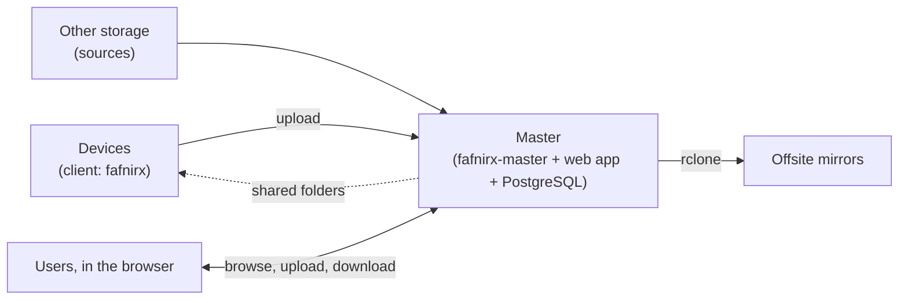

# fafnirx

Collect the files of your computers on a server you own, keep every version, browse them from anywhere, and copy them
offsite. Backups flow one way: devices → master → mirrors. The master never changes a file on a device, and a device
cannot read or list what the master holds, except the shared folders of its own user, which sync both ways.



## Features

- **Client** (Windows, macOS, Linux): watches folders, uploads changes (resumable, verified, deduplicated), tray icon,
  self-update from GitHub releases. **Android:** [fafnirx-android](https://github.com/jameelhamdan/fafnirx-android).
- **Shared folders**: a folder that belongs to a user, not to a computer, kept in sync both ways by any of their computers.
  Other users get access only when the owner adds them.
- **Master**: one Rust binary with the web app built in. Files are stored as plain files in
  `files/users/<user>/<device>/<path>`; the newest 5 versions are kept, deleted files are removed after 30 days (both configurable).
- **File browser**: search, filter, sort, preview, version history, zip download, drag-and-drop upload, delete and restore.
  Photos and videos can be opened in the viewer and rated or favorited from here.
- **Photo and video library** over the same files: timeline, favorites, archive, trash, albums (a folder can be an album),
  tags, ratings, corrected dates and places. Originals are never changed.
- **Video player** with subtitles and adaptive quality, as the optional [video module](docs/video.md), installed from the web app, so a server without videos carries no ffmpeg.
- **Sources and mirrors**: Google Drive and any other [rclone](https://rclone.org) storage in; any rclone remote out.
- **Users and roles**: administrator, normal, read-only. Six languages (English, Spanish, Chinese, Arabic, Russian, Japanese).

## Quick start

```sh
mkdir fafnirx && cd fafnirx
curl -fsSLO https://raw.githubusercontent.com/jameelhamdan/fafnirx/master/docker-compose.yml
printf 'FAFNIRX_ADMIN_PASSWORD=choose-one\nFAFNIRX_DB_PASSWORD=another-one\n' > .env
docker compose up -d
```

Open `http://<server>:8080`, log in as `admin`, add a device (its token is shown once). On the device, install the client
from the [latest release](https://github.com/jameelhamdan/fafnirx/releases/latest), then:

```sh
fafnirx enroll --server http://<server>:7443     # asks for the token
fafnirx add-folder ~/Documents
```

## Performance

Measured with thumbnails off, on one desktop (12 threads, PostgreSQL 17 in Docker, loopback) with 5,200 photos. Script:
`tests/bench-local.mjs`.

| | |
| --- | --- |
| Memory | master 13 MiB idle, 34 MiB peak; PostgreSQL about 100 MiB |
| CPU | 0.2 core importing; same speed on 1 core as on 12 |
| Import | 58 small or 15 large (3 MB) photos per second |
| Upload / download | about 500 / 700 MiB/s |
| Page load (p50) | 10-17 ms for the timeline, folders and dashboard |

Minimum and recommended hardware: [Installation](docs/installation.md#1-the-master-docker).

Stated requirements of similar projects (they do more, so this is for scale only):

| | RAM and CPU |
| --- | --- |
| [Nextcloud](https://docs.nextcloud.com/server/stable/admin_manual/installation/system_requirements.html) | 128 MB minimum per PHP process, 512 MB recommended |
| [Immich](https://docs.immich.app/install/requirements) | 6 GB minimum, 8 GB recommended; 2 cores, 4 recommended |
| [Jellyfin](https://jellyfin.org/docs/general/administration/hardware-selection/) | 8 GB; an i5-11400 or N100 class CPU for transcoding |

## Documentation

| | |
| --- | --- |
| [Overview](docs/overview.md) | What it does, how a file travels, the rules |
| [Installation](docs/installation.md) | Master and clients, configuration reference |
| [Usage](docs/usage.md) | Web app, library, processing, change log, client |
| [Sources](docs/sources.md) | Pull files in from Google Drive and other storage |
| [Mirrors](docs/mirrors.md) | Offsite backups (compressed, encrypted) and replicas |
| [Modules](docs/modules.md) | Optional features, installed as plugins or run as services of their own |
| [Video module](docs/video.md) | Video playback, subtitles, details and poster frames |
| [Deployment](docs/deployment.md) | Storage, proxy, tunnel, backups, security checklist |
| [Architecture](docs/architecture.md) | Components, data model, IDs, locking, API |
| [Development](docs/development.md) | Build, test, extend, release |

## Repository

| Path | What |
| --- | --- |
| `crates/master` | `fafnirx-master`, split into apps (`devices`, `files`, `library`, `integrations`, `monitoring`, `web`, `platform`, `repo`) and its `migrations` |
| `crates/client` | `fafnirx`: client, tray, self-update |
| `crates/db` | Typed queries, generated at build time from `queries/*.sql` |
| `crates/common` | Hashing, chunking, path rules, gRPC types |
| `crates/module-api` | The contract between the master and its modules |
| `modules` | Optional features as services: `video/service` is `fafnirx-video` (HLS, details, poster frames) |
| `crates/sign` | `fafnirx-sign`: signed client builds (optional) |
| `frontend` | Web app (React, shadcn/ui), built into the master |
| `proto`, `installer`, `tests`, `docs` | Device contract, installers, end-to-end tests, documentation |

MIT licensed: [LICENSE](LICENSE), [third-party notices](THIRD_PARTY_LICENSES.md). Written with
[Claude](https://claude.com/claude-code) under human direction and review.

fafnirx is provided as is, without warranty. You are responsible for your storage and backups; keep tested copies of
anything that matters (3 copies, 2 kinds of storage, 1 offsite) and check that you can restore from them.
