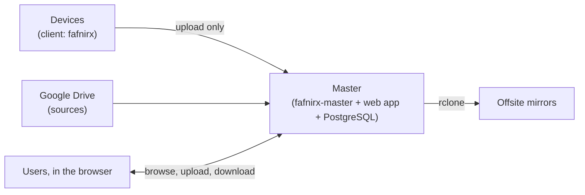

# fafnirx

Collect the files of your computers on a server you own, keep every version, browse them from anywhere, and copy them
offsite. Data flows one way: devices → master → mirrors. A device only reads its own folders and sends them; the
master never changes a file on a device, and a device can never read or list what the master holds.



## Features

- **Client** (Windows, macOS, Linux): watches folders, uploads changes (resumable, verified, deduplicated), tray icon,
  self-update from GitHub releases. **Android:** [fafnirx-android](https://github.com/jameelhamdan/fafnirx-android).
- **Master**: one Rust binary with the web app built in. Files are stored as plain files in
  `files/users/<user>/<device>/<path>`; the newest 5 versions are kept, deleted files are removed after 30 days (both configurable).
- **File browser**: search, filter, sort, preview, version history, zip download, drag-and-drop upload, delete and restore.
  Photos and videos can be opened in the viewer and rated or favorited from here.
- **Photo and video library** over the same files: timeline, favorites, archive, trash, albums (a folder can be an album),
  map, tags, ratings, corrected dates and places. Originals are never changed.
- **Video player** with subtitles; optional [streaming](docs/streaming.md) in several qualities.
- **Sources and mirrors**: Google Drive folders in; any [rclone](https://rclone.org) remote out.
- **Users and roles**: administrator, normal, read-only. Six languages (English, Spanish, Chinese, Arabic, Russian, Japanese).

## Quick start

```sh
mkdir fafnirx && cd fafnirx
curl -fsSLO https://raw.githubusercontent.com/jameelhamdan/fafnirx/master/docker-compose.yml
printf 'FAFNIRX_ADMIN_PASSWORD=choose-one\nFAFNIRX_DB_PASSWORD=another-one\n' > .env
docker compose up -d
```

Open `http://<server>:8080`, log in as `admin`, add a device (its token is shown once). On the device, install the client
from the [latest release](https://github.com/jameelhamdan/fafnirx/releases/latest), then:

```sh
fafnirx enroll --server http://<server>:7443     # asks for the token
fafnirx add-folder ~/Documents
```

## Documentation

| | |
| --- | --- |
| [Overview](docs/overview.md) | What it does, how a file travels, the rules |
| [Installation](docs/installation.md) | Master and clients, configuration reference |
| [Usage](docs/usage.md) | Web app, library, processing, change log, client, sources, mirrors |
| [Video streaming](docs/streaming.md) | Optional adaptive playback |
| [Deployment](docs/deployment.md) | Storage, proxy, tunnel, backups, security checklist |
| [Architecture](docs/architecture.md) | Components, data model, IDs, locking, API |
| [Development](docs/development.md) | Build, test, extend, release |
| [Plans](docs/plans/features.md) | Not built yet |

## Repository

| Path | What |
| --- | --- |
| `crates/master` | `fafnirx-master`, split into apps (`devices`, `files`, `library`, `integrations`, `monitoring`, `web`, `platform`, `repo`) and its `migrations` |
| `crates/client` | `fafnirx`: client, tray, self-update |
| `crates/db` | Typed queries, generated at build time from `queries/*.sql` |
| `crates/common` | Hashing, chunking, path rules, gRPC types |
| `crates/stream` | `fafnirx-stream`: optional HLS service |
| `crates/sign` | `fafnirx-sign`: signed client builds (optional) |
| `frontend` | Web app (React, shadcn/ui), built into the master |
| `proto`, `installer`, `tests`, `docs` | Device contract, installers, end-to-end tests, documentation |

MIT licensed: [LICENSE](LICENSE), [third-party notices](THIRD_PARTY_LICENSES.md). Written with
[Claude](https://claude.com/claude-code) under human direction and review.

fafnirx is provided as is, without warranty. You are responsible for your storage and backups; keep tested copies of
anything that matters (3 copies, 2 kinds of storage, 1 offsite) and check that you can restore from them.
