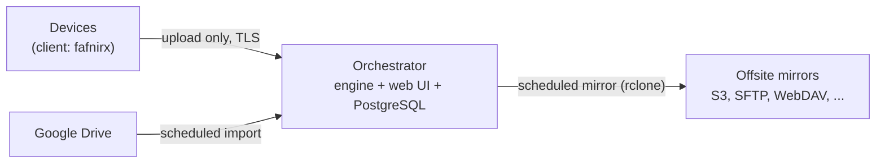

# fafnirx

Collects data from your devices (Windows, macOS, Linux) to one server you own, which mirrors it offsite.
Data only flows one way: devices → orchestrator → mirrors. Nothing is ever sent back, and a client can add data but
never read or delete it.

Named after Fafnir, the dragon who hoards treasure: data goes in and nothing comes out.

## How it works



- The **client** watches the folders you pick, splits changed files into 4 MiB chunks, hashes them (BLAKE3) and uploads
  only the chunks the server does not have yet. Edits to big files are cheap, copies upload nothing, and interrupted
  uploads resume.
- The **orchestrator** verifies and stores the chunks once (deduplicated), and keeps the newest 5 versions of every
  file. A delete on a device only marks the file; it stays recoverable for 30 days.
- A **web UI** manages devices, Google Drive sources, mirrors, settings and alerts.
- **Mirrors** are plain file trees with a `versions/` history, readable without fafnirx.

Scale it is built for: a handful of devices, thousands of files, files up to 5 GB.

| Part | What | Where |
|---|---|---|
| `fafnirx-server` | Rust engine: gRPC data path over TLS, chunk store, retention, alerts, sources, mirrors | `crates/server` |
| web UI | FastAPI + Alpine.js: devices, tokens, sources, mirrors, settings | `web/` |
| `fafnirx` | Client: watcher, resumable chunked upload, offline queue, tray icon, signed self-update | `crates/client` |
| `fafnirx-sign` | Creates the update signing key, publishes signed client builds | `crates/sign` |
| PostgreSQL | All metadata. The only supported database | `schema.sql` |

## Install

You need a Linux host with Docker, and local disk for PostgreSQL (not a network share).

```sh
export FAFNIRX_ADMIN_PASSWORD='choose-one'        # web UI login
export FAFNIRX_DB_PASSWORD='another-one'          # PostgreSQL password (letters and digits)
export FAFNIRX_TLS_HOSTS='nas.lan,192.168.1.5'    # names/IPs your devices will use
docker compose up -d --build
```

- Devices connect to `:7443` (TLS only; a CA is created on first start).
- The web UI is at `http://<host>:8080` (plain HTTP, LAN or VPN only; never expose it publicly).
- PostgreSQL data is in `./pgdata`, everything else in `./data`. See [Installation](docs/installation.md) and
  [Deployment](docs/deployment.md) for settings, ZFS, SMB and backups.

## Use

1. In the web UI, **add a device** and copy its token (shown once). Download the **CA certificate**.
2. On the device (build the client with `cargo build --release -p fafnirx`):

```sh
fafnirx enroll --server https://nas.lan:7443 --token <token> --ca fafnirx-ca.pem
fafnirx add-folder ~/Documents --name documents
fafnirx run                  # or: fafnirx install-service  (start at login)
```

Other commands: `sync`, `status`, `pause`, `resume`, `update`, `tray`. Put a `.fafnirxignore` (gitignore syntax) in a
collected folder to exclude files.

- **Google Drive**: web UI → Sources. Share folders with a service account and paste its key.
- **Mirrors**: web UI → Mirrors. Any rclone backend (`s3`, `sftp`, `webdav`, `b2`, ...).
- **Restoring**: manual. Copy from a mirror's `files/` tree, or rebuild from the chunk store.

Details for all of these are in [Usage](docs/usage.md).

## Documentation

| | |
|---|---|
| [Overview](docs/overview.md) | What it is and how it works |
| [Installation](docs/installation.md) | Server and client setup, configuration reference |
| [Usage](docs/usage.md) | Devices, sources, mirrors, alerts, restores, signed updates |
| [Architecture](docs/architecture.md) | Components, data flow, [database structure](docs/architecture.md#database-structure) |
| [Tech stack](docs/tech-stack.md) | What it is built with |
| [Development](docs/development.md) | Build, test, contribute |
| [Deployment](docs/deployment.md) | Storage, TLS, backups, upgrades, security |
| [Specification](docs/spec.md) | The full design and its reasoning |

## License

MIT. See [THIRD_PARTY_LICENSES.md](THIRD_PARTY_LICENSES.md) for the Beszel styling and Inter font notices.
