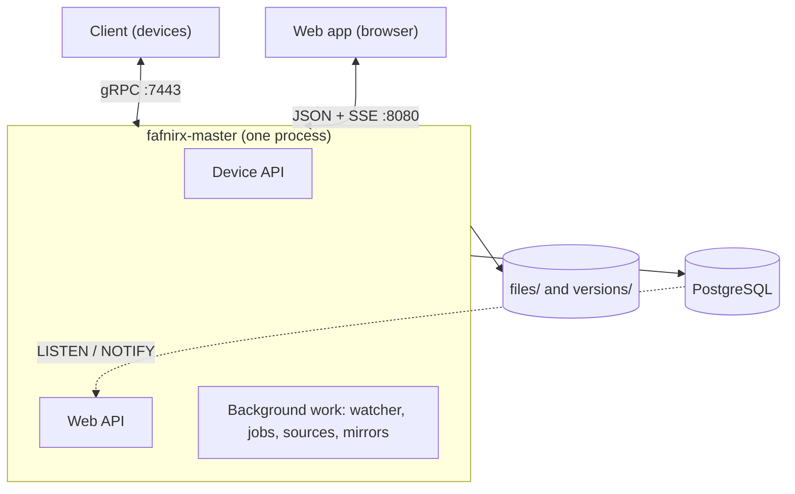
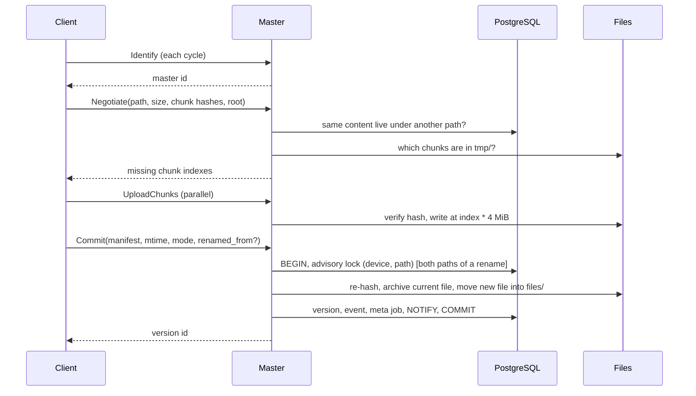
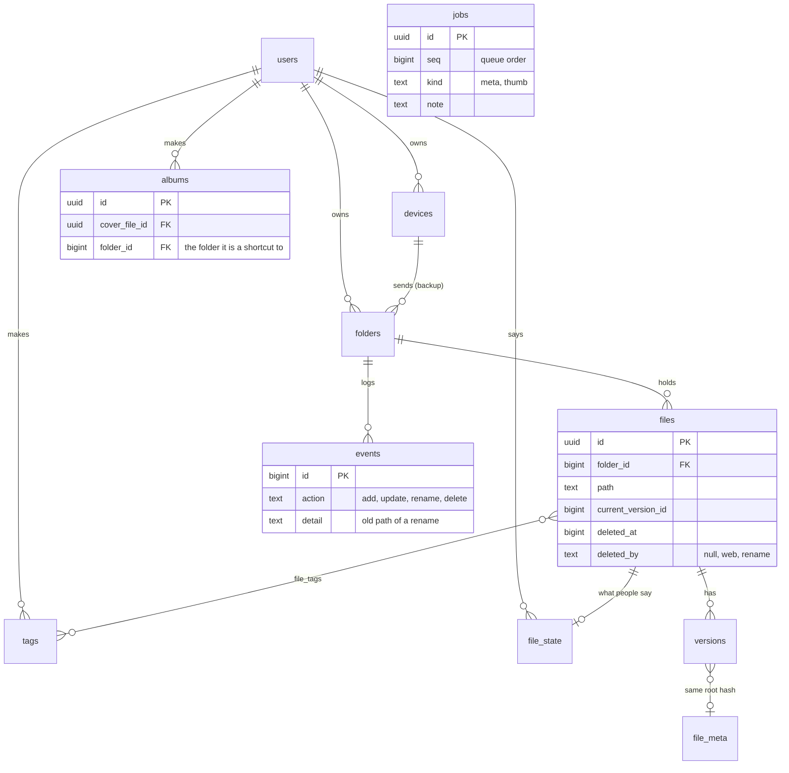

# Architecture

| Component | Role |
|---|---|
| Client `fafnirx` (`crates/client`) | Watch, hash in chunks, upload, offline queue, folder sync, tray, self-update from GitHub releases |
| Master `fafnirx-master` (`crates/master`) | Device API, web API, file store, ingest, retention, alerts, sources, mirrors, metadata |
| Web app (`frontend`) | React, built into the master. A module's part is built apart and loaded by the browser from the module while it is up |
| Modules (`modules/<id>/service`) | Optional add-on containers that announce themselves to the master; only the master talks to them ([modules](modules.md)). Today: `fafnirx-video` ([video](video.md)) and `fafnirx-fetch`, which reads web sources ([fetch](sources.md#web-files-and-feeds)); more kinds of source are plugins of the same shape ([plugins](plugins.md)) |
| `crates/module-api`, `fetch-api`, `module-kit` | The contract between master and module, what a module that reads sources says to the master, and the plumbing every such module shares |
| `crates/common` | gRPC types, chunking, hashing, path rules |

## Design decisions

- **Two APIs, two trust levels.** The device gRPC API (`proto/fafnirx.proto`) has no call that reads, lists or deletes the
  files of a device. The one exception is [folders](#folders), which a device reads and writes for its own user. Everything
  else that reads or deletes is in the web API, behind a login and role checks. Different ports, no shared authentication.
- **Plain files.** The current version of a path is stored whole in `files/users/<user>/<name>/<path>` (`files/<name>/<path>` in
  a master folder; `files/users/<user>/<device>/<directory>/<path>` for a directory a device sends). A replaced or deleted version moves to `versions/<version id>/...`. Chunks exist only on the wire and in
  `tmp/`; there is no cross-file deduplication.
- **Devices and folders are two tables.** A device (`devices`) is a computer or phone with a token, a host and a lease; a folder
  (`folders`) holds files. A folder is a `user` folder (made by its owner), a `master` folder (no owner) or a `backup` folder:
  one for each directory a device sends, made the first time it sends a file of it. Paths in a folder are relative to it; a
  device's paths on the wire start with the directory (`docs/a.txt`), and the master splits them. A folder is named by its `key`:
  `<user>/<name>`, `master:<path>` or `<user>/<device>/<directory>`; a device by `<user>/<name>`. A device and a folder of one
  user never share a name, because both are directories of `files/users/<user>/`. A folder can be renamed: its directory,
  versions and every row keyed by the name move in one transaction; everything else points at the folder id, so albums and
  sources follow. A `public_id` is the address clients keep, so a rename does not detach them.
- **IDs.** Files, albums, tags, jobs and alerts have random UUIDs, shown as 22-character URL-safe Base64. Devices, users,
  sources and mirrors are addressed by slug. Versions, events and sessions keep numeric keys.
- **One process.** Locks, live events and queued work go through PostgreSQL. Only browser uploads in progress and the login
  rate limit live in memory.
- **A client knows its master.** Each database has a random id, asked at the start of every cycle; a different id makes the
  client drop its record and resend everything.
- **Metadata is separate from data.** Losing PostgreSQL loses versions and history, not the files; losing the data directory
  loses the data. Back up both.
- **No TLS in the master.** Trust comes from the network or a TLS proxy. Tokens are hashed, passwords use argon2.
  `FAFNIRX_TRUSTED_PROXY` names the proxies whose `X-Forwarded-For` is believed.
- **Library data sits beside the file.** Extracted metadata is per content (root hash); ratings and tags per file and user.
  Both go with their file.
- **Albums** are shortcuts to a folder: every live photo and video under it, one album per user and folder, no files of
  their own. They follow the folder when it is renamed or moved.
- **Artwork is looked up, not stored.** A video's picture and `.nfo` come from the file, else its folder or the two above,
  and are cached by content hash.

## What a file operation means

One operation, one event, one transaction under the path's lock.

| Operation | `files` row | Event | Trash |
|---|---|---|---|
| First write of a path | created, version current | `add` | no |
| New content for a live path | new version current, old archived | `update` | no |
| Rename (client, source, a move noticed in a folder, or Move in the web app) | new path written; old path vacated | one `rename` on the new path, detail = old path | **no**: hidden from Trash and listings; retention removes it |
| Delete | marked deleted (`web` when done in the web app) | `delete` | yes |
| Brought back | deletion cleared | `add`/`update` | leaves |

Retention, jobs and sign-ins write no events. Per-day activity counts `add`, `update`, `rename`, `delete`.

## Upload and commit

Every call carries the token and an instance name. If anything fails after files moved, the moves are undone before the error
returns.

**Locking.** Every change to a path (commit, delete, web upload or move, watcher) first takes a PostgreSQL advisory
transaction lock on `(device, path)`; a rename takes both paths in a fixed order. File moves happen inside the lock, so
paths never interleave and the watcher never sees a half-done commit.

**Watcher.** The master watches `files/`. A path quiet for 5 s is compared with the database: new or changed files become
versions, vanished ones are marked deleted, a vanished file matched by a new file of the same size and mtime is a rename, and a
new `files/users/<user>/<name>` becomes a folder. The whole tree is also compared every 5 minutes or on request. A missing
folder deletes nothing.

**Live updates.** Changes `NOTIFY` inside their transaction, so it arrives on commit. One `LISTEN` connection feeds browsers
over SSE; the web app maps topics to stale queries and refetches once per burst. A slow stream is told to resync. Each
stream rereads its login every minute: lost access stops its events, and an ended session closes it.

## Folders

A folder of a user is shared when the owner adds other users to it, each read-write or
read-only; a member can leave. Versions, trash, retention, mirrors, the watcher and the web file browser treat every folder
alike. A **master folder** is a folder of the master files that belongs to nobody: a folder row like the others, named by its
path in `files/`, that devices can sync both ways; administrators make, rename and remove them, every user can use them,
read-only users read. A new folder in `files/` becomes one by itself unless it would be inside, or around, another. The web app and the clients name a
folder `<owner>/<name>` or `master:<path>`, and one query gives every folder a user can use.

A device reaches a folder like this:

- **Writes.** `Negotiate`, `UploadChunks`, `Commit` and `MarkDeleted` act on the folder instead of the calling device when
  the call has `x-fafnirx-folder` (a name, `master:<path>` or the stable id). The caller still authenticates as its own device.
  Read-only members are refused. Without the header a call is a plain upload.
- **Reads.** `ListFolders`, `ListChanges` and `DownloadFolder`; `CreateFolder` makes one. `ListChanges` keeps no log: it
  lists the paths written or deleted since a cursor, as they are now. A deletion stays listed while the trash holds it and says
  whether the web app made it. Deletions are only known back to a point (set by retention); a caller with an older cursor gets
  every live path and treats paths it has that are not listed as deleted.
- **Wake-up.** `WatchFolder` tells a client when a folder changed, once per burst of changes. Polling every 60 s is the
  fallback.
- **Names.** Commits and moves into a folder refuse names Windows cannot hold and paths that differ only in case from a live
  one, so folders stay portable. Updating an existing path is allowed, and so are case-only renames. Folders that are visible
  over SMB get this check only for web changes; the watcher and device backups are taken as they are.
- **Web access.** Members see a shared folder in their listings and may write if allowed. Deleting a folder needs all its
  files deleted first, then removes trash, versions, log and stored copies.

**Client sync.** Each folder attached to a folder of the master (`target = "folder"`) has its own state database. A cycle receives, then sends with the same upload
engine. A local file that still matches its recorded size and mtime is unchanged, so the master's change applies; otherwise it
is hashed: equal means in step, different is a conflict. The folder's mode settles conflicts: the master's version wins and the
local one is parked in `.fafnirx-conflicts/`, or both are kept (the local one is renamed), or the user is asked (answered with `folder resolve` or from the tray, and kept as both after a timeout). There is no
compare-and-swap on the master, so a push can overwrite a version another device committed after this one's receive. Received
files are written to a temporary name, verified and renamed. `status` reads only the state database, so it works with the
client stopped.

**Held deletions.** A large deletion by another device is held, without expiry, until `release-deletes` applies it or
`folder keep` keeps the files (they are sent again). The heartbeat carries each folder's state; the master raises a
`deletions_held` alert per device and expires it after 15 minutes without renewal.

## Background work

| Work | Where | Notes |
|---|---|---|
| Offline and disk alerts, expiry of upload-error and held-deletion alerts | master, every minute | |
| Retention, version pruning, stale uploads, cache cleaning | master, hourly | Removes files with their records |
| Sources, mirrors | master | Both are `links` (interval, enabled, last status). A tick of one loop queues each link that is due as a job (`source` or `mirror`, in the same `jobs` table as `meta` and `thumb`) and then starts the queued runs, claimed with `FOR UPDATE SKIP LOCKED`. Mirrors and rclone sources run one at a time; sources a module reads, two at a time. A restart fails the runs it interrupted; the link queues again when it is due. A run fetches at most `max_per_run` files and asks for another while more wait |
| Metadata (`meta`) | master, table `jobs` | 3 attempts; videos are probed by a module; a job can leave a note shown in Processing |
| Thumbnails (`thumb`) | master | Queued by the first request for a picture, answered `202`, announced when done. Workers scale with cores; newest request first. Kept in `cache/thumbs/` |
| Segments, subtitles | video module | On request; in memory |
| Listing and fetching a source | fetch module | When the master asks; in memory |

Finished jobs stay a day; queueing the same job while one is queued or running does nothing; pausing jobs makes workers wait.
A file counts as unread while it has no metadata row; its `work` state comes from its unfinished jobs.

## Database

Sources and mirrors are the two directions of one `links` table (`direction` `in`/`out`): a folder tied to some storage, with a
schedule, a last status and a `config` text (the storage; for a mirror also its passwords). A source writes into one whole folder
of its owner's, a mirror holds one whole folder, one device (its folders together) or everything. `link_items` remembers what each has copied, so the scheduler,
the run/toggle/delete handlers and the run list are written once. A link points at the folder or device row, so renaming a folder needs no
patching of links.

Other tables: `sessions`, `shared_members`, `device_folder_state` (what each device says about its
folders, replaced with every heartbeat), `device_activity`, `alerts`, `settings`, `links`, `link_items`, `schema_migrations`. The schema is `crates/master/migrations/` (`0001_schema.sql` and later files); the master applies migrations it
has not applied when it starts, once, under a lock, and refuses a database newer than itself. Events are kept 90 days.

Folder totals (files, bytes, deleted) are kept on the folder row, marked stale by writes and recomputed when its device
finishes syncing, or within a minute for folders whose device does not report.

## Web API

JSON under `/api` behind the login cookie (random token, hash stored, `SameSite=Strict`, `HttpOnly`); changing calls need
`x-requested-with`. Every route and the role it needs is listed in `crates/master/src/web/mod.rs` and pinned by `crates/master/tests/unit/web/api/routes.rs`.
Files, folders, library, albums, sources, mirrors, queue, settings and module routes each live with their app (see
[Development](development.md#code-layout)).

Browser uploads are chunked: pieces are `PUT` at an offset (409 with the expected offset if misaligned); `finish` checks that every
byte arrived, hashes the file and commits it through the device path.

## Security model

| Threat | Mitigation |
|---|---|
| Stolen device token | Adds data to its own device, and reads and writes the folders of its user (replaced files stay as versions); revoke it. A second device is refused while the first is connected, and the owner is alerted |
| Compromised device | Cannot read, list or delete anything but the folders of its user, those shared with them and the master folders |
| Stolen password | Five wrong guesses per minute per address (counted before the check, so parallel guesses do not slip through); a name guessed from many addresses is slowed to one check a second, not locked, so its owner still logs in. Sessions end on disable, new password, logout. Add Access or a VPN |
| A user reaching another's files | Queries and downloads are limited to the role's devices; others' devices answer 404. Ids are random but never trusted: access is checked on every call. **Sources are the exception:** any user can add one, and it reads with the master's rights (a folder on the master, a remote of `rclone.conf`, any address for the fetch module). fafnirx is for people who trust each other |
| Compromised master | Cannot ship a client update: clients update from GitHub releases (signed, when `UPDATE_SIGNING_KEY` is set) |
| Path tricks | Validated on arrival and again when mapped to disk |
| Stored HTML/SVG opened in a browser | Always a download with `nosniff` |
| Tampered chunk, bit rot | Verified on arrival and before install; re-hashed before mirroring (a mismatch fails that file) |
