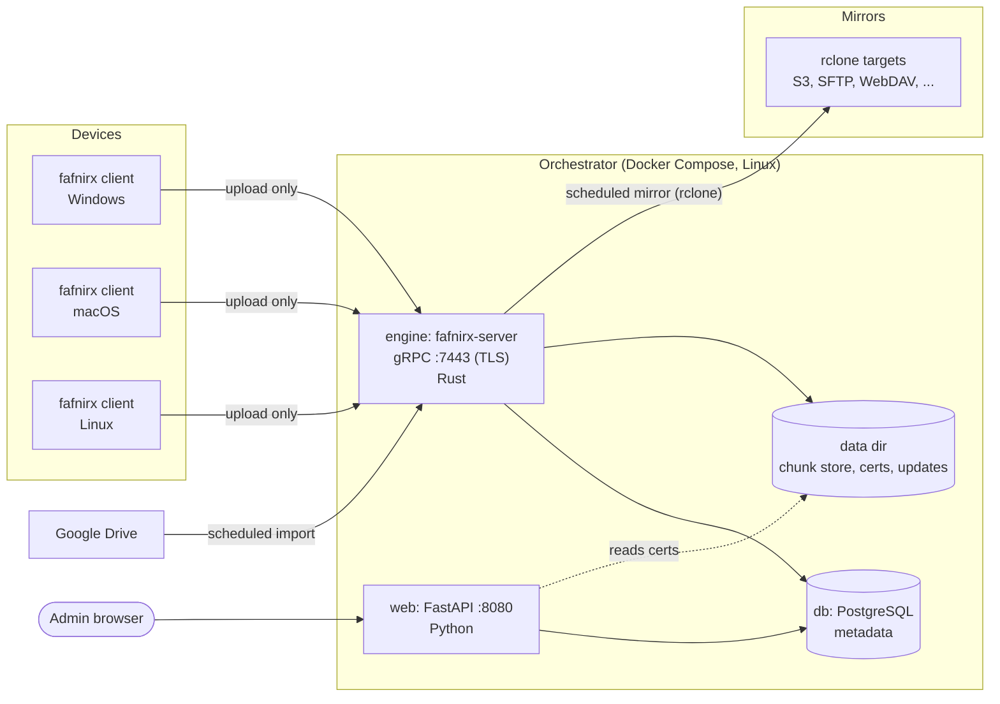
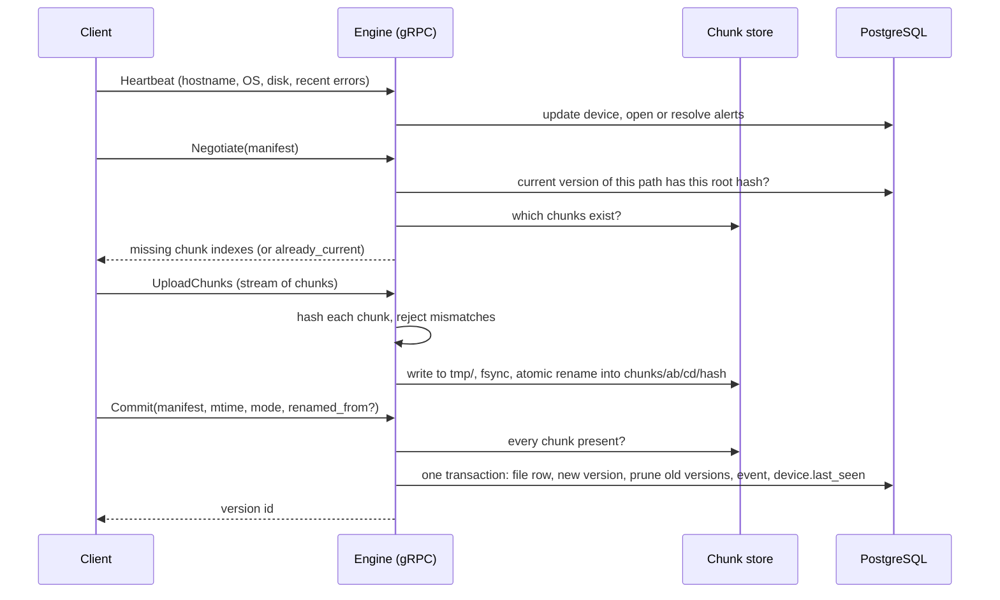
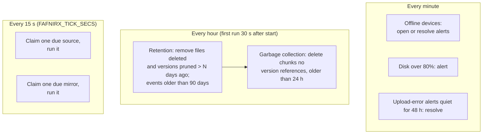
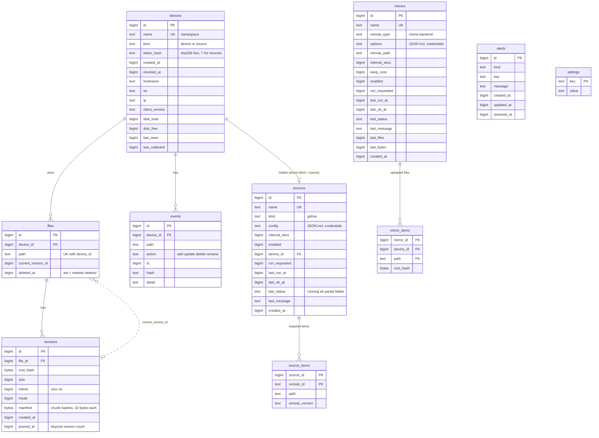

# Architecture

## Components



| Component | Language | Job |
|---|---|---|
| Client `fafnirx` (`crates/client`) | Rust | Watch folders, chunk and hash, upload, queue offline, tray icon, self-update |
| Engine `fafnirx-server` (`crates/server`) | Rust | gRPC data path, chunk store, ingest, retention and garbage collection, alerts, Drive import, mirror runs |
| Web UI (`web/fafnirx_web`) | Python | Admin UI: devices and tokens, sources, mirrors, settings, alerts |
| `fafnirx-sign` (`crates/sign`) | Rust | Create the update key, publish signed client builds |
| Common (`crates/common`) | Rust | Generated gRPC types, chunking, hashing and path rules shared by client and engine |
| PostgreSQL | - | All metadata. The only database; both processes share it |

The engine and the web UI never call each other. They coordinate **only through the database**: the web UI sets
`run_requested = 1` on a source or mirror and the engine's scheduler picks it up on its next tick; the engine writes
`last_status`, alerts and heartbeats that the web UI displays.

Design decisions worth knowing:

- **One-way by construction.** The gRPC service has no call that reads, lists or deletes stored data. `Negotiate` only
  tells a client which of its own chunk hashes are missing.
- **Content-addressed storage.** A chunk is a file named by its BLAKE3 hash, so duplicates collapse and uploads are
  idempotent.
- **Metadata is separate from data.** Losing PostgreSQL loses the map from paths to chunks, not the chunks; losing a
  chunk loses data. Back up both (see [Deployment](deployment.md#backups)).
- **Single orchestrator** on purpose; offsite mirrors are the backup.

## Upload path



Every RPC carries the device token (`authorization: Bearer ...`), is checked against the SHA-256 hash stored in
`devices.token_hash`, and only travels over TLS. The server certificate is signed by a CA the engine creates on first
start; clients pin that CA.

The commit is a single database transaction. If the file already has a version with the same root hash, the commit is
a no-op that returns the existing version.

## Background work in the engine



- **Claiming** a source or mirror is one `UPDATE ... WHERE id = (SELECT ... FOR UPDATE SKIP LOCKED) RETURNING ...`, so a
  job can only be started once. A job left `running` by a crash is marked failed on the next start.
- **Garbage collection** takes an exclusive in-process lock for its final "is it still unreferenced" check and the
  delete; commits hold the same lock shared while they check chunks and record the version. That closes the window in
  which a client re-sends content whose chunk is about to be deleted.
- **Mirror runs** rebuild changed files from chunks into a staging directory (at most 512 MiB or 2000 files at a time),
  re-hash every chunk, then call `rclone`. Backend options are passed as environment variables so credentials never
  show up on a command line.

## Data on disk

```text
data/                            FAFNIRX_DATA
├── chunks/ab/cd/<64 hex>        content-addressed chunks (immutable)
├── tmp/                         in-flight writes; cleared on engine start
├── certs/                       ca.pem, ca.key, server.pem, server.key, hosts.txt
├── updates/<platform>/          bin, version, signature (written by fafnirx-sign publish)
├── mirror-stage/                temporary, during mirror runs
└── web_secret                   web UI session key
```

PostgreSQL's own files live separately (`FAFNIRX_DB_DIR`).

## Database structure

PostgreSQL, one schema, defined in [`schema.sql`](../schema.sql). Both processes apply it on start, serialized with an
advisory lock; every statement is idempotent. All integers are `BIGINT` (timestamps are unix seconds; `versions.mtime`
is unix nanoseconds).



### Tables

| Table | Purpose |
|---|---|
| `devices` | One row per client, and one hidden row per source (`kind = 'source'`, name `source:<name>`, token hash `!` which no token can match). The `name` is the namespace. |
| `files` | A path on a device, unique per `(device_id, path)`. `deleted_at` is the delete mark. `current_version_id` points at the live version (no foreign key, to avoid a cycle). |
| `versions` | One row per stored version of a file: root hash, size, mtime, and the `manifest`, the concatenated 32-byte chunk hashes in order. `pruned_at` marks versions beyond the version count; retention removes them later. |
| `events` | Change log shown on the device page (add, update, delete, rename). Kept 90 days. |
| `alerts` | `kind` is one of `device_offline`, `upload_error`, `disk_usage`, `source_failed`, `mirror_failed`. A partial unique index `(kind, key) WHERE resolved_at IS NULL` allows one open alert per cause. |
| `sources` | Configured third-party sources. `config` is JSON and holds credentials. The web UI sets `run_requested`; the engine writes the `last_*` fields. |
| `source_items` | What was already imported from a source: remote id to path and version marker, so unchanged and renamed items are not downloaded again. |
| `mirrors` | Configured offsite mirrors. Same pattern as sources. `options` is JSON and holds credentials. |
| `mirror_items` | The root hash of each file as last uploaded to a mirror. Deletes cascade with the mirror. |
| `settings` | Key/value: `version_count` (5), `retention_days` (30), `offline_after_secs` (60). |

Notes:

- Credentials in `sources.config` and `mirrors.options` are stored in plain text. Protect the database like the
  secrets it holds.
- To find the chunks of a version: `SELECT encode(manifest, 'hex') FROM versions WHERE id = ...`, split into 64-character
  hashes; the chunk file is `chunks/<h[0:2]>/<h[2:4]>/<h>`.
- The schema has no versioned migrations; see [Development](development.md#changing-the-schema).
