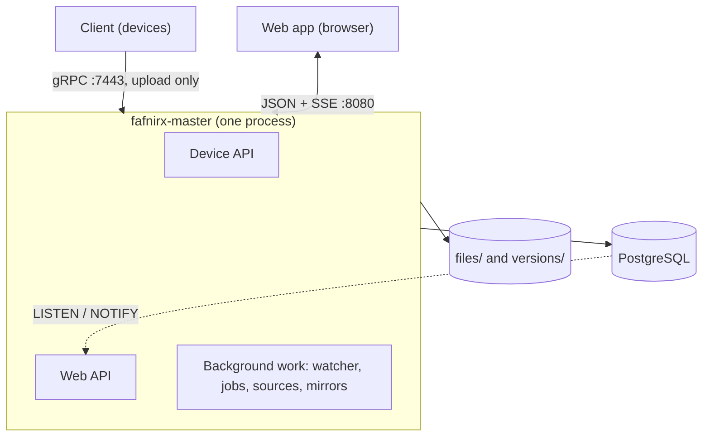
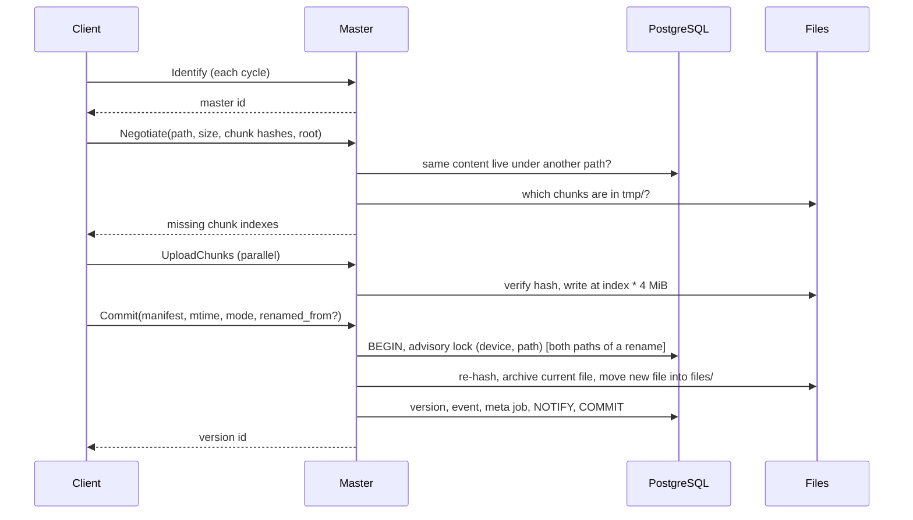
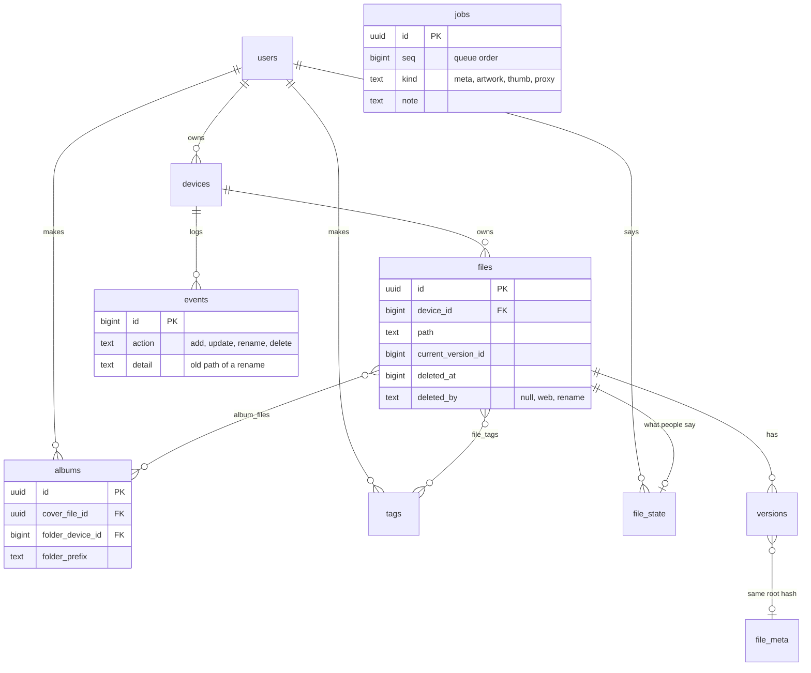

# Architecture

| Component | Role |
|---|---|
| Client `fafnirx` (`crates/client`) | Watch, hash in chunks, upload, offline queue, tray, self-update from GitHub releases |
| Master `fafnirx-master` (`crates/master`) | Device API, web API, file store, ingest, retention, alerts, sources, mirrors, metadata |
| Web app (`frontend`) | React, built into the master. The video player (`src/player`) imports nothing from the app |
| `fafnirx-stream` (`crates/stream`) | Optional HLS service; only the master talks to it ([streaming](streaming.md)) |
| `fafnirx-sign` (`crates/sign`) | Optional: signed client builds |
| `crates/common` | gRPC types, chunking, hashing, path rules, `ffprobe` parsing |

## Design decisions

- **Two APIs, two trust levels.** The device gRPC API (`proto/fafnirx.proto`) has no call that reads, lists or deletes stored
  data; `Negotiate` only reports which chunks of the caller's own file are missing. Reading and deleting is in the web API,
  behind a login and role checks. Different ports, no shared authentication.
- **Plain files.** A path's current version is stored whole in `files/<user>/<device>/<path>` (`files/<path>` for master
  files). A replaced or deleted version moves to `versions/<version id>/<user>/<device>/<path>`. Chunks exist only on the wire
  and in `tmp/`; there is no cross-file deduplication.
- **Users own devices; the name is the folder.** `devices.name` is an immutable slug (1-63 of `a-z 0-9 . _ -`, no reserved
  Windows names), unique per user; `devices.folder` (`<user>/<name>`, set by trigger) names a device in the store, mirrors and
  API. Master files are one internal device (kind `master`, id 0, folder `_master`, no owner). Local folders (`local`) and
  sources (`source`) are devices too.
- **IDs.** Files, albums, tags, jobs and alerts have random v4 UUID keys, shown as 22-char URL-safe Base64 without padding
  (`platform/id.rs`, `Id`; the hyphenated form is accepted). Devices, users, sources, mirrors are addressed by slug. Versions
  (named in `versions/`), events (ordered) and sessions keep numeric keys; jobs add `seq` for queue order.
- **One process.** Locks, live events and queued work go through PostgreSQL. Only browser uploads in progress and the login
  rate limit live in memory.
- **A client knows its master.** Each database has a random `settings.master_id`, asked at the start of every cycle
  (`Identify`); a different id makes the client drop its record and resend everything.
- **Metadata is separate from data.** Losing PostgreSQL loses versions and history, not the files; losing the data directory
  loses the data. Back up both.
- **No TLS in the master.** Trust comes from the network or a TLS proxy. Tokens are hashed, passwords use argon2.
  `FAFNIRX_TRUSTED_PROXY` names the proxies whose `X-Forwarded-For` is believed.
- **Library data sits beside the file.** `file_meta` is per content (root hash); `file_state` per file and user; albums, tags
  and states go with their file (`ON DELETE CASCADE`).
- **Albums** are picked files (`album_files`), a folder (`folder_device_id` + `folder_prefix`: every live photo and video under
  the prefix), or both; one folder album per user and folder. The cover is decided in `library/albums.rs` (chosen, poster,
  first video, newest). `repo::albums::follow_folder_move` changes the prefix (and an auto-name) in the rename's transaction
  when the last file leaves a folder to a sibling of the same parent.
- **Artwork is looked up, not stored.** `library/artwork.rs` picks a video's picture (own, else the poster of its folder or
  the two above) and `.nfo` from `repo::files::neighbours`; `thumb` and the on-demand picture use the same lookup, cached by
  the image's content hash.

## What a file operation means

One operation, one event, one transaction under the path's lock.

| Operation | `files` row | Event | Trash |
|---|---|---|---|
| First write of a path | created, version current | `add` | no |
| New content for a live path | new version current, old archived | `update` | no |
| Rename by a client or source (`commit_version`), a move noticed in a local folder (`adopt_live`), or Move in the web app (`move_path`; local folders and master files only, the file is moved not copied) | new path written; old path vacated: `deleted_at` set, `deleted_by='rename'` | one `rename` on the new path, detail = old path | **no**: hidden from Trash, listings, deleted counts; retention removes it |
| Delete (device, source, web app, file gone from the store) | `deleted_at` set (`deleted_by='web'` in the web app) | `delete` | yes |
| Brought back (file returns, version restored) | `deleted_at`, `deleted_by` cleared | `add`/`update` | leaves |

Retention, jobs and sign-ins write no events. Per-day activity counts `add`, `update`, `rename`, `delete`.

## Upload and commit

Every call carries the token and `x-fafnirx-instance`. If anything fails after files moved, the moves are undone before the
error returns.

**Locking.** Every change to a path (commit, delete, web upload or move, watcher) first takes a PostgreSQL advisory
transaction lock on `(device id, path)`; a rename takes both paths in a fixed order. File moves happen inside the lock, so
paths never interleave and the watcher never sees a half-done commit.

**Watcher.** `files/livetree.rs` watches `files/`. A path quiet for 5 s is compared with the database: new or changed files
become versions (`adopt_live`), vanished ones are marked deleted (`forget_absent`), a vanished file matched by a new file of
the same size and mtime is a rename, a new `files/<user>/<name>` becomes a `local` device. The whole tree is also compared
every 5 minutes or on `POST /api/files/rescan`. A missing device folder deletes nothing.

**Live updates.** `db::notify(topic, key)` runs `pg_notify` in the changing transaction, so it arrives on commit. One
`LISTEN` connection feeds browsers over SSE (`GET /api/events`); the web app maps topics (`files`, `library`, `activity`,
`devices`, `alerts`, `jobs`) to stale queries and refetches once per burst. A slow stream gets `resync`.

## Background work

| Work | Where | Notes |
|---|---|---|
| Offline and disk alerts, upload-error expiry | `monitoring/jobs.rs`, every minute | |
| Retention, version pruning, stale uploads, cache cleaning | `monitoring/jobs.rs`, hourly | Removes files with their records |
| Sources, mirrors | `integrations/` | `FOR UPDATE SKIP LOCKED` |
| `meta` → `artwork` → `thumb` → `proxy` | `library/meta.rs`, table `jobs` | 3 attempts; `proxy` is a slow lane; a job returns a note shown in Processing |
| Pictures on request | `library/meta.rs` | `cache/thumbs/`, at most 4 decoded at once |
| Segments, subtitles | `crates/stream` | On request; in memory, `GET /tasks` |

`done` jobs stay a day; queueing the same `(kind, payload)` while one is queued or running is a no-op; setting `jobs_paused`
makes workers wait. A file counts as unread while it has no `file_meta` row: that is the API's `processing` flag; `work`
(`waiting`, `running`, `failed`) comes from its unfinished jobs.

## Database

Other tables: `users`, `sessions`, `devices`, `versions`, `file_meta`, `file_state`, `tags`, `alerts` (uuid), `settings`,
`device_activity`, `sources`, `source_items`, `mirrors`, `mirror_items`, `schema_migrations`. The migrations in
`crates/master/migrations/` are the source of truth. `events` are kept 90 days.

**Indexes** (migrations `0001`, `0002`, re-made in `0010`): `files (device_id, path)` unique, `(device_id, path
text_pattern_ops)` for folders, `path` trigram (`pg_trgm`) for search, `current_version_id`, `deleted_at` where deleted, `id`
where live and `media` set; `versions (file_id, id)`, `root_hash`; `events (device_id, id)`, `(device_id, path, id DESC)`,
`ts`; `devices.token_hash` unique, `folder` unique; `jobs (kind='proxy', seq)` where queued, `(status, kind)`; `alerts
(kind, key)` unique where open; both directions of each link table. `files.media` is a column computed from the file name
(a test keeps it equal to `library/meta.rs`).

**Device totals** (`file_count`, `total_bytes`, `deleted_files`, renamed-away rows excluded) are kept on the device row,
marked stale by writes and recomputed when the device finishes syncing (or within a minute for devices that do not report).

## Web API

JSON under `/api` behind the login cookie (random token, hash stored, `SameSite=Strict`, `HttpOnly`). Changing calls need
`x-requested-with`. Ids are the 22-character form.

| Area | Endpoints |
|---|---|
| Session, users | `POST /api/login`, `/logout`, `GET /api/session`, `POST /api/me/password`; admin: `GET/POST /api/users`, `PATCH /api/users/:name` |
| Overview | `GET /api/dashboard`, `POST /api/alerts/:id/dismiss`, `GET /api/events` (SSE) |
| Devices | `GET/POST /api/devices`, `GET /api/devices/:folder` (slash as `%2F`), `POST .../token`, `.../release`, `.../revoke` |
| Files | `GET /api/files` (entries carry `id`, `processing`), `GET /api/files/info` (carries `work`), `POST /api/files/delete`, `/restore`, `/move` (`{device, from, to}`; local folders and master files, 409 otherwise), `/rescan` (admin) |
| Transfers | `GET /api/files/download` (ranges, versions), `/thumb`, `POST /api/files/zip`, `POST /api/uploads`, `PUT/GET/DELETE /api/uploads/:id`, `POST /api/uploads/:id/finish` |
| Library | `GET /api/timeline/buckets`, `/timeline?month=`, `/library?ids=`, `GET/PATCH /api/library/:id` (carries `work`), `GET /api/library/:id/folder`, `POST /api/library/bulk`, `GET /api/tags`, `DELETE /api/tags/:id`, `GET /api/map`, `GET /api/trash`. Assets carry `processing` |
| Pictures | `GET /api/media/:id/{thumb,preview,video,original,download}` (`?v=<hash>` caches for good; `video` is 404 until a playable copy exists) |
| Albums | `GET/POST /api/albums` (a `folder` body makes or returns the folder's album), `GET/PATCH/DELETE /api/albums/:id`, `POST .../files` and `.../files/remove` (by `ids` or `items` of `{device, path}`) |
| Streaming | `GET /api/stream/:id/{master.m3u8,<quality>/index.m3u8,<quality>/seg<n>.ts,subtitles.json,subtitles/<n>.vtt}` |
| Processing | `GET /api/queue`; admin: `POST /api/queue/pause`, `/retry`, `/cancel`, `/rebuild` |
| Integrations | `GET/POST /api/sources` + `/:user/:name`, `/run`, `/toggle`; admin: `GET/POST /api/mirrors` + `/:name`, `/run`, `/toggle`, `/resync` |
| Settings | `GET/PUT /api/settings` |

Browser uploads are chunked: pieces are `PUT` at an offset (409 with the expected offset if misaligned); `finish` verifies the
hash and commits through the device path.

## Security model

| Threat | Mitigation |
|---|---|
| Stolen device token | Can only add data; revoke it. A second computer is refused while the first is connected, and the owner is alerted |
| Compromised device | Cannot read, list or delete: no such call |
| Stolen password | Guesses rate-limited per address and user; sessions end on disable, new password, logout. Add Access or a VPN |
| A user reaching another's files | Queries and downloads are limited to the role's devices (`web/access.rs`); others' devices answer 404. Ids are random but never trusted: access is checked on every call |
| Compromised master | Cannot ship a client update: GitHub, or builds signed with a key not on the master |
| Path tricks | Validated on arrival and again when mapped to disk |
| Stored HTML/SVG opened in a browser | Always a download with `nosniff` |
| Tampered chunk, bit rot | Verified on arrival and before install; re-hashed before mirroring (a mismatch fails that file) |
