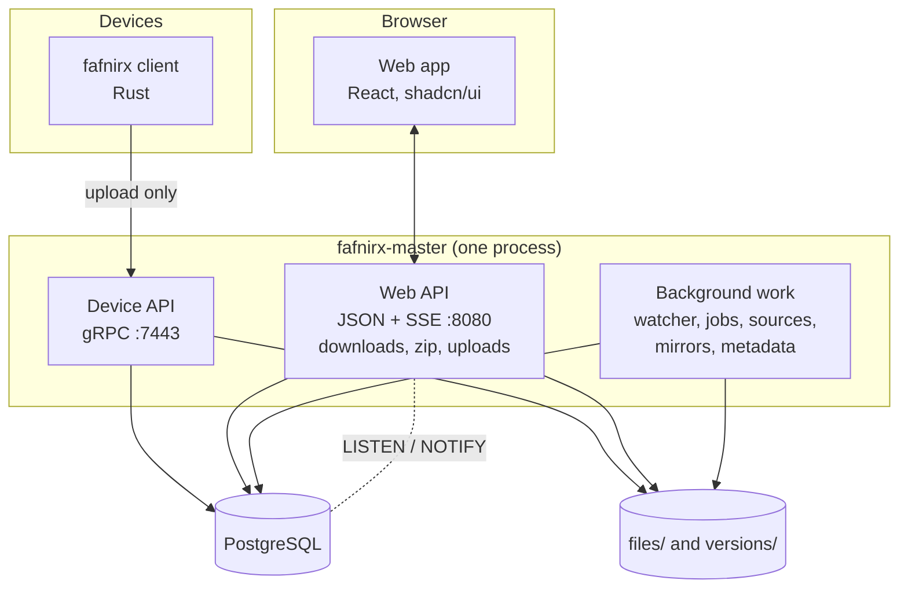
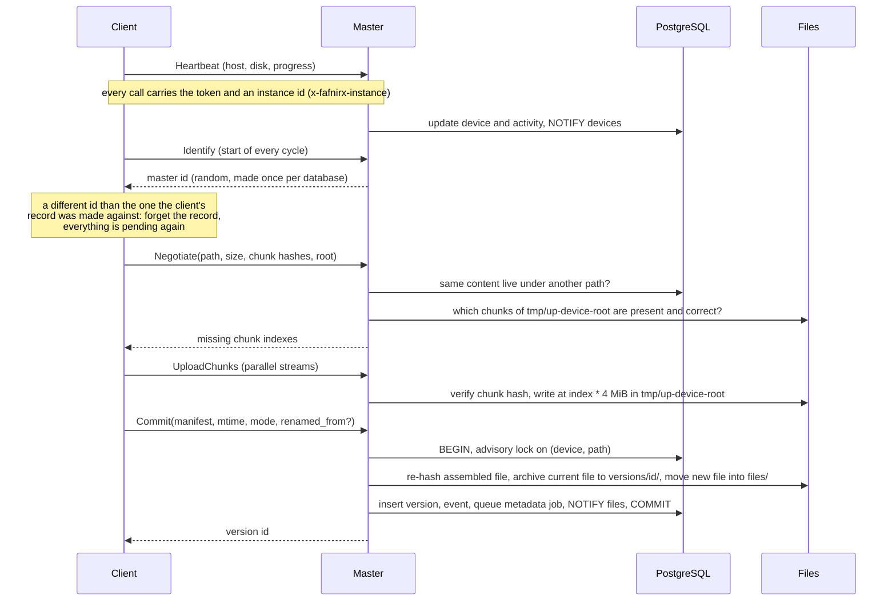
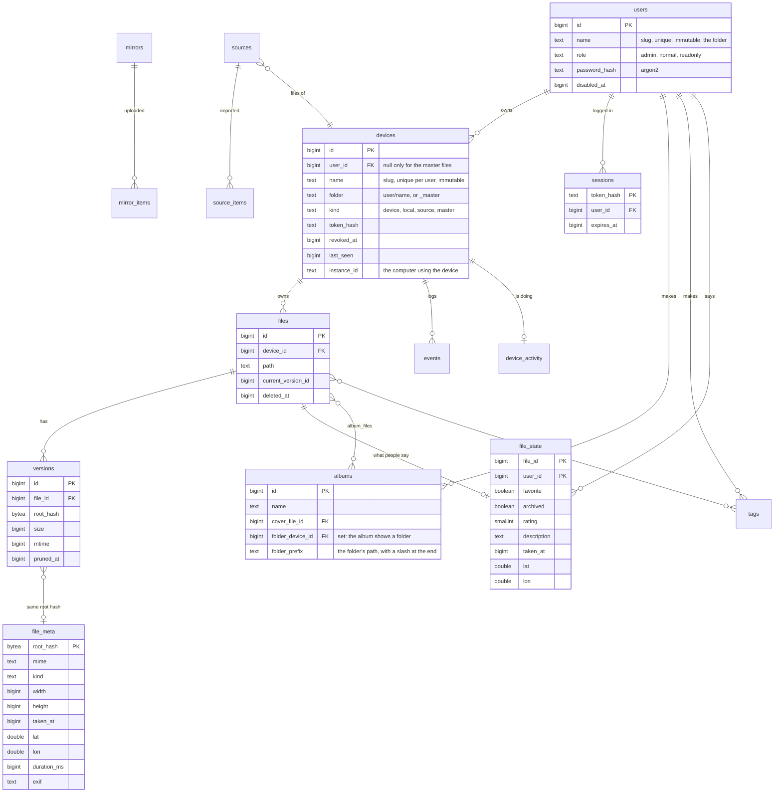

# Architecture

## Components

| Component | Language | Role |
|---|---|---|
| Client `fafnirx` (`crates/client`) | Rust | Watch folders, hash in chunks, upload, queue offline, tray icon, self-update, run as a service |
| Master `fafnirx-master` (`crates/master`) | Rust | Device API, web API, file store, ingest, retention, alerts, sources, mirrors, metadata |
| Web app (`frontend`) | TypeScript, React | The web interface, built into the master binary. Its video player (`frontend/src/player`) is a module of its own that imports nothing from the app |
| `fafnirx-sign` (`crates/sign`) | Rust | Create the update key, publish signed client builds |
| `fafnirx-stream` (`crates/stream`) | Rust | Optional HLS streaming service: playlists, and segments made with ffmpeg as they are asked for. Only the master talks to it ([streaming](streaming.md)) |
| Common (`crates/common`) | Rust | Generated gRPC types, chunking, hashing and path rules shared by client and master, and the reading of `ffprobe`'s answer (`probe`) shared by the master and the streaming service |
| PostgreSQL | | All metadata |

## Design decisions worth knowing

- **Two APIs, two trust levels.** The device gRPC API (`proto/fafnirx.proto`) has no call that reads, lists or deletes
  stored data: `Negotiate` only tells a client which chunks of its *own* file are missing. Everything that reads or
  deletes lives in the web API, behind a user login, and what a user reaches there depends on their role. They listen on
  different ports and share no authentication.
- **Plain files.** The current version of every path is stored whole, under its own name, in
  `files/<user>/<device>/<path>`, or in `files/<path>` for the master files. A version that is replaced or deleted moves to
  `versions/<version id>/<user>/<device>/<path>` (`versions/<version id>/<path>` for a master file). Chunks exist only on the wire and
  while an upload is assembled in `tmp/`; they are never stored separately, so there is no cross-file deduplication.
, no reserved Windows names), immutable, enforced by the database; a device name is unique
  per user. `devices.folder` (`<user>/<name>`, set by a trigger) is what the file store, the mirrors and the API call a
  device. The master files are held by one internal device (kind `master`, id 0, folder `_master`, no owner), so that they
  use the same tables as everything else. A top-level name of `files/` is a user if a user has that name; anything else is
  a master file, so a user's name and a master path cannot clash (the master files refuse such a path, and a user cannot be
  added under a name the master files use). Local folders and sources are devices too (kind `local` and `source`),
  so everything that works on files works on all three.
- **One process.** The master is a single binary. Locks, live events and queued work still go through PostgreSQL (see
  below), so state lives in the database rather than in memory. Only browser uploads in progress and the login limit are
  kept in memory.
- **A client remembers which master it sent to.** The client keeps a local record of what it has uploaded, so that an
  unchanged file is not even offered again. Each database has a random master id (`settings.master_id`, made when the
  schema is first applied), and the client asks for it at the start of every cycle (`Identify`). If the answer is not the
  id its record was made against (a wiped database, a new master at the same address) the record is dropped and
  everything is collected again. Without this a client would report files as sent that the master never had.
- **Metadata is separate from data.** Losing PostgreSQL loses versions and history, not the files (they keep their
  names); losing the data directory loses the data. Back up both ([Deployment](deployment.md#backups)).
- **No TLS in the master.** Trust comes from the network (LAN, VPN) or from a TLS proxy in front (a Cloudflare tunnel, or
  the Caddy of `docker-compose.proxy.yml`, which also closes the master's own ports). Device tokens and passwords are hashed
  (passwords with argon2) or signed, but the transport is plain. Client updates are signed independently, so they are safe
  on any transport. Behind a proxy, `FAFNIRX_TRUSTED_PROXY` names the addresses whose `X-Forwarded-For` is believed, so that
  failed logins are counted per person; from anyone else the header is ignored.
- **An album is files picked, a folder, or both.** `album_files` holds the picked files. An album with `folder_device_id` and
  `folder_prefix` also contains every live photo and video whose path starts with the prefix, so a show's new episodes are
  in its album without anyone adding them; such an album lists its files in natural name order (`Episode 2` before
  `Episode 10`) and has one per user and folder.

## Upload and commit

If anything fails after the files moved, the moves are undone before the error is returned. The file store and the
database therefore only disagree while the transaction is open, under that path's lock.

## Locking

Every change to one path (a commit, a delete, an upload from the web app, something the file watcher found) first takes
a PostgreSQL **advisory transaction lock** keyed by `(device id, path)`. A rename takes both of its paths in a fixed order.
The lock is held until the transaction ends, and the file moves happen before that, so:

- two processes never work on the same path at once, and different paths never wait for each other;
- the file watcher can compare disk and database without ever seeing a half-done commit.

## The file watcher and network drive

`files/livetree.rs` watches `files/` with the operating system's file events. Touched paths queue up; once a
path has been quiet for 5 seconds it is compared with the database: new or changed files become versions
(`ingest::adopt_live`), vanished ones are marked deleted (`ingest::forget_absent`), a new folder `files/<user>/<name>` becomes a
`local` device of the user whose folder it is in. Whatever is in `files/` and is not a user's folder is the master files, and
is compared the same way. Anything the master wrote itself matches its record (same size and modification time) and is skipped
without being read. Watchers miss things on some mounts, so the whole tree is also compared every 5 minutes, or when an
administrator asks (`POST /api/files/rescan`; one comparison runs at a time). A missing
device folder deletes nothing, so an unmounted volume cannot wipe records.

## Live updates

Every change calls `db::notify(topic, key)`, which runs `pg_notify('fafnirx', {"topic", "key"})` inside the same
transaction, so it is delivered exactly when the change commits. The master keeps one connection
that `LISTEN`s and pushes the messages to browsers over server-sent events (`GET /api/events`). The web app maps a topic
to the queries it makes stale (`files`, `activity`, `devices`, `alerts`, `jobs`) and refetches them, at most once per
burst. A dropped stream or a slow browser gets a `resync` and refreshes everything.

## Background work

| Work | Where | Notes |
|---|---|---|
| Offline and disk alerts, upload-error expiry | `monitoring/jobs.rs`, every minute | |
| Retention, version pruning, stale uploads | `monitoring/jobs.rs`, hourly | deletes files with their records |
| Sources, mirrors | `integrations/` (`mod.rs`, `gdrive.rs`, `mirror.rs`) | claimed with `FOR UPDATE SKIP LOCKED` |
| File watcher | `files/livetree.rs` | |
| Photo metadata | `library/meta.rs`, table `jobs` | a job is claimed with `FOR UPDATE SKIP LOCKED`, retried up to 3 times |
| Previews | `library/meta.rs`, on request | cached in `cache/thumbs/`, at most 4 decoded at once |

## Database structure

`file_meta` is about a **content** (by root hash: what the camera said, the same for every copy); `file_state` is about a
**file** (a path of a device: what people said). Both the library tables and the files they point at are removed together
when retention removes a file for good (`ON DELETE CASCADE`), and nothing in them is ever written into the file itself.

The database is the only source of truth for the setup (`settings`, `users`, `devices`, `mirrors`, `sources`). Albums, tags and `file_state` belong to a user (`file_state` is per user and file, so a master file can be a
favorite of one user and not of another). Other tables: `events` (change log, 90 days), `alerts`, `settings`, `jobs` (queued background work: `meta` reads a
photo or video and makes its pictures, `proxy` converts a video), `sources`, `source_items`, `mirrors`, `mirror_items`,
`tags` and `file_tags`, `album_files`. The numbered migrations in `crates/master/migrations/` are the source of truth and are applied on start.

## Indexes

Every lookup, listing and search of the APIs has an index. They are created by the migrations (`0001_initial` for keys and
relations, `0002_indexes` for the rest).

| Table | Index | Answers |
|---|---|---|
| `devices` | `name` (unique), `token_hash` (unique, devices only) | Finding a device by folder name; every call a device makes finds it by token |
| `files` | `(device_id, path)` (unique) | One file by path: the commit, the delete, the file info |
| | `(device_id, path text_pattern_ops)` | A folder: `path LIKE dir/%`, in the file browser, downloads, the watcher |
| | `path` trigram (GIN) | The file browser search (`ILIKE %text%`) |
| | `current_version_id` | Which files hold a version: finding content by hash on every upload |
| | `(deleted_at DESC, id DESC)` where deleted | The Trash page and retention |
| | `id` where live and `media` is set | The photo library: timeline, map, albums, type filters |
| `versions` | `(file_id, id)`, `root_hash`, `pruned_at` where pruned | History of a file, content by hash, retention |
| `events` | `(device_id, id)`, `(device_id, path, id DESC)`, `ts` | Recent activity of a device, the history of one file, the activity chart and its retention |
| `file_meta` | `root_hash` (primary), `root_hash` where placed | Details of a content, the map |
| `file_state` | `file_id` (primary), `file_id` where favorite, archived or placed | Favorites, Archive, the map |
| `tags`, `file_tags`, `albums`, `album_files` | name (case-insensitive, unique), both directions of each link | Tags and albums from a file and from the tag or album |
| `jobs` | `(kind = 'proxy', id)` where queued, `run_after` where queued | The next job a worker claims |
| `alerts` | `(kind, key)` unique where open, `resolved_at` where resolved | One open alert per cause; clearing old ones |
| `mirror_items`, `source_items` | their primary keys | What a mirror or a source already has |

`files.media` is a column the database computes from the file name (`image`, `video` or empty), so the library never runs a
pattern over every path. A test keeps it equal to the extension lists in `library/meta.rs`.

The search index needs the `pg_trgm` extension, which is part of PostgreSQL's standard contrib packages (the `postgres`
Docker image has it). The first migration run installs it into the `public` schema.

On 300,000 files, the lookups behind an upload, a folder listing, a search and the Trash page take 1-3 ms (100-200 ms
without the indexes). The photo timeline adds up every photo and takes about 0.3 s.

### Device totals

The number of files, their size and the files in the trash are not added up when a page is shown. Each device row keeps
them (`file_count`, `total_bytes`, `deleted_files`). Every write that touches a device marks them stale
(`totals_stale`), and they are added up again for that one device when it has finished syncing: when its client reports
it is idle, or within a minute for a device that does not report (a local folder, a source, a change made in the web
app, retention). The dashboard and the device list therefore show the totals as of the last finished sync.

## Web API

JSON under `/api`, all behind the login cookie (a random token whose hash is kept in the database, `SameSite=Strict`, `HttpOnly`). Calls that change
something must carry an `x-requested-with` header, which a form on another site cannot set.

| Area | Endpoints |
|---|---|
| Session | `POST /api/login` (user name and password), `POST /api/logout`, `GET /api/session`, `POST /api/me/password` |
| Users (administrators) | `GET/POST /api/users`, `PATCH /api/users/:name` (role, disabled, new password) |
| Overview | `GET /api/dashboard`, `POST /api/alerts/:id/dismiss`, `GET /api/events` (SSE) |
| Devices | `GET/POST /api/devices`, `GET /api/devices/:folder` (`<user>/<name>`, the slash encoded as `%2F`), `POST .../token`, `POST .../release`, `POST .../revoke` |
| Files | `GET /api/files` (browse, search, filter, sort, page), `GET /api/files/info`, `POST /api/files/delete`, `POST /api/files/restore` |
| Streaming | `GET /api/stream/:id/master.m3u8`, `:quality/index.m3u8`, `:quality/seg<n>.ts`, `subtitles.json` and `subtitles/<n>.vtt`, for a file by its id (`/api/files/info` has it). The master checks the login and passes them to the streaming service, if there is one |
| Transfers | `GET /api/files/download` (ranges, versions), `GET /api/files/thumb`, `POST /api/files/zip`, `POST /api/uploads`, `PUT/GET/DELETE /api/uploads/:id`, `POST /api/uploads/:id/finish` |
| Library | `GET /api/timeline/buckets` (months with the file count of each day), `GET /api/timeline?month=YYYY-MM` (scope, device, kind and tag filters), `GET /api/library?ids=`, `GET/PATCH /api/library/:id`, `POST /api/library/bulk`, `GET /api/tags`, `DELETE /api/tags/:id`, `GET /api/map`, `GET /api/trash` (restore with `POST /api/files/restore`) |
| Pictures by id | `GET /api/media/:id/{thumb,preview,video,original,download}` (`?v=<hash>` makes the picture cacheable for good; videos answer `404` until a playable copy exists) |
| Albums | `GET/POST /api/albums` (a body with `folder` makes an album of a folder, and returns the existing one if there is), `GET/PATCH/DELETE /api/albums/:id`, `POST /api/albums/:id/files` and `/files/remove` (files by `ids`, or by `items` of `{device, path}`: a file or a folder in the file browser) |
| File store | `POST /api/files/rescan` (administrators): compare `files/` with the database now |
| Integrations | `GET/POST /api/sources` (each user's own) with `/:user/:name`, `/run` and `/toggle`; `GET/POST /api/mirrors` (administrators) with `/:name`, `/run`, `/toggle` and `/resync` |
| Settings | `GET/PUT /api/settings` |

Uploads are chunked and resumable: a session is created, pieces are `PUT` at an offset (the server answers `409` with the
offset it expects when they do not line up), and `finish` verifies the hash and commits through the same path as the
device API.

## Security model

| Threat | Mitigation |
|---|---|
| Stolen device token | It can only add data. Revoke it in the web app; the old token stops working at once. A second computer using it is refused while the first is connected, and the owner is alerted |
| Compromised device | Cannot read, list or delete anything (the API has no such call) |
| Stolen password | Guesses are rate-limited per connecting address and per user name; sessions are kept in the database and end when the user is disabled, gets a new password or logs out. An administrator's password is the key to protect; put Cloudflare Access or a VPN in front |
| A user reading or changing another user's files | Every query and every download is limited to the devices the user's role reaches (`web/access.rs`); a device of someone else does not exist for them (404) |
| Compromised master | Cannot ship a client update: updates need a signature from a key that is not on the master |
| Path tricks (`..`, absolute, reserved names) | Paths are validated on arrival and again when mapped to disk |
| A browser opening a stored HTML or SVG file | Those are always served as downloads, with `nosniff` |
| A corrected date or place | Stored beside the file, never in it; reversible |
| Tampered chunk | Verified against its hash on arrival, and the whole file again before it is installed |
| Bit rot on the master | Re-hashed before mirroring; a mismatch fails that file, not the run |
