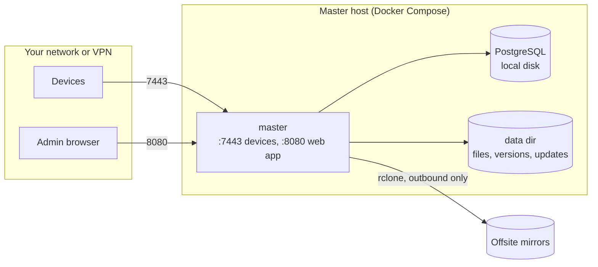

# Deployment



- **Inbound:** `7443` from devices (token-authenticated) and `8080` from users (password-authenticated). Both are
  plain HTTP. Keep them on a trusted network or VPN, or publish them through a TLS proxy ([below](#remote-access-with-a-cloudflare-tunnel)).
- **Outbound:** the master reaches Google Drive and your mirror endpoints. Nothing else leaves.

## Storage layout

| What | Host path (default) | Put it on | Do not put it on |
|---|---|---|---|
| PostgreSQL files | `./pgdata` (`FAFNIRX_DB_DIR`) | Local disk, for example a ZFS dataset | SMB, NFS, or any network share. PostgreSQL needs real file locking and `fsync` |
| Files, versions, updates | `./data` (`FAFNIRX_DATA_DIR`) | A filesystem that detects bit rot (ZFS), local or shared | - |

Inside the data directory:

```text
files/<user>/<device>/<path>     the current tree of each device; shareable as a network drive
files/<path>                    the master files: what is not in the folder of a user
versions/<id>/<device>/<path>    what a newer version or a delete replaced
tmp/                             uploads being assembled (removed after a day untouched)
cache/thumbs/                    photo previews, made on demand (removed after 30 days without a request)
cache/video/                     playable copies of videos (removed when no version has the video any more)
updates/<platform>/              signed client builds (only if you sign your own, see Usage)
```

The config folder (`./config`, `FAFNIRX_CONFIG_DIR`) lives apart from the data. It only holds `rclone.conf`, for mirrors that
use your rclone remotes ([Mirrors](usage.md#mirrors-offsite-copies)). Everything else is set up in the web app and kept in the database.

fafnirx checks hashes on upload and when staging files for a mirror. It does not scrub the stored files, so use a
checksumming filesystem and scrub it regularly.

### Example: ZFS

```sh
zfs create -o compression=lz4 -o atime=off -o recordsize=16K tank/fafnirx/pgdata
zfs create -o compression=lz4 -o atime=off tank/fafnirx/data           # default recordsize is fine
chown 1000:1000 /tank/fafnirx/pgdata /tank/fafnirx/data
```

Use a mirrored vdev (RAID 1) or better for both; a pool with redundancy lets a scrub repair bad blocks. With `.env`:

```ini
FAFNIRX_DB_DIR=/tank/fafnirx/pgdata
FAFNIRX_DATA_DIR=/tank/fafnirx/data
FAFNIRX_UID=1000
FAFNIRX_GID=1000
```

### Sharing `files/` as a network drive

Share `<data>/files` over SMB or NFS with write access for the `FAFNIRX_UID` user. Everything in it that is not the folder of a
user is a master file, so the share is also where master files are dropped. The folders of the users (`files/<user>/`) are
their private files: make them read-only for the share (the share has logins of its own, not the users of fafnirx, and
whoever can read it can read all of them), or share only what should be shared. For example with Samba:

```ini
[fafnirx]
   path = /tank/fafnirx/data/files
   read only = no
   force user = fafnirx
   create mask = 0644
   directory mask = 0755
```

Every top-level folder is a device; a folder created there with a valid name becomes a local folder by itself. See
[Usage](usage.md#local-folders-and-the-network-drive) for what is recorded and when. Do not share `versions/` or `tmp/`
writable.

## Reverse proxy with Caddy

`docker-compose.proxy.yml` puts [Caddy](https://caddyserver.com) in front of fafnirx and closes the master's own ports, so
that the proxy is the only way in:

```sh
docker compose -f docker-compose.yml -f docker-compose.proxy.yml up -d
# or put COMPOSE_FILE=docker-compose.yml:docker-compose.proxy.yml in .env and use `docker compose` as usual
```

- By default it is plain HTTP on the same ports as before (the web app on `80`, devices on `7443`), so nothing changes for
  a network at home. For https on the internet, set a domain in `.env`; Caddy gets and renews the certificate itself:

  ```ini
  FAFNIRX_WEB_ADDRESS=fafnirx.example.com
  FAFNIRX_DEVICE_ADDRESS=fafnirx.example.com:7443
  ```

  Devices then enroll with `fafnirx enroll --server https://fafnirx.example.com:7443`. Ports `80` and `443` must reach the
  machine for the certificate. Other ports on the host: `FAFNIRX_HTTP_PORT`, `FAFNIRX_HTTPS_PORT`, `FAFNIRX_DEVICE_PORT`.
- The master is told to believe the client address that Caddy passes on (`FAFNIRX_TRUSTED_PROXY`, set to the compose
  network), so failed logins are counted per person and not once for the proxy. Nobody else can reach the master, so
  nobody else can forge that header.
- The `Caddyfile` is short and meant to be edited: add a second site, access logs, or `trusted_proxies` when Caddy itself
  sits behind a tunnel.
- The streaming service stays behind the master and its login, as before; the proxy does not cache its segments (they are
  made on demand and kept by the service, and a cache in front would serve them without the login).

## Remote access with a Cloudflare tunnel

The master speaks plain HTTP on purpose; for the internet put TLS in front of it with a tunnel. No inbound port is opened.

1. Create a tunnel and two public hostnames in Cloudflare Zero Trust, pointing at the master:

   ```yaml
   ingress:
     - hostname: files.example.com        # the web app
       service: http://localhost:8080
     - hostname: devices.example.com      # the device API (gRPC)
       service: http://localhost:7443
       originRequest:
         http2Origin: true                # gRPC needs HTTP/2 to the origin
     - service: http_status:404
   ```

2. In the Cloudflare dashboard turn on **gRPC** for the zone (Network settings).
3. Put **Cloudflare Access** in front of `files.example.com` for a second login and one-time-pin or single sign-on. Do not
   put Access in front of `devices.example.com`: devices authenticate with their token and cannot do a browser login.
4. Enroll devices with the https address: `fafnirx enroll --server https://devices.example.com` (it asks for the token).
5. In the web app's enroll dialog, edit the address to the https one before copying the command.

Notes:

- The web app sets its login cookie `Secure` when the request arrives with `X-Forwarded-Proto: https`, which Cloudflare
  sends. It rate-limits password guesses per connecting address. It believes no forwarding header unless told which
  proxy to trust, so behind a tunnel on its own all visitors share one address and five wrong guesses lock the login for a
  minute for everyone. Run the tunnel's `cloudflared` through the [Caddy proxy](#reverse-proxy-with-caddy) (point it at
  `http://proxy:80` and `http://proxy:7443`), or set `FAFNIRX_TRUSTED_PROXY` to the address `cloudflared` connects from:
  then the visitor's own address is counted.
- Every response carries a Content-Security-Policy (the pages may only load their own scripts and styles, plus map
  pictures from the tile server), `X-Frame-Options: DENY`, `nosniff`, a referrer policy and, behind https,
  `Strict-Transport-Security`.
- Uploads from the browser go in 8 MiB pieces, under Cloudflare's request size limit. The device client uploads in
  4 MiB chunks over gRPC streams.
- Live updates use a long-lived connection (server-sent events) with a keep-alive every 15 seconds, which Cloudflare allows.
- Client self-updates come from GitHub over https (or are signed with a key that is not on the master), so they stay safe whatever the transport to the master.
- Without a tunnel, a VPN (WireGuard, Tailscale) gives the same safety.

## Backups

You need four things; the first three matter most.

| Back up | Why | How |
|---|---|---|
| PostgreSQL | The map from paths to versions, tokens, settings, credentials | `docker compose exec db pg_dump -U fafnirx fafnirx > fafnirx.sql`, or ZFS snapshots of `pgdata` |
| `data/files/` and `data/versions/` | The data itself | ZFS snapshots, or rely on the offsite mirror |
| `config/rclone.conf` | The rclone remotes of your mirrors, if you use them | Copy it, or keep it in a private repository. It holds credentials |
| The update signing key | Not on the master by design | Wherever you keep it (`update.key`) |

Snapshot **the database first, then the data directory**. A file that a newer snapshot lacks was replaced or deleted
after the database snapshot, and it is still under `versions/` until retention removes it.

Keep to the **3-2-1 rule**: 3 copies of the data, on 2 kinds of storage, 1 of them offsite. The master is one copy, a ZFS
snapshot or another disk is the second, and a mirror (administrators only; it pushes all users' files and the master files)
is the offsite one.

The offsite mirror is a separate, independent copy of the current tree and its recent history, readable without fafnirx.
It does not contain the database. A full restore of the master needs the database and data directory backups.

```sh
docker compose exec -T db psql -U fafnirx fafnirx < fafnirx.sql      # restore into an empty database
```

## Upgrades

```sh
docker compose pull          # or set FAFNIRX_IMAGE to the new version in .env first
docker compose up -d
```

The master applies the database migrations it is missing on start (in order, in one transaction, serialized by an
advisory lock), and refuses to start against a database made by a newer version. Back up the database before upgrading. Upgrading the PostgreSQL **major** version needs a dump and restore; do not just change the
image tag. Client updates are separate: devices take new releases from GitHub by themselves within about six hours, or, if you sign
your own builds, from `fafnirx-sign publish` ([Usage](usage.md#client-updates)).

## Security checklist

- Choose strong `FAFNIRX_ADMIN_PASSWORD` and `FAFNIRX_DB_PASSWORD`; keep `.env` readable only by you.
- Keep `8080` and `7443` off the internet unless they are behind a TLS proxy (`docker-compose.proxy.yml` closes them). Keep the PostgreSQL port unpublished (the
  compose file does not publish it).
- Device tokens are shown once and stored only as SHA-256 hashes. Revoke a lost device in the web app.
- Source and mirror credentials sit in the database (and in `rclone.conf`, for rclone remotes) in plain text. Treat
  database backups and the config folder as secrets; do not commit them to a public repository.
- The update signing key stays off the master. A compromised master cannot ship a client update.
- A device can add data but cannot read or delete it (the device API has no such call), so a compromised device cannot
  destroy history. The web API can read and delete; its login is the thing to protect.
- Data is not encrypted at rest or on mirrors. Use an encrypted dataset on the host, and an encrypting rclone remote
  (`crypt`) if you need it on mirrors.

## Operations

The image runs as a normal user (uid 1000) and checks `GET /healthz` every 30 seconds; `docker compose ps` shows `healthy`.

```sh
docker compose ps
docker compose logs -f master
docker compose exec db psql -U fafnirx fafnirx           # inspect metadata
docker compose restart master
```

Watch the **alerts** on the Dashboard, the disk usage alert (80%), and the status of each mirror. A mirror that has not
succeeded for a while is the most important thing to notice.
