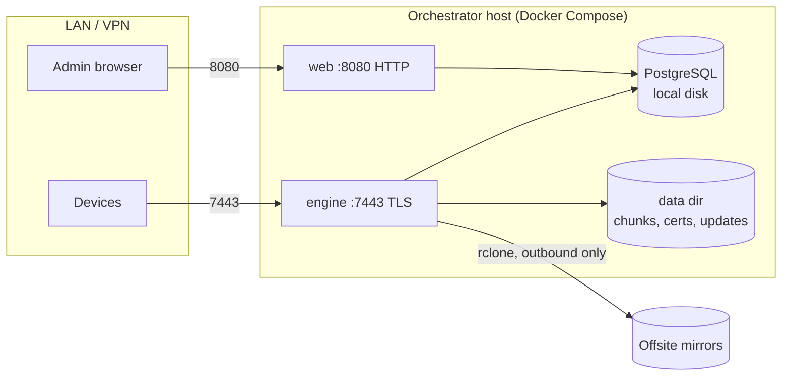

# Deployment

How to run fafnirx for real: where things live, how clients reach it, how to back it up and how to keep it running.

## Topology



- **Inbound:** `7443` from devices (TLS, token-authenticated) and `8080` from admins.
- **Outbound:** the engine reaches Google Drive and your mirror endpoints. Nothing else leaves.
- The web UI is plain HTTP with one shared password. Do not expose it to the internet. If you must, put a reverse proxy
  with TLS in front of it and keep `7443` direct; the web app honours `X-Forwarded-*` headers.

## Storage layout

| What | Host path (default) | Put it on | Do not put it on |
|---|---|---|---|
| PostgreSQL files | `./pgdata` (`FAFNIRX_DB_DIR`) | Local disk, for example a ZFS dataset | SMB, NFS, or any network share. PostgreSQL needs real file locking and `fsync` |
| Chunk store, certs, updates | `./data` (`FAFNIRX_DATA_DIR`) | A filesystem that detects bit rot (ZFS), local or shared | - |

fafnirx checks hashes on upload and when rebuilding files for a mirror. It does not scrub the chunk store, so use a
checksumming filesystem and scrub it regularly.

### Example: ZFS

```sh
zfs create -o compression=lz4 -o atime=off -o recordsize=16K tank/fafnirx/pgdata
zfs create -o compression=lz4 -o atime=off tank/fafnirx/data           # chunks are 4 MiB or less; default recordsize is fine
chown 1000:1000 /tank/fafnirx/pgdata /tank/fafnirx/data
```

Use a mirrored vdev (RAID 1) or better for both; a pool with redundancy lets a scrub repair bad blocks.
`compression=lz4` is cheap and helps the database most.

With `.env`:

```ini
FAFNIRX_DB_DIR=/tank/fafnirx/pgdata
FAFNIRX_DATA_DIR=/tank/fafnirx/data
FAFNIRX_UID=1000
FAFNIRX_GID=1000
```

The `postgres` image runs its own user and fixes ownership of an empty `pgdata` itself. `engine` and `web` run as
`FAFNIRX_UID:FAFNIRX_GID` and need to write to the data directory.

### Sharing the data over SMB

You can share `FAFNIRX_DATA_DIR` for inspection or copying, but note:

- The chunk store is content addressed (`chunks/ab/cd/<hash>`). It is not a browsable tree of your files.
- Mount it read-only for users. Nothing outside the engine should write to it.
- To browse or restore real files, use a [mirror's `files/` tree](usage.md#mirrors-offsite-copies) or rebuild
  files from the manifest ([Restoring data](usage.md#restoring-data)).

## TLS and device addresses

On first start the engine creates a CA (`data/certs/ca.pem`, valid to 2064) and a server certificate for the names in
`FAFNIRX_TLS_HOSTS`. Clients pin the CA.

- List **every** name or IP a device will use (LAN name, VPN address, public DNS name).
- If you change `FAFNIRX_TLS_HOSTS`, restart the engine. It reissues the server certificate, keeping the same CA, so
  enrolled devices are unaffected.
- Back up `data/certs/ca.key`. Losing it means re-enrolling every device with a new CA.

## Backups

You need four things; the first two matter most.

| Back up | Why | How |
|---|---|---|
| PostgreSQL | The map from paths and versions to chunks, tokens, settings, credentials | `docker compose exec db pg_dump -U fafnirx fafnirx > fafnirx.sql`, or ZFS snapshots of `pgdata` |
| `data/chunks/` | The data itself | ZFS snapshots, or rely on the offsite mirror |
| `data/certs/` | The CA key | Copy it once, keep it safe |
| The update signing key | Not on the server by design | Wherever you keep it (`update.key`) |

Snapshot **the database first, then the chunk store**. Chunks are immutable and only deleted after a version stops
referencing them plus 24 hours, so a chunk snapshot taken slightly later always covers every version in an earlier
database snapshot.

The offsite mirror is a separate, independent copy of the current tree and its recent history, readable without fafnirx.
It does not contain the database. A full restore of the orchestrator needs the database and chunk backups.

Restore the database with:

```sh
docker compose exec -T db psql -U fafnirx fafnirx < fafnirx.sql      # into an empty database
```

## Upgrades

```sh
git pull
docker compose up -d --build
```

The engine and web UI apply `schema.sql` on start (idempotent). Read the release notes first if the schema changed.
Upgrading the PostgreSQL **major** version needs a dump and restore; do not just change the image tag.

Client updates are separate: publish a signed build with `fafnirx-sign publish` and the devices pick it up within about
six hours ([Usage](usage.md#signed-client-updates)).

## Security checklist

- Choose strong `FAFNIRX_ADMIN_PASSWORD` and `FAFNIRX_DB_PASSWORD`; keep `.env` readable only by you.
- Keep `8080` off the internet. Keep the PostgreSQL port unpublished (the compose file does not publish it).
- Device tokens are shown once and stored only as SHA-256 hashes. Revoke a lost device in the web UI.
- Source and mirror credentials sit in the database in plain text. Treat database backups as secrets.
- The update signing key stays off the orchestrator. A compromised server cannot ship a client update.
- A client can add data but cannot read or delete it, so a compromised device cannot destroy history.
- Data is not encrypted at rest or on mirrors. Use an encrypted dataset on the host, and an encrypting rclone remote (`crypt`) if you need it on mirrors.

## Operations

```sh
docker compose ps
docker compose logs -f engine
docker compose logs -f web
docker compose exec db psql -U fafnirx fafnirx           # inspect metadata
docker compose restart engine
```

Watch these: the **alerts** on the web UI home page, the disk usage alert (80%), and the `last_status` of each mirror.
A mirror that has not succeeded for a while is the most important thing to notice.
