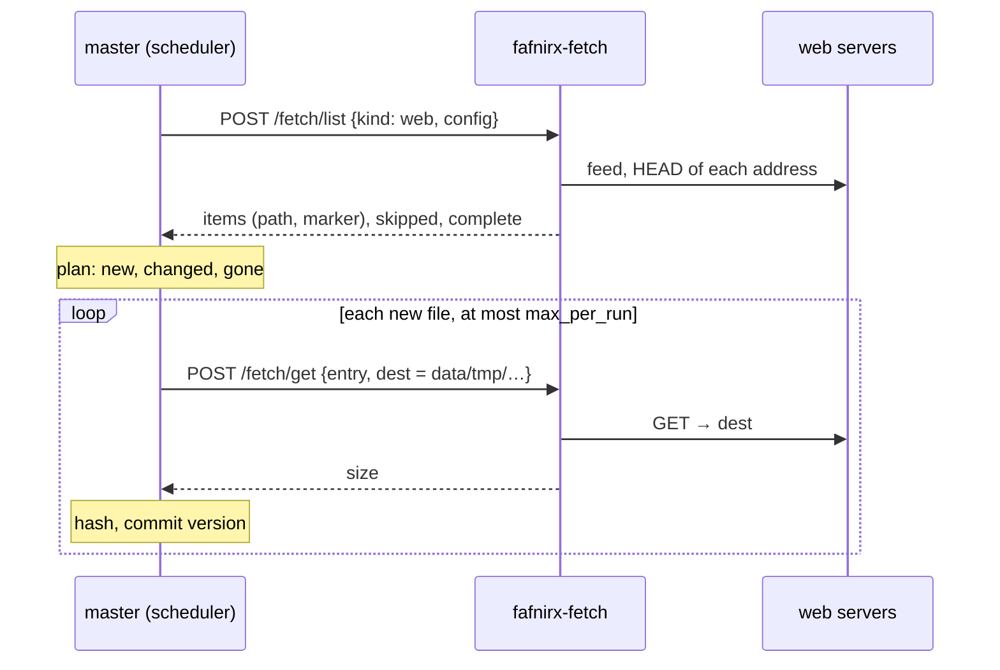

# Fetch module

The optional [module](modules.md) that reads **web sources**: addresses of files, and RSS or Atom feeds whose entries link to files,
over plain HTTP(S). Each file becomes a file of the source, with versions and retention like any other ([Sources](sources.md)).
Without the module the Sources page doesn't offer web sources; rclone sources (storage, Google Drive) don't need it.

It is also the smallest complete example of a **fetch plugin**: other kinds of source (a site, a protocol, a service with its own
API) are written the same way and run as containers next to it. See [Plugins](plugins.md).

`fafnirx-fetch` (`modules/fetch/service`) runs next to the master as a container. The master
keeps everything that is data: when a source runs it asks the module what the source offers, compares that with what it has (the same
code as for rclone sources), asks for the files that are new one at a time, then hashes and commits them. The module has no database
and writes only below `data/tmp`.



## Web source

**Sources → Add source → Services → Web** (offered when the module is running):

| Setting | |
|---|---|
| Addresses | one address of a file per line (up to 200), `http://` or `https://` |
| Feed | optional RSS or Atom feed whose entries link to files; read on every run |
| Only / never files matching | patterns ([Rust regex syntax](https://docs.rs/regex/latest/regex/#syntax)) tested against the file's name |
| Smallest / largest file | MB and GB; files outside are not offered (a size the server doesn't tell is not held against a file) |
| Files per run | 1–500, default 25 |

- A file is named after the last part of its address (`https://host/dir/Report%20final.pdf?x=1` is `Report final.pdf`), made safe for
  file names. Two addresses with the same name are two files; the second gets a short hash in front.
- For an entry of a feed the **enclosure** is the file; an entry without one links to the file itself.
- The marker is made of what the server says of the file (`ETag`, `Last-Modified`, `Content-Length`): **a file that changes on the
  server is fetched again as a new version**, one that doesn't is not. A server that sends none of these has its file fetched once.
- **A feed only adds.** It shows its latest entries, not everything, so what drops out of it is not deleted; the same goes for a run
  in which an address could not be reached (alert *Source failed*, tried again next run). Files of a source with only a fixed list are
  deleted when you take the address out of the list. Delete files you no longer want in the web app, or remove the source.
- A run fetches at most *Files per run* files; each is committed as soon as it is there. If more are waiting the master asks for
  another run at once. A restart or a failure loses at most the file being made.
- A download that receives nothing for 10 minutes (`FAFNIRX_FETCH_IDLE_SECS`) is given up on; the file counts as failed and the run as
  *partial*. An empty file is a failure too.
- The module follows redirects and reaches **any address your server can reach**, including the local network. Only give the right to
  add sources to people you trust.

## Run it

In `.env`, then `docker compose up -d`:

```sh
COMPOSE_PROFILES=fetch
FAFNIRX_PLUGIN_SECRET=<openssl rand -hex 24>     # the master's, shared with every add-on
```

It gets only `data/tmp` of the data folder, **at the same path as the master** (`/data/tmp`), because the master names files by it.

| Variable | Default | |
|---|---|---|
| `FAFNIRX_PLUGIN_SECRET` | | required, 16+ characters (the master's `FAFNIRX_PLUGIN_SECRET`) |
| `FAFNIRX_MASTER_URL`, `FAFNIRX_PLUGIN_URL` | | where the master's web API is, and where the master reaches this module (compose sets them) |
| `FAFNIRX_PLUGIN_LISTEN` | `0.0.0.0:8091` | |
| `FAFNIRX_DATA` | `data` | the master's data folder; files are written to `tmp/` in it |
| `FAFNIRX_FETCH_JOBS` | `2` | files made at the same time |
| `FAFNIRX_FETCH_IDLE_SECS` | `600` | give up on a download that receives nothing for this long |

## API

Contract: `crates/fetch-api` on top of `crates/module-api`; the whole of it, with examples, is in [Plugins](plugins.md#the-contract).

| Request | Answer |
|---|---|
| `GET /manifest` | capabilities `fetch.web` and `status` |
| `POST /fetch/check` `{kind: "web", config}` | `{config, label}`: the settings reduced to what the module reads, and the label for the Sources page; `400` with a sentence for the user |
| `POST /fetch/list` `{kind, config}` | `{items: [{path, marker, size, mtime_ns, reference}], skipped, complete}` |
| `POST /fetch/get` `{kind, config, entry, dest}` | writes the file of `entry` to `dest` and answers `{size}`; `400` if `dest` is not a file directly in `<data>/tmp` |
| `GET /status` | `active`, `failed` tasks, `made`, `slots` |

## Legal

You are responsible for what your sources download. Copying files from the web may be restricted by the terms of the site and by
copyright: use this only for content you own, that is licensed for it, or that you otherwise have the right to copy. Adding a source
asks you to confirm that you may copy what it downloads; the confirmation and its time are kept with the source. This is not legal advice.
