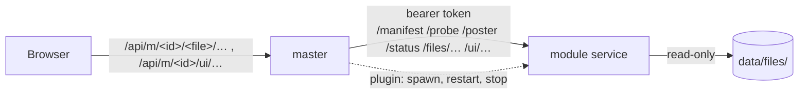

# Modules

Optional features that run as a service of their own, so a server that doesn't need one doesn't carry it. Today: [video](video.md)
(brings ffmpeg). Master works without any module; the web app just doesn't offer what the module adds. Modules don't know each other.

Two ways to run one, same contract:

| | Plugin | Container |
|---|---|---|
| What | zip bundle in `<data>/plugins/<id>/`: program, web part, tools | image `fafnirx-<id>` next to the master |
| Started by | master, loopback port, own random token | you (compose profile `<id>`) |
| Install | **Plugins** page, or unzip by hand | `docker compose pull` |
| Config | none | `FAFNIRX_MODULE_<ID>_URL`, `FAFNIRX_MODULE_<ID>_TOKEN` |
| Use for | single container, small images | other host, resource limits, GPU |

Address wins over plugin of same id (plugin not started).



## Plugins

Admin: **Plugins** → Install / Update / Remove. Master fetches `fafnirx-plugin-<id>-<version>-<platform>.zip` from the GitHub
release of **its own version**, checks the `.sha256` next to it, unpacks to `.<id>.new`, validates `plugin.json` (id, contract,
platform, exec exists), stops the old one, swaps the folder, starts. No master restart. Offline: unzip into `<data>/plugins/<id>/`,
master picks it up (scan every 2 s).

- Crash → restart with backoff 1 s … 60 s. Master exits → plugin exits (stdin pipe closes, `FAFNIRX_MODULE_EXIT_WITH_STDIN=1`).
- Env given to the plugin: `FAFNIRX_<ID>_*` from master env, basics (`PATH`, `HOME`, `TZ`, `TMP*`, `SYSTEMROOT`…), `plugin.json` `env`
  (`{dir}` = plugin folder), then `FAFNIRX_MODULE_TOKEN`, `FAFNIRX_MODULE_LISTEN`, `FAFNIRX_DATA` (not overridable). DB url, passwords
  etc. are not passed.
- Runs as the master's user. Install from project releases only: checksum comes from the same release, protects against bad
  downloads, not against a hostile release. Limits: 400 MB download, 1.5 GB unpacked.
- Platforms: `linux-x86_64`, `linux-aarch64` (bundle is built on the master image's Debian so the binary runs there).

Bundle:

```
fafnirx-plugin-<id>-<version>-<platform>.zip   (+ .zip.sha256: "<hex>  <name>")
  plugin.json   {"id","version","contract","platform","exec":"bin/fafnirx-video","env":{"FAFNIRX_FFMPEG":"{dir}/bin/ffmpeg"}}
  bin/          program + tools (static ffmpeg for video)
  ui/           web part from `npm run build:module -- <id>`
  licenses/
```

Made by Docker target `plugin-<id>`; the release workflow attaches them.

## Container

```sh
FAFNIRX_MODULE_VIDEO_URL=http://video:8090
FAFNIRX_MODULE_VIDEO_TOKEN=<openssl rand -hex 24>     # service reads it as FAFNIRX_MODULE_TOKEN
```

Don't publish the service port; it has no login, only the token.

Both: master reads `/manifest` (every 2 s while a plugin starts, else every 30 s), uses the module while id + contract match. The
session (`GET /api/session`) lists modules that are up; the web app shows a module's parts only for those.

## Contract

`crates/module-api`, `CONTRACT = 1`. Every request has `Authorization: Bearer <token>` except `GET /health`. Master has already
checked login and file access; modules have no users.

| Request | By | Answer |
|---|---|---|
| `GET /manifest` | master | `{id, version, contract, capabilities, ui?}` |
| `GET /probe?p&h` | master, `probe.video` | length, size, codec, date, place |
| `GET /poster?p&h&max` | master, `poster` | JPEG ≤ `max` px (videos, HEIC/AVIF master can't decode) |
| `GET /status` | master, `status` | `active`, `failed` tasks, each with `path`; other fields are the module's own |
| `GET /files/<rest>?p&h` | browser via `/api/m/<id>/<file id>/<rest>` | module-specific, per file |
| `GET /ui/<file>` | browser via `/api/m/<id>/ui/<file>` | web part (script, style), same for everybody |

`p` = path under `files/` (`users/alice/laptop/clip.mp4`, master files: `clip.mp4`). `h` = hex content hash (changed file → new
hash → no stale cache). Browser reaches only `/files/` and `/ui/`. Master drops `/status` tasks of files the user can't see.
`ui` = `{entry, css?, sdk}`; `sdk` = `WEB_SDK` the script was built for.

Capability = promise. Add one only when the master needs to ask a module something new (constant in `module-api`, hook in
`crates/master/src/modules/mod.rs` returning `None` without module). Other `contract` → module not used.

## Web part

Built apart, loaded by the browser from the module while it's up. Not in the app bundle: no module, no download.

- `frontend/src/modules/<id>/index.ts` default-exports `FrontendModule` (`@/sdk`): optional `viewer`, optional `queue` section.
  Lazy-load heavy stuff (hls.js).
- `npm run build:module -- <id>` → `frontend/dist-modules/<id>/` (`index.js`, chunks, `style.css`); the service serves it from
  `FAFNIRX_MODULE_UI`. Build = `vite.module.config.ts`.
- `react`, `react/jsx-runtime`, `@/sdk`, `@/components/ui/*` are not bundled: at run time they come from `window.__fafnirx`
  (`src/sdk/runtime.ts`), so one React, same i18n, toasts, look. Everything else (icons, hls.js) is bundled. `style.css` = Tailwind
  classes of the module, same theme (`src/theme.css`).
- `SDK` (`runtime.ts`) must equal `WEB_SDK` (`module-api`); test checks. Mismatch → script not loaded.
- Script missing/failing → files fall back to download.
- Loader: `src/lib/module-loader.ts`; registry: `src/sdk/registry.ts`.

## Rules

1. Module crate depends on `fafnirx-module-api` + `fafnirx-common` only (`crates/module-api/tests/rules.rs`).
2. Master never names a module; asks capabilities or proxies. No module → plain file (icon, download).
3. Web part imports `@/sdk`, `@/components/ui`, own folder only (oxlint). App never imports a module.
4. Shared data goes through the master (columns it keeps per file). Own tables would be `m_<id>_*` with own migrations; none yet.
5. No login in modules; listen where only the master reaches, trust the token.

## Writing one

1. `modules/<id>/service`, crate `fafnirx-<id>`, add to workspace. `/manifest` with real capabilities + `ui`
   (`modules/video/service/src/ui.rs`), browser routes under `/files/`, `bearer_matches` guard on everything, validate `p` stays in
   the tree, exit on stdin EOF when `FAFNIRX_MODULE_EXIT_WITH_STDIN` is set (`main.rs`).
2. Web part in `frontend/src/modules/<id>/` incl. `style.css` (copy video's).
3. Dockerfile targets `<id>` and `plugin-<id>`; compose service (profile `<id>`) in both compose files; matrix entries in
   `docker.yml`; `smoke-image.sh`.
4. Tests: service unit tests, e2e in `tests/` (`e2e-video.mjs`, `e2e-plugin.mjs`: real master + real service, fake heavy program).
   Docs page like [video](video.md).
