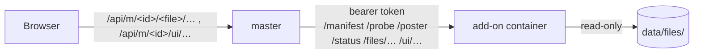

# Modules

The core of fafnirx is small: the master, PostgreSQL, the web app and the clients. Everything advanced is an **add-on container** that
you start when you need it: [video](video.md) playback brings ffmpeg, [fetch](fetch.md) reads web sources, and anyone can write
more, such as a new kind of source ([Plugins](plugins.md)). A server without an add-on doesn't carry its dependencies or spend
its CPU, and the web app doesn't offer what it would have added. The heavy work (transcoding, downloading, third-party tools)
runs in the add-on's container, which can sit on another host and have its own resource limits. Add-ons don't know each other.

## Turn one on

In `.env`, then `docker compose up -d`:

```sh
FAFNIRX_PLUGIN_SECRET=<openssl rand -hex 24>    # once: the secret the master and every add-on share (16+ characters)
COMPOSE_PROFILES=video,fetch                    # which add-on containers to start
```

That is all. A starting add-on tells the master where it is (`POST /api/plugins/register`, with the secret) and keeps telling it every
30 s; the master asks it for its manifest, uses it while the id and contract match, and lists it under Settings → Plugins
(administrators; read only). `GET /api/session` lists the add-ons that are up, and the web app shows an add-on's parts only for those.
**Required add-ons.** An add-on announces itself, so the master cannot tell "not wanted" from "failed to start". `FAFNIRX_PLUGINS` (comma
separated ids) says which ones should be there: any of them that is not connected, not reachable or not set up shows administrators a red
warning on every page and a "Required" mark under Settings → Plugins (`expected` and state `missing` in `GET /api/plugins`). Add-ons not listed
still work. With the compose file, `FAFNIRX_PLUGINS` defaults to `COMPOSE_PROFILES`, so the add-ons you start are the ones required; set it
only to differ (for example an add-on run on another host). Empty: nothing is required and nothing is reported. Turn one off by stopping its container (and taking it out of `FAFNIRX_PLUGINS` / `COMPOSE_PROFILES`, or administrators are warned): the master forgets an add-on that has been silent for 90 s. Its cache and what the master has
already read stay. An add-on has no login and publishes no port: only the master reaches it, so keep it that way.

Images: `fafnirx-video` and `fafnirx-fetch` come from the same release as the master. An add-on from somewhere else connects the same
way: its container gets `FAFNIRX_PLUGIN_SECRET`, `FAFNIRX_MASTER_URL` (the master's web address, `http://master:8080`) and
`FAFNIRX_PLUGIN_URL` (where the master reaches it), and it can run on another host.



## Contract

`crates/module-api`, `CONTRACT = 1` (the fetch requests are typed in `crates/fetch-api`, which only modules that read sources use). Every request has `Authorization: Bearer <token>` except `GET /health`. Master has already
checked login and file access; modules have no users.

| Request | By | Answer |
|---|---|---|
| `GET /manifest` | master | `{id, version, contract, capabilities, ui?, setup?}`; `setup` lists what is missing for it to work (shown under Settings as "Running, not set up") |
| `GET /probe?p&h` | master, `probe.video` | length, size, codec, date, place |
| `GET /poster?p&h&max[&at_ms]` | master, `poster` | JPEG ≤ `max` px (videos, HEIC/AVIF the master can't decode). A video's frame at `at_ms`; without it the module finds the first non-black frame at 10%, 20%, … and says where in `x-poster-ms` (ms), which the master stores and sends back as `at_ms` |
| `GET /status` | master, `status` | `active`, `failed` tasks, each with `path`; other fields are the module's own |
| `POST /fetch/list`, `POST /fetch/get` | master, `fetch.<kind>` | what a source offers; one file of it written to `<data>/tmp/…` ([fetch](fetch.md#api)). The one place a module writes; the master hashes and commits it |
| `GET /files/<rest>?p&h` | browser via `/api/m/<id>/<file id>/<rest>` | module-specific, per file |
| `GET /ui/<file>` | browser via `/api/m/<id>/ui/<file>` | web part (script, style), same for everybody |

`p` = path under `files/` (`users/alice/laptop/clip.mp4`, master files: `clip.mp4`). `h` = hex content hash (changed file → new
hash → no stale cache). Browser reaches only `/files/` and `/ui/`. Master drops `/status` tasks of files the user can't see.
`ui` = `{entry, css?, sdk}`; `sdk` = `WEB_SDK` the script was built for.

Capability = promise. Add one only when the master needs to ask a module something new (constant in `module-api`, hook in
`crates/master/src/modules/mod.rs` returning `None` without a module). Other `contract` → module not used.

## Web part

Built apart, loaded by the browser from the module while it's up. Not in the app bundle: no module, no download.

- `frontend/src/modules/<id>/index.ts` default-exports `FrontendModule` (`@/sdk`): optional `viewer`, optional `queue` section.
  Lazy-load heavy stuff (hls.js).
- `npm run build:module -- <id>` → `frontend/dist-modules/<id>/` (`index.js`, chunks, `style.css`); the service serves it from
  `FAFNIRX_PLUGIN_UI`. Build = `vite.module.config.ts`.
- `react`, `react/jsx-runtime`, `@/sdk`, `@/components/ui/*` are not bundled: at run time they come from `window.__fafnirx`
  (`src/sdk/runtime.ts`), so one React, same i18n, toasts, look. Everything else (icons, hls.js) is bundled. `style.css` = Tailwind
  classes of the module, same theme (`src/theme.css`).
- `SDK` (`runtime.ts`) must equal `WEB_SDK` (`module-api`); test checks. Mismatch → script not loaded.
- Script missing/failing → files fall back to their plain form (a video plays as the original in the browser's own player).
- Loader: `src/lib/module-loader.ts`; registry: `src/sdk/registry.ts`.

## Rules

1. Module crate depends on `fafnirx-module-api` + `fafnirx-common` only (a module that reads sources also `fafnirx-fetch-api`) (`crates/module-api/tests/rules.rs`).
2. Master never names a module; asks capabilities or proxies. No module → plain file (icon, native player, download).
3. Web part imports `@/sdk`, `@/components/ui`, own folder only (oxlint). App never imports a module.
4. Shared data goes through the master (columns it keeps per file). Own tables would be `m_<id>_*` with own migrations; none yet.
   A module reads `files/` read-only; fetch modules write only directly in `tmp/`, which the master checks and commits.
5. No login in modules; listen where only the master reaches, trust the token.

## Writing one

1. `modules/<id>/service`, crate `fafnirx-<id>`, added to the workspace. A module that reads sources implements the kit's `Fetcher`
   ([Plugins](plugins.md)); another one (video) is its own service on the kit's `start`, `run` and `ui`: `/manifest` with real
   capabilities and `ui`, browser routes under `/files/`, `bearer_matches` guard on everything, validate that `p` stays in the tree.
2. Web part in `frontend/src/modules/<id>/` including `style.css` (copy video's).
3. `docker/Dockerfile.<id>` (it builds only this module), a compose service with profile `<id>` in `docker/docker-compose.yml`, a
   `connect` smoke test in `docker.yml`, the image in the release.
4. Tests: service unit tests, e2e in `tests/` (`e2e-video.mjs`: real master + real service, fake heavy program).
   Docs page like [video](video.md).

A module in its own repository does the same: its own Dockerfile and image, built against the `fafnirx-module-kit` crate (and
`fafnirx-fetch-api` for a kind of source). [Plugins](plugins.md) is the guide.
