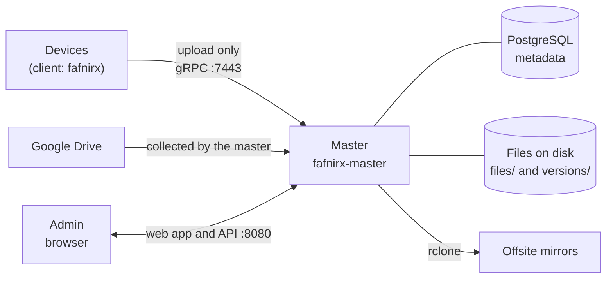
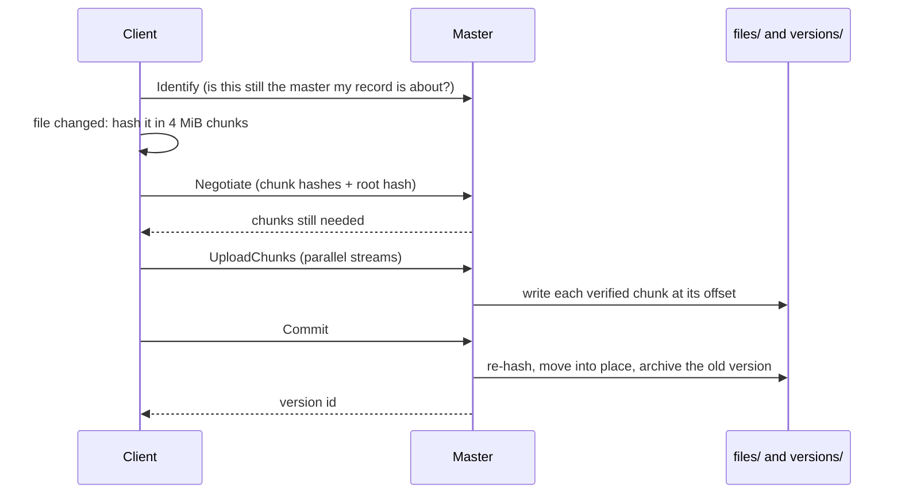

# Overview

The scale it is built for: 3-5 devices, up to hundreds of thousands of files, files up to 5 GB. Preserving the original data matters above all else: nothing a device does can delete or overwrite data the master already holds.

Named after Fafnir, the Norse dragon who hoards treasure: data goes in and nothing leaves a device’s reach.

fafnirx collects the data of your devices (Windows, macOS, Linux) into one
server you own, the **master**, and lets you browse it, copy it offsite and get any version of any file back.

## How a file travels

1. **The client notices a change** with a file watcher and a periodic scan, and waits for the file to settle.
2. **It hashes the file in 4 MiB chunks** with BLAKE3. A file is its ordered chunk hashes plus a root hash over them.
3. **It sends the list; the master answers with the chunks it still needs.** A changed file is sent whole; an
   interrupted upload resumes with the missing chunks; content the device already has under another path (a copy or
   a rename) needs no data at all.
4. **The master verifies every chunk**, writes them into one file at their offsets, checks the root hash of the
   result, and moves it to `files/<user>/<device>/<path>`. The file it replaces moves to `versions/<id>/<user>/<device>/<path>`.
5. **Deleting on the device only marks the path deleted.** The data stays until the retention period has passed.
6. **Mirrors** copy the current tree (and what changed since the last run) to storage you choose.

## Seeing and using the data

The **web app** is the way in. Devices are folders; open one to browse its files, search, filter by type, sort,
preview photos, read their metadata, see every version, download or upload. A zip download streams, so it works for
any size. Everything on the pages updates live: a device's progress bar moves, a new file appears in an open folder.

For photos and videos there is a **library** on top of the same files: a timeline by month and day with a scrubber,
favorites, an archive, a trash, albums (also a whole folder as an album, like a TV show), a map, tags,
ratings and descriptions, and corrections of dates and places. None of it touches the original files. Videos play in a
player of their own, with subtitles from the file or beside it.

Because the files are plain files, you can also reach them without the web app: share `data/files/` over SMB or NFS
and use it as a **network drive**. Files you add or change there are noticed and recorded as versions. What you put in
`files/` outside the folders of the users is a **master file**, which belongs to nobody and which every user can see.

## Rules that do not change

- Collection is one way. The client only reads the files it collects: it never writes, renames, moves or deletes
  anything in them, and nothing is ever sent back to a device.
- The device is the source of truth, the master is an aggregator. A file deleted on a device is marked deleted on the
  master, kept in the trash, and removed for good after the retention period. A file renamed or moved on a device is
  renamed and moved on the master, without sending it again. If a large part of a folder disappears at once (an unmounted
  drive, an accidental delete), the client holds those deletions back for hours before passing them on
  ([when many files disappear](usage.md#when-many-files-disappear)).
- The master changes only its own files, never a file on a device. There are three roles: an administrator reaches
  everything, a normal user reads the master files and reads and writes their own folders, a read-only user only reads
  the master files.
- A file deleted on the master is hidden and goes to the trash; it is not synced again, and nothing happens on the device.
- Files a device or a source sent cannot be changed or renamed on the master. Only local folders, the files uploaded
  to the master itself, are changed there.
- A new install collects all the files of its folders, and the tray says that the first sync is sending all of them.

## What it is not

- Not a sync tool: nothing is ever sent back to a device. Restoring is a download or a copy.
- Not an encryption layer: data on the master and on mirrors is not encrypted by fafnirx. Use an encrypted disk, and an
  encrypting rclone remote (`crypt`) if the mirror needs it.
- Not an access-control system for a company: there are three roles (administrator, normal, read only) and a workspace per
  user, with shared master files. Put Cloudflare Access or a VPN in front if you need more.

## The pieces

| Piece | What it is |
|---|---|
| `fafnirx` | The client: watcher, resumable upload, offline queue, tray icon, signed self-update |
| `fafnirx-master` | The master: device API, web API and web app, users, file store, background work |
| `fafnirx-sign` | Creates the update signing key and publishes signed client builds |
| `fafnirx-stream` | Optional: streams videos in several qualities to the web app ([Video streaming](streaming.md)) |
| PostgreSQL | All metadata: users, devices, files, versions, events, settings, jobs |
| rclone | Performs mirror uploads (installed in the Docker image) |

Read next: [Installation](installation.md), then [Usage](usage.md).
