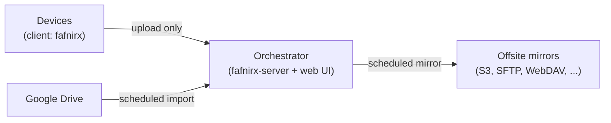
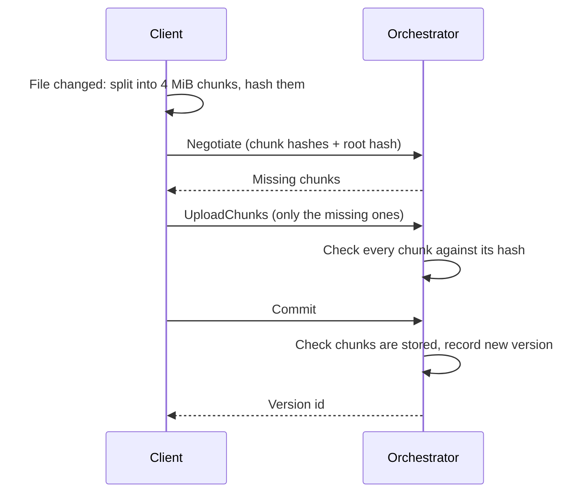

# Overview

## What fafnirx is

fafnirx collects data from your devices (Windows, macOS, Linux) into one server you own, the **orchestrator**, and
mirrors it offsite from there. Data only flows one way:

It is built for a small setup: a handful of devices, thousands of files, files up to 5 GB. It is named after Fafnir, the
dragon who hoards treasure: data goes in and nothing comes out.

The one rule everything else follows: **preserving the original data matters more than anything else.** A client can
add and update data. It cannot read, list or delete anything on the orchestrator, and a delete on a device only
*marks* the file deleted. Nothing is removed until the retention period has passed.

## How it works

1. **A client runs on each device.** It watches the folders you chose, plus a periodic full scan.
2. **Files are split into 4 MiB chunks** and each chunk is hashed with BLAKE3. A file is described by its ordered list of
   chunk hashes and a root hash.
3. **The client sends the list; the orchestrator answers with the chunks it does not have yet.** Only those are
   uploaded, so an edit to a large file sends only the changed chunk, a copied file sends nothing, and an interrupted
   upload resumes where it stopped.
4. **The orchestrator verifies every chunk** and records a new *version* of the path only once the whole file checks out.
5. **A web UI** manages devices, tokens, sources, mirrors, retention and alerts.
6. **Mirrors**: on a schedule, the orchestrator copies the current file tree (and what changed since the last run) to
   any storage rclone supports, as plain files you can read without fafnirx.

## What you get

- **Deduplication.** Identical content, from any device or file, is stored once.
- **Versions.** The newest 5 versions of every file are kept (configurable).
- **Safe deletes.** Deleted files stay recoverable for 30 days (configurable), then the file, its versions and chunks
  nothing else uses are removed.
- **Renames are free.** A moved file with the same content is recorded as a rename, with no re-upload.
- **Offline tolerance.** Changes made while the device is offline are queued and uploaded later.
- **Google Drive as a source**, collected by the orchestrator itself with a service account.
- **Offsite mirrors** through rclone, with a plain file tree, a `versions/` history and JSON statistics.
- **Signed self-update** of the client, from the orchestrator, with a key that is never on the server.
- **Alerts** for offline devices, upload errors, failed mirror or source runs, and a disk over 80% full.

## What it is not

- Not a sync tool: nothing is ever sent back to a device. Restoring is a manual copy (see [Usage](usage.md#restoring-data)).
- Not multi-user: one admin password, meant for a LAN or VPN.
- Not an encryption layer: data on the orchestrator and on mirrors is not encrypted by fafnirx. Bit-rot protection at
  rest is left to the filesystem (ZFS is recommended); fafnirx verifies hashes on upload and again when it builds
  files for a mirror.

## Names

| Name | What |
|---|---|
| `fafnirx` | The client, installed on devices |
| `fafnirx-server` | The orchestrator's engine (Rust) |
| web UI | The orchestrator's admin interface (Python) |
| `fafnirx-sign` | Tool that creates the update signing key and publishes signed client builds |
