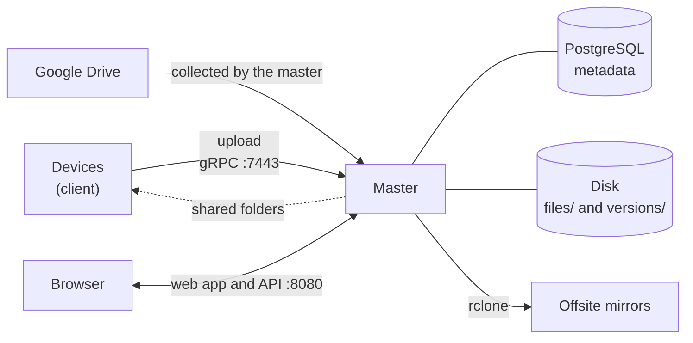

# Overview

fafnirx collects the files of your devices into one server you own (the **master**), keeps their versions, lets you browse
them and copy them offsite. Scale: 3-5 devices, hundreds of thousands of files, files up to 5 GB. Original data comes
first: replaced and deleted files stay as versions until retention ends.

## How a file travels

1. The client notices a change (file watcher + periodic scan) and waits for the file to settle.
2. It hashes the file in 4 MiB chunks (BLAKE3): a file is its chunk hashes plus a root hash.
3. It sends the list; the master answers with the chunks it still needs. Interrupted uploads resume. Content the device
   already has under another path (a copy or a rename) needs no data.
4. The master verifies every chunk, assembles the file, checks the root hash, and moves it to
   `files/users/<user>/<device>/<path>`. The file it replaces moves to `versions/<version id>/<user>/<device>/<path>`.
5. Deleting on the device only marks the path deleted; the data stays until the retention period passes.
6. Mirrors copy the current tree, and what changed since the last run, to storage you choose.

## Rules that do not change

- **Backups are one way.** The client only reads the folders it collects. Nothing is sent back to them; restoring is a
  download. The exception is a [shared folder](usage.md#shared-folders-sync-both-ways), which the user chooses to sync both ways.
- **The device is the source of truth.** A change, rename or delete on a device is applied on the master (a rename without
  re-sending; a delete as "marked deleted", recoverable until retention ends). A mass deletion is held back by the
  client for hours ([delete guard](usage.md#the-delete-guard)).
- **The master changes only its own files**, never a file on a device. Files a device or source sent cannot be edited or
  renamed on the master; only local folders, shared folders and master files can.
- **Deleting in the web app hides, never erases.** The file goes to the Trash; the device is not asked for it again. In a
  shared folder, computers delete it too.
- **Roles.** Administrator: everything. Normal: master files and own folders, read and write. Read only: reads master files.

## Not in scope

- Not a general sync tool: only shared folders sync both ways.
- Not encryption of the master's disk: use an encrypted disk. Backup mirrors are encrypted with your key.
- Not enterprise access control: three roles and a workspace per user.

## The pieces

| Piece | What it is |
|---|---|
| `fafnirx` | Client: watcher, resumable upload, offline queue, tray, self-update. Android: [fafnirx-android](https://github.com/jameelhamdan/fafnirx-android) (separate repository) |
| `fafnirx-master` | Device API, web API and app, users, file store, background work |
| `fafnirx-stream` | Optional: adaptive video streaming ([streaming](streaming.md)) |
| `fafnirx-sign` | Optional: sign your own client builds |
| PostgreSQL | All metadata |
| rclone | Mirror uploads and storage sources (in the Docker image) |

Next: [Installation](installation.md), then [Usage](usage.md).
