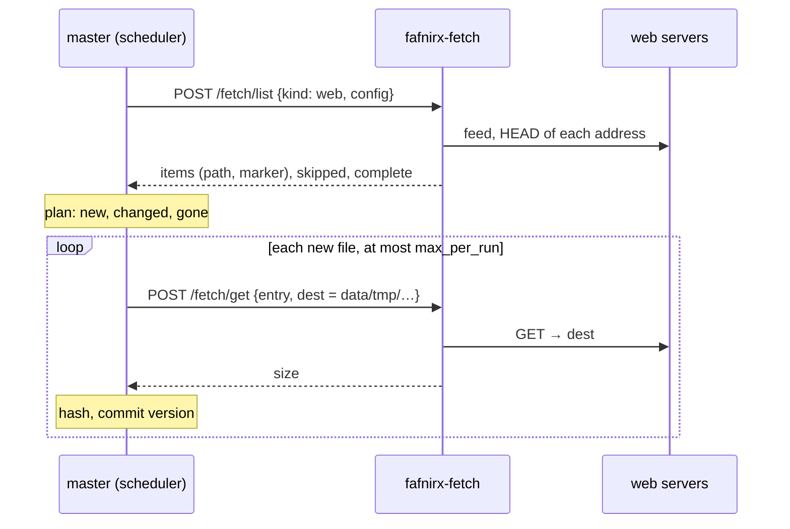

# Sources

A source is storage the master reads on a schedule. Its files are written into a folder you choose and appear under
**Files** there like any other file, with versions and retention. A source never writes back.

A source belongs to its user (`<user>/<name>`). **Where the files go** is one whole folder: a folder of its own
(`<user>/source-<name>`, a normal local folder, which you can rename), one of your folders, a folder shared with you that you may
change, or a master folder. [Mirrors](mirrors.md) and the network drive treat the files like any others. Credentials are never
shown again.

**Edit** (pencil on the Sources page) changes the name, the place, the schedule and what it reads; a password or cookie field left
empty keeps what is stored. Renaming the folder in Files keeps the source attached. Changing the folder puts what it collected
in the Trash of the old one and it collects everything again into the new one; it cannot be changed while it runs. **Deleting**
a source removes only the files it collected, not the rest of the folder.

Sources read any storage [rclone](https://rclone.org) supports: Google Drive, OneDrive, Dropbox, Nextcloud/WebDAV, SFTP,
S3-compatible, a local folder.

**Sources → Add source → Storage** offers a protocol: Backblaze B2, S3-compatible, SFTP, WebDAV, a folder, a remote from
`rclone.conf` or any other rclone backend (the same choices and fields as for a mirror, see [Storage](mirrors.md#storage)). When
the [fetch module](#web-files-and-feeds) or a [plugin](plugins.md) is running, a **Services** tab adds its kinds of source. Then a
name and a schedule.

- Each run lists the folder recursively and downloads files that are new or whose size or modification time changed.
- The remote layout is kept: `Photos/2024/a.jpg` on the storage is `Photos/2024/a.jpg` below the place the source writes to.
- The storage has no stable file ids, so a **rename or move downloads the file again** and the old path is marked deleted.
  (A kind that gives its files keys, see [Plugins](plugins.md), moves them instead.)
- Files gone from the storage are marked deleted (kept for the retention period). If listing fails nothing is deleted and
  the run fails with an alert.
- Names rclone lists that cannot be a path (`..`, empty parts) and files of unknown size are skipped and counted.
- A file deleted in the web app stays deleted until it changes on the storage.

OAuth storage (OneDrive, Dropbox): run `rclone config` once, put the resulting `rclone.conf` in `./config` (or
`FAFNIRX_RCLONE_CONFIG`; writable by the master, readable by its owner only) and choose **Remote from rclone.conf**, written
as `name:folder`.

## Google Drive

Choose **Storage → Other rclone backend** with the backend `drive`, and put its settings under *More backend options*, one
`key=value` per line:

```text
service_account_credentials={"type":"service_account", …}
root_folder_id=<the part after /folders/ in the folder's URL>
```

Create a Google Cloud **service account**, enable the Drive API, and share the Drive folder with the account's email (viewer is
enough). One source reads one folder; add another source for each further folder. Docs, Sheets and Slides are skipped (add
`drive_export_formats` to export them). Any other rclone backend is added the same way, with its settings from the
[rclone documentation](https://rclone.org/overview/).

## Web files and feeds

Read by the optional **fetch module** ([module](modules.md) `fafnirx-fetch`, `modules/fetch/service`), not by rclone: addresses of files, and
RSS or Atom feeds whose entries link to files, over plain HTTP(S). Without the module the Sources page doesn't offer web sources.
It is also the smallest complete example of a **fetch plugin** ([Plugins](plugins.md)).

The master keeps everything that is data: when a source runs it asks the module what the source offers, compares that with what it
has (the same code as for rclone sources), asks for the files that are new one at a time, then hashes and commits them. The module
has no database and writes only below `data/tmp`.



**Sources → Add source → Services → Web** (offered when the module is running):

| Setting | |
|---|---|
| Addresses | one address of a file per line (up to 200), `http://` or `https://` |
| Feed | optional RSS or Atom feed whose entries link to files; read on every run |
| Only / never files matching | patterns ([Rust regex syntax](https://docs.rs/regex/latest/regex/#syntax)) tested against the file's name |
| Smallest / largest file | MB and GB; files outside are not offered (a size the server doesn't tell is not held against a file) |
| Files per run | 1–500, default 25 |

- A file is named after the last part of its address (`https://host/dir/Report%20final.pdf?x=1` is `Report final.pdf`), made safe for
  file names. Two addresses with the same name are two files; the second gets a short hash in front.
- For an entry of a feed the **enclosure** is the file; an entry without one links to the file itself.
- The marker is made of what the server says of the file (`ETag`, `Last-Modified`, `Content-Length`): **a file that changes on the
  server is fetched again as a new version**, one that doesn't is not. A server that sends none of these has its file fetched once.
- **A feed only adds.** It shows its latest entries, not everything, so what drops out of it is not deleted; the same goes for a run
  in which an address could not be reached (alert *Source failed*, tried again next run). Files of a source with only a fixed list are
  deleted when you take the address out of the list. Delete files you no longer want in the web app, or remove the source.
- A run fetches at most *Files per run* files; each is committed as soon as it is there. If more are waiting the master asks for
  another run at once. A restart or a failure loses at most the file being made.
- A download that receives nothing for 10 minutes (`FAFNIRX_FETCH_IDLE_SECS`) is given up on; the file counts as failed and the run as
  *partial*. An empty file is a failure too.
- The module follows redirects and reaches **any address your server can reach**, including the local network. Only give the right to
  add sources to people you trust.

### Run it

In `.env`, then `docker compose up -d`:

```sh
COMPOSE_PROFILES=fetch
FAFNIRX_PLUGIN_SECRET=<openssl rand -hex 24>     # the master's, shared with every add-on
```

It gets only `data/tmp` of the data folder, **at the same path as the master** (`/data/tmp`), because the master names files by it.

| Variable | Default | |
|---|---|---|
| `FAFNIRX_FETCH_JOBS` | `2` | files made at the same time |
| `FAFNIRX_FETCH_IDLE_SECS` | `600` | give up on a download that receives nothing for this long |

### API

The module speaks the fetch contract in [Plugins](plugins.md#the-contract), with kind `web` (capabilities `fetch.web`, `status`).

### Legal

You are responsible for what your sources download. Copying files from the web may be restricted by the terms of the site and by
copyright: use this only for content you own, that is licensed for it, or that you otherwise have the right to copy. Adding a source
asks you to confirm that you may copy what it downloads; the confirmation and its time are kept with the source. This is not legal advice.

## More kinds of source

A [plugin](plugins.md) adds a kind of source of its own to **Services** (a site, a protocol, a service with an API): it brings its
form, and checks, lists and downloads on the master's behalf. The master treats its files like any other source's. Anyone can write
one and run it as a container next to their server: [Plugins](plugins.md).

## Run and pause

**Run now** starts a run at once; the pause button stops the schedule; deleting a source keeps its files for the retention
period, then removes them. A failed or partial run raises **Source failed**; a good run clears it.

See also [Mirrors](mirrors.md), [Usage](usage.md).
