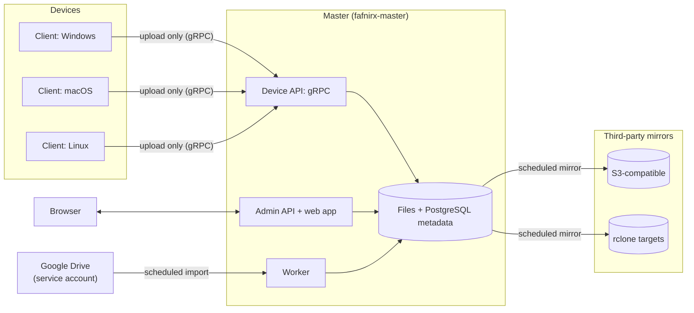

# fafnirx

Multi-platform (Windows, macOS, Linux) data collection. Clients on devices send their data to a central master, the master stores it as plain files, lets the owner browse it, and mirrors it offsite. Data is never sent back to devices.

Scale: 3-5 devices, up to hundreds of thousands of files, max file size 5 GB.

Principle: preserving original data matters above all else. Nothing a device does can delete or overwrite data already held by the master.

Named after Fafnir, the Norse dragon who hoards treasure: data goes in and nothing leaves a device's reach. Binaries: `fafnirx` (client), `fafnirx-master` (master) and `fafnirx-sign` (update signing).

## Architecture

- Collector model, one-way: clients → master → third-party mirrors. Clients never receive files.
- The master is **one Rust binary** (`fafnirx-master`) with three roles that can run in one process (the default) or apart:
  - **api:** the admin JSON API, login, live updates (server-sent events) and the web app.
  - **transfer:** the device gRPC API, and the admin API's downloads, previews, zip streams and chunked uploads.
  - **worker:** the file watcher, scheduled jobs (alerts, retention), Google Drive import, mirror runs, and the details, thumbnails, previews and playable copies of photos and videos.
- The **web app** is React with shadcn/ui, built into the master binary.
- Everything shares one PostgreSQL database (the only supported engine) and the data directory. Locks are PostgreSQL advisory locks, events travel through `LISTEN/NOTIFY`, queued work is claimed with `SKIP LOCKED`, so the roles never need shared memory.
- Each device has its own folder on the master, `files/<device name>/`. The name is a slug, unique and immutable, enforced by the database. Local folders (uploaded to in the browser or dropped into `files/`) and third-party sources are devices of their own kind.
- The master is a single point of failure by choice; offsite mirrors are the backup.
- Master storage: plain files on disk (`files/<device>/<path>`, replaced versions under `versions/<id>/<device>/<path>`) plus PostgreSQL metadata.
- Bit-rot protection of data at rest is left to the storage layer (for example ZFS). fafnirx verifies hashes on upload and before mirroring.
- **No TLS in the master and no private CA.** The master is meant for a trusted network or VPN over plain HTTP, or for the internet behind a TLS proxy such as a Cloudflare tunnel. Clients accept `http://` and `https://` server addresses (https verified against the system trust store) and warn when asked to use plain http for a public address.

## Collection strategy

- **Direction:** upload only. A client can add and update data but cannot read, list or delete anything on the master, including its own earlier uploads. The have/need exchange lets a client probe whether a hash is already stored for itself; this is accepted because there is a single owner. Reading and deleting exist only in the admin API, behind the admin login.
- **Updates:** when a file changes on a device, the master records a new version of that path. The last upload for a path is its current version.
- **Versions:** the last 5 versions of each file are kept (configurable). Replaced versions are kept as whole files under `versions/`.
- **Deletes (the client is the authority):** a delete on a device is a request to mark, never to erase. The master marks the path deleted in metadata (`deleted_at`), the file and all its versions stay recoverable, and nothing is removed until the retention period has passed. If the client brings the file back, it is live again and the earlier content stays as a version. Deletes in a third-party source follow the same rule. A delete made in the web app of a file a device sent hides it in the trash and is remembered (`deleted_by`): the device is told the path is up to date, so it is not sent again, and nothing happens on the device. Restoring it from the trash ends that.
- **Retention:** counted from the moment of the delete, 30 days by default (configurable). After that the file record and all its versions are removed, and their stored files are deleted from disk. Versions beyond the version count are pruned the same way: marked first, removed after retention. The change log is kept for 90 days. Covered by `tests/e2e-retention.mjs`.
- **History:** a metadata change log (device, path, action, time, hash) is kept.
- **Change cursor:** the client remembers which changes it has uploaded and resumes from there after being offline.
- **File metadata:** mtime and size are always kept; mode bits best effort; no extended attributes. Paths are stored normalized to NFC. Empty directories are ignored. For photos and videos the master also reads the type, size, date, GPS position, EXIF data (and, for videos, length and codec) once per content: see [Photo library](#photo-library).
- **Renames/moves:** if a file disappears and one with the same root hash appears, it is recorded as a rename, with no re-upload. A file renamed and edited in one step is a new file.
- **Skipped items:** locked files, symlinks and case-conflicting names are skipped and logged.
- **Hot files** (changing during upload): the failed upload is retried with backoff at 10 minutes, then 1 hour, then 1 day, then logged as skipped until the next change or scan.
- **Initial upload:** the first run uploads all existing data, subject to the bandwidth limit, and is resumable.
- **Change detection:** filesystem watcher plus periodic scan; each is configurable per device.
- **Transfer:** chunked on the wire, resumable, stored as whole files:
  - Files are hashed in fixed 4 MiB chunks, each identified by its BLAKE3 hash. The root hash covers the ordered chunk hashes and the size.
  - Client sends the manifest; master replies with the chunks it still needs: all of them for a new file, only the undelivered ones when resuming an interrupted upload, none when the device already has the content (a copy or rename). Chunks are sent over parallel gRPC streams.
  - Chunks are verified on arrival and written at their offset into one file in a temp area. After the commit re-hashes the assembled file and the root hash matches, the file is moved to `files/<device>/<path>` and the file it replaces to `versions/<version id>/...`.
  - If the source file changes mid-transfer, the root hash check fails and the file is re-scanned and re-sent.
  - A changed file is sent whole; there is no delta upload.
- **Integrity:** BLAKE3 per chunk and per file (root hash).

## Master

- Linux, deployed with Docker (or as a systemd service): the device and web ports exposed, a volume for data, the admin password via environment variable.
- The web app is protected by a single admin password and a signed, `HttpOnly`, `SameSite=Strict` cookie. Wrong guesses are rate-limited per client address. Over a TLS proxy the cookie is also `Secure`.
- The web app creates devices. Each device has a unique name (its folder) and its own token. There is no universal token. Tokens can be rotated and revoked; a revoked device's data is kept.
- A reinstalled client reuses its device's token and folder.
- Devices are listed with name, type, IP, used/available storage, data collected, last collected, online/offline, and live upload progress (percent, speed, time left).
- The web app configures third-party sources, mirrors, version count and retention.
- The web app shows alerts: failed mirror runs, offline devices, upload errors, and master disk use over 80%. Collection is never paused automatically. An upload-error alert resolves itself 48 hours after the client last reported that error; the other alerts resolve when their cause does, and any alert can be dismissed by hand. Email and webhook alerts are not included.
- Offline threshold: 60 s without heartbeat.
- Hosts the client binaries for auto-update (`<data>/updates/<platform>/`, written by `fafnirx-sign publish`). Binaries are signed with a key kept off the master, and clients verify the signature and that the version is higher before installing.
- Third-party source credentials (Google service account key) are stored on the master and managed in the web app; they are never sent back to the browser.
- **File browser:** browse every device, local folder and source; every folder shows how many files it holds and how much space they take (the current versions); search and filter by type; sort by name, modified, recorded, date taken, size or type; list and grid views; select several items to download (a streamed zip when more than one file or any folder) or delete; open a file for a preview, its metadata and EXIF data, and its full version history with download and restore; upload files and folders by drag and drop into a local folder, in resumable 8 MiB pieces.
- **Network drive:** `files/` can be shared and written to. New and changed files, removed files and new top-level folders are noticed and recorded (a file watcher with a periodic full comparison as a fallback).
- **Live updates:** the web app is pushed changes (server-sent events fed by `NOTIFY`): device status and progress, files in an open folder, recent activity, alerts, jobs.
- Restoring data to a device is a download or a manual copy from the master.

## Web app

- Good defaults over configuration: minimal, functional, responsive from phone to wide screen; keyboard and screen-reader friendly controls (labelled buttons, dialogs with focus handling from Radix).
- React 19, TypeScript, Tailwind v4 and shadcn/ui (Radix), TanStack Query for data, React Router, TanStack Virtual for long lists. Light and dark themes, following the system by default.
- Wording: short labels and plain sentences in sentence case, the product name stays `fafnirx`. The same applies to the tray menu.
- Pages: Timeline, Favorites, Albums (and one album), Map, Archive, Trash, Dashboard, Files, Devices (and one device), Sources, Mirrors, Settings.
- Pages load on demand; the app is served by the master itself, so it works on a LAN without internet access (the map needs a tile server it can reach: see `FAFNIRX_MAP_TILES`).

## Photo library

A second way into the same files, for photos and videos. Nothing is copied: the library is a view over the current versions of the files every device, local folder and source holds, plus what people say about them.

- **What is in it:** files with a photo or video extension (`jpg jpeg png gif webp bmp tif tiff heic heif avif`, `mp4 mov mkv avi webm m4v wmv mts 3gp mpg mpeg`) that are not deleted, from every device. A device filter, a type filter (photos or videos) and a tag filter narrow it.
- **Originals are never touched.** Everything below is stored beside the file in the database (`file_state`, `tags`, `albums`), keyed by the file (a path of a device), so it survives new versions of the file and comes back when a deleted file is restored. It is removed when retention removes the file for good. A mirror keeps a readable copy in `meta/library.json`.
- **Date:** a photo's date is the one corrected by a person, else the camera's (EXIF `DateTimeOriginal`, or a video's creation time), else the file's modification time. Cameras record no time zone, so every date is read and shown as UTC, the same on every screen.
- **Timeline:** months, then days, newest first, in square thumbnails that fill the width (larger on a wide screen, three or four across on a phone). The server tells the page how many files each day holds, so the page knows how tall every month is before loading a picture; only months near the screen are drawn and loaded. A **scrubber** at the right edge names the years, follows the real height of each month, and jumps when dragged, touched or used with the arrow keys.
- **Viewer:** full screen, opened from the grid. Arrow keys or a swipe move to the next photo (across months); `Esc` closes; `i` toggles the info panel and `f` the favorite. Photos show a 1600 px preview; videos play a browser-playable copy (see below) with the poster as the first picture; a file that cannot be shown says so and offers the original.
- **Favorites, archive:** a favorite is a flag, shown with a heart and listed on Favorites. Archived files leave the timeline and are listed in Archive. Both can be set one by one or on a selection.
- **Trash:** every deleted file of every device, with when it was deleted and when it will be removed for good (the retention period), and a **Restore** that puts it back with its albums, tags and favorite. There is deliberately no "delete now": removal happens only when retention says so.
- **Tags, description, rating, date, place:** edited in the viewer's info panel. Tags are free text, shared by every file, and case-insensitive. A rating is one to five stars; choosing the star that is set clears it. Changing the date or the place only records a correction; **Use the original** takes it back. A corrected place is picked on a small map or typed as latitude and longitude. A selection can be tagged in one go.
- **Albums:** named groups of photos and videos, optionally with a description and a chosen cover (the newest file otherwise). A file can be in many albums; removing it from an album or deleting the album never deletes the file; a deleted file is not counted until it is restored.
- **Map:** every photo and video with a place (from the camera's GPS tags, or a corrected one) on an OpenStreetMap-style map. Nearby ones group into a numbered bubble that opens as you zoom; a strip below lists what is in view and opens the viewer. The tile address is `FAFNIRX_MAP_TILES` (default OpenStreetMap, which needs internet access in the browser).
- **Thumbnails and previews:** made by the worker when a new content arrives (320 px for the grid and 1600 px for the viewer, JPEG, never enlarged, upright according to the EXIF orientation), and on demand when missing. They are cached by content, so they are shared by copies and never go stale.
- **Videos** need `ffmpeg` and `ffprobe` (installed in the Docker image; `FAFNIRX_FFMPEG`, `FAFNIRX_FFPROBE` for other places). The worker reads length, size, codec, creation date and place; makes a poster frame; and, for anything browsers do not all play (everything except H.264 in `mp4`, `m4v` or `mov`, and `webm`), converts a 720p H.264/AAC copy in a slower lane of the queue so that a long film never holds up photo thumbnails. The original is untouched and is what is mirrored and downloaded. Without ffmpeg videos are listed with an icon and play only if the browser can play the original. HEIC and AVIF photos get a preview only if the installed ffmpeg can decode them (Debian's build usually cannot); they are listed and downloadable either way.
- **Not included:** faces, object or text search, partner or multi-user libraries, live photos, editing of pictures, stacks. Search by name is in the file browser.

## Client

- Windows / macOS / Linux, configured with a TOML file (the `server` address, which can be a LAN `http://` address, a VPN address or a public `https://` one).
- Folders to collect set in the config file; an optional ignore file (`.fafnirxignore`) lives in each collected folder.
- Credential stored in the OS keychain, with a file fallback.
- **Runs by itself:** `fafnirx enroll` registers the client as a service and starts it (a systemd user unit on Linux, a LaunchAgent on macOS, a per-user Run registry key on Windows; no administrator rights). Only one client runs per state directory. A running client notices a new enrollment (token, server) and restarts itself.
- Installers: a Windows setup program, and `installer/install.sh` for Linux and macOS.
- Uploads only while connected; otherwise shows an error. Changes made while offline are queued and uploaded when back online.
- Per-device bandwidth limit and pause.
- Auto-update from the master.
- Tray icon: `fafnirx tray` is a separate process (so the daemon stays headless). It shows a hard-drive icon coloured by state (green online, red error, amber paused, grey not running) whose activity light blinks while a sync cycle is running. The menu shows the server and its connection state, the device name, what is happening now (scanning, hashing or uploading with file, position, percent, speed and time left, or when the next scan is due), the last sync result, how much the master holds from this device, totals since start, and the last error. It controls the client: pause/resume, sync now, check for updates, start/stop the client. An "open" submenu opens the config file, the log file, the client data folder, each collected folder and the web app (`web_url` in the config, default port 8080 on the master host). The daemon publishes this in `status.json` and reads `paused`, `sync-now` and `stop` marker files from its state directory. On Linux it needs a desktop with a status-notifier/appindicator host; build with `--no-default-features` to leave it out.

## Third-party sources (inbound)

- Collected by the master itself on a per-source schedule, one module per source, treated like a device: a source owns a device row (`kind = 'source'`, named `source-<name>`, unusable token), so its files, versions, events and retention use the same tables as device files and show in the file browser.
- First: Google Drive, via a service account (key pasted in the web app, stored on the master, never shown again). Folders are given by id or URL and must be shared with the service account's email.
  - Raw files only. Native Google Docs/Sheets/Slides, forms and shortcuts are skipped and counted in the run message.
  - File names are made safe (`/ \ : * ? " < > |` and control characters become `_`, NFC) and duplicates get a stable ` (<id prefix>)` suffix before the extension.
  - Each run lists the folders, downloads what is new or changed (md5 + modified time), and skips the rest. A renamed or moved file with unchanged content is not downloaded again.
  - Files that disappeared from Drive are marked deleted and follow the delete rule above. If the listing fails the run fails without deleting anything.
  - Failed or partial runs raise a `source failed` alert; a good run clears it.

## Third-party mirrors (outbound)

- The master's data is mirrored to S3-compatible storage and anything else rclone supports. The master runs the `rclone` binary (installed in the Docker image) and passes backend options through environment variables, so credentials never appear on a command line.
- Runs every 3 days by default, configured per mirror in the web app (interval, backend type, options, path on the remote, runs kept). "Run now" and "resync" (forget what was uploaded) are available too.
- Layout on the mirror, readable and restorable with any tool and independent of fafnirx and PostgreSQL:
  - `files/<device>/...`: the current file tree, the same layout as the master.
  - `versions/<UTC timestamp>/...`: what that run replaced or removed (the same relative paths).
  - `meta/stats.json` and `meta/<device>.json`: statistics and a file list (path, size, mtime, root hash) per device.
- Each run uploads only files whose content changed since the last run. Changed files are linked from the file store in batches (at most 512 MiB or 2000 files staged on disk at a time) and every file is re-hashed first, so bit rot on the master's disk is reported (run status "partial", alert) instead of mirrored.
- Old versions and files deleted within retention are kept in `versions/`; the newest 3 runs are kept and older run directories are purged. This is the same on S3 and every other backend, so S3 object versioning is not required.
- No encryption. Restore is manual.

## Status

Implemented and covered by unit tests, API tests and four end-to-end suites (`tests/e2e.mjs`, `e2e-roles.mjs`, `e2e-io.mjs`, `e2e-retention.mjs`): everything above. Not tested on real hardware: the Linux and macOS autostart installers and the tray icon on Linux and macOS, Google Drive against Google itself, and the Cloudflare tunnel setup. The photo library (timeline, scrubber, viewer, edits, albums, trash, map) is covered by unit and API tests and was driven in a real browser on desktop and phone sizes; the video parts (poster frames, probing, playable copies) are covered only by tests of the parsing and of the job lanes and were not run against a real ffmpeg yet.
