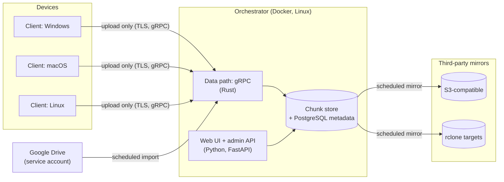
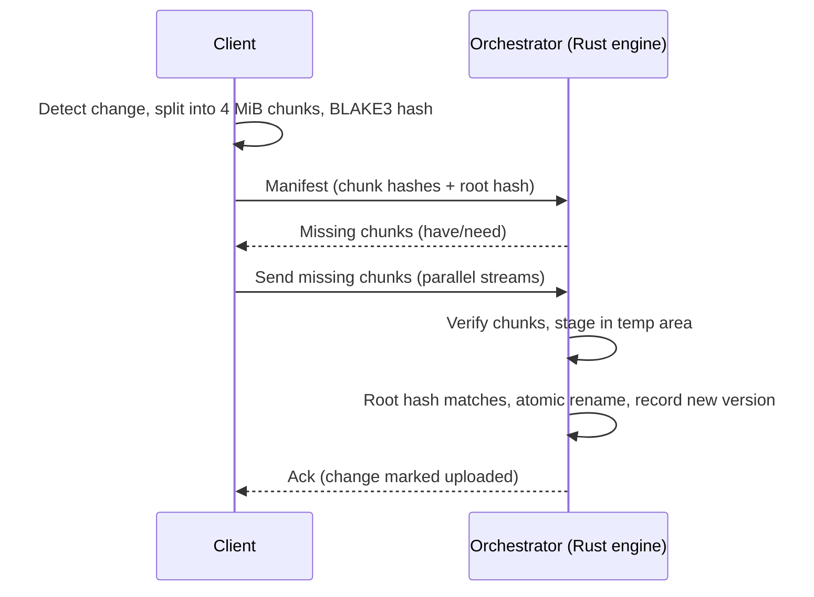

# fafnirx

Multi-platform (macOS/Windows/Linux) data collection. Clients on devices send their data to a central orchestrator, and the orchestrator mirrors it offsite. Data is never sent back to devices.

Scale: 3-5 devices, thousands of files, max file size 5 GB.

Principle: preserving original data matters above all else. Nothing a client does can delete or overwrite data already held by the orchestrator.

Named after Fafnir, the Norse dragon who hoards treasure: data goes in and nothing leaves. Binaries: `fafnirx` (client) and `fafnirx-server` (orchestrator).

## Architecture

- Collector model, one-way: clients -> orchestrator -> third-party mirrors. Clients never receive files.
- The orchestrator is two processes:
  - **Rust engine:** serves the gRPC data path (uploads, hashing, chunk storage, heartbeats) and runs the scheduled jobs (Google Drive import, mirror).
  - **Python (FastAPI):** serves the web UI and the admin/metadata API.
  - Both use the same PostgreSQL database (the only supported engine; no SQLite).
- Each device has its own namespace on the orchestrator (`/devices/<device-name>/...`), so devices never conflict with each other.
- Orchestrator is a single point of failure by choice; offsite mirrors are the backup.
- Orchestrator storage: content-addressed chunk store on disk plus PostgreSQL metadata. Identical content from different devices is stored once.
- Bit-rot protection of data at rest is left to the storage layer (e.g. ZFS). fafnirx verifies hashes on upload only.

Upload of one file (client to orchestrator):

## Collection strategy

- **Direction:** upload only. A client can add and update data but cannot read, list or delete anything on the orchestrator, including its own earlier uploads. The have/need exchange lets a client probe whether a hash is already stored; this is accepted because there is a single owner.
- **Updates:** when a file changes on a device, the orchestrator records a new version of that path. The last upload for a path is its current version.
- **Versions:** the last 5 versions of each file are kept (configurable on the orchestrator). Chunk dedup makes this cheap.
- **Deletes (the client is the authority):** a delete on a device is a request to mark, never to erase. The orchestrator marks the path deleted in metadata (`deleted_at`), the file and all its versions stay recoverable, and nothing is removed until the retention period has passed. If the client brings the file back, it is live again and the earlier content stays as a version. Deletes in a third-party source (Google Drive) follow the same rule.
- **Retention:** counted from the moment of the delete, 30 days by default (configurable on the orchestrator). After that the file record and all its versions are removed, and chunks that no other file or version references are deleted from disk (at least 24 hours after they were stored). Chunks still used by another file stay. Versions beyond the version count are pruned the same way: marked first, removed after retention. Garbage collection re-checks under the database lock, right before deleting, that a chunk is still unreferenced, so a client that re-sends identical content at that moment cannot lose it. The change log (events shown on the device page) is kept for 90 days. Covered by `tests/e2e_retention.py`.
- **History:** a metadata change log (device, path, action, time, hash) is kept.
- **Change cursor:** the client remembers which changes it has uploaded and resumes from there after being offline.
- **File metadata:** mtime and size are always kept; mode bits best effort; no extended attributes. Paths are stored normalized to NFC (macOS). Empty directories are ignored.
- **Renames/moves:** if a file disappears and one with the same root hash appears, it is recorded as a rename, with no re-upload. A file renamed and edited in one step is a new file.
- **Skipped items:** locked files, symlinks and case-conflicting names are skipped and logged.
- **Hot files** (changing during upload): the failed upload is retried with backoff at 10 minutes, then 1 hour, then 1 day, then logged as skipped until the next change or scan.
- **Initial upload:** the first run uploads all existing data, subject to the bandwidth limit, and is resumable.
- **Change detection:** filesystem watcher plus periodic scan; each is configurable per device.
- **Transfer:** content-addressed chunks, resumable by design:
  - Files are split into fixed 4 MiB chunks, each identified by its BLAKE3 hash. A file is a manifest (ordered chunk hashes + root hash).
  - Client sends the manifest; orchestrator replies with the chunks it lacks (have/need). Only missing chunks are sent, over parallel gRPC streams.
  - Resume = repeat have/need. No byte offsets are tracked, and interrupted or repeated chunk uploads are harmless.
  - Chunks are verified on arrival and staged in a temp area. The file appears only after the root hash matches, via atomic rename.
  - If the source file changes mid-transfer, the root hash check fails and the file is re-scanned and re-sent.
  - Unchanged chunks are never re-sent, so edits to large files are cheap.
- **Integrity:** BLAKE3 per chunk and per file (root hash).

## Orchestrator

- Linux, deployed with Docker: gRPC and web UI ports exposed, volumes for data and certificates, admin password via environment variable.
- Web UI protected by a single admin password. It is served over plain HTTP and is only ever reachable on the LAN, through the VPN; it is never exposed publicly, so it has no TLS of its own. (A reverse proxy in front is fine if that changes.)
- Web UI creates devices. Each device has a unique name (its namespace) and its own token. There is no universal token. Tokens can be revoked; a revoked device's data is kept.
- A reinstalled client reuses its device's token and namespace.
- Web UI lists devices: name, type, IP, used/available storage, data collected, last collected, online/offline.
- Web UI configures third-party sources, the mirror schedule, version count and retention.
- Web UI shows alerts: failed mirror runs, offline devices, upload errors, and orchestrator disk use over 80%. Collection is never paused automatically. An upload-error alert resolves itself 48 hours after the client last reported that error (clients repeat it on every retry, so one that went quiet has been fixed); the other alerts resolve when their cause does, and any alert can be dismissed by hand. Email/webhook alerts are not included.
- TLS required for client connections, using a self-signed CA generated by the orchestrator. Clients pin the CA or fingerprint in their TOML.
- A device token is only accepted over TLS.
- Offline threshold: 60 s without heartbeat.
- Hosts the client binaries for auto-update (`<data>/updates/<platform>/`, written by `fafnirx-sign publish`). Binaries are signed with a key kept off the orchestrator, and clients verify the signature and that the version is higher before installing.
- Third-party source credentials (Google service account key) are stored on the orchestrator and managed in the web UI.
- Restoring data to a device is a manual copy from the orchestrator.

## Web UI style

- Very minimal and functional. Visual style, colours and UI language are copied from Beszel (shadcn/ui look): dark theme by default with a light toggle, neutral greys, thin borders, small rounded cards, compact tables, and a green/red dot for online/offline, and enough space between the top bar and the page heading.
- Same layout ideas as Beszel: a top bar, and a flat table of devices on the home page (status dot, name, status, OS, IP, collected, files, device disk, last collected; one row per device, live status refresh). The device detail page shows the namespace, token management and recent activity.
- Wording: short labels and plain sentences in normal sentence case (capital first letter, proper nouns capitalized, the product name stays `fafnirx`), no marketing copy. The same applies to the tray menu.
- Server-rendered templates from FastAPI with a small hand-written stylesheet, plus Alpine.js (about 15 KB gzipped) for interactivity: theme toggle, copy token, live device status refresh, modals. No frontend build step; the Alpine file is vendored into the app, not loaded from a CDN, so the UI works offline on a LAN.
- Tokens are taken from Beszel's `internal/site/src/index.css` (MIT license). Define them as CSS variables; the dark theme is the default, applied by a `.dark` class on `html`:

  | Token | Light | Dark |
  |---|---|---|
  | `--background` | `hsl(30 8% 98%)` | `hsl(220 5.5% 9%)` |
  | `--foreground` | `hsl(30 0% 10%)` | `hsl(220 2% 97%)` |
  | `--card` | `hsl(30 0% 100%)` | `hsl(220 5.5% 10.5%)` |
  | `--card-foreground` | `hsl(240 6% 12%)` | `hsl(220 2% 97%)` |
  | `--primary` | `hsl(240 5.88% 10%)` | `hsl(220 2% 96%)` |
  | `--primary-foreground` | `hsl(30 0% 100%)` | `hsl(220 4% 10%)` |
  | `--secondary` | `hsl(240 4.76% 95.88%)` | `hsl(220 4% 16%)` |
  | `--muted` | `hsl(26 6% 94%)` | `hsl(220 6% 16%)` |
  | `--muted-foreground` | `hsl(24 2.79% 35.1%)` | `hsl(220 4% 67%)` |
  | `--accent` | `hsl(20 23.08% 94%)` | `hsl(220 5% 15.5%)` |
  | `--destructive` | `hsl(0 66% 53%)` | `hsl(0 62% 46%)` |
  | `--border` | `hsl(30 8.11% 85.49%)` | `hsl(220 3% 17%)` |
  | `--input` | `hsl(30 4.29% 72.55%)` | `hsl(220 4% 22%)` |
  | `--ring` | `hsl(30 3.97% 49.41%)` | `hsl(220 4% 80%)` |
  | `--table-header` | `hsl(225 6% 97%)` | `hsl(220 6% 13%)` |

- Radius `0.8rem` (small `calc(var(--radius) - 4px)`, medium `- 2px`, large `var(--radius)`). Page container max width `1500px` with `1rem` side padding.
- Font: Inter (variable), vendored as a local font file. Body uses `font-variant-ligatures: no-contextual`.
- Status "online" uses Beszel's green scale, e.g. `hsl(140 50% 48%)` (green-500); "offline" uses `--destructive`.
- Links: primary colour, medium weight, underline on hover.
- Do not reuse the Beszel logo or name. Keep the MIT copyright notice for copied CSS in the repo's licenses file.

## Client

- Windows / macOS / Linux, configured with a TOML file (including the `server` address, which can be LAN, VPN or public, the device token and the pinned CA).
- Folders to collect set in the config file; an optional ignore file (`.fafnirxignore`) lives in each collected folder.
- Credential stored in the OS keychain, with a file fallback.
- Starts when the device comes online: `fafnirx install-service` registers a systemd user unit (Linux), a LaunchAgent (macOS) or a per-user Run registry key (Windows, no administrator rights needed).
- Uploads only while connected; otherwise shows an error. Changes made while offline are queued and uploaded when back online.
- Per-device bandwidth limit and pause.
- Auto-update from the orchestrator.
- Tray icon: `fafnirx tray` is a separate process (so the daemon stays headless). It shows a hard-drive icon coloured by state (green online, red error, amber paused, grey not running) whose activity light blinks while a sync cycle is running. The menu shows the server and its connection state, the device name, what is happening now (scanning, hashing or uploading with file, position and bytes sent, or when the next scan is due), the last sync result, how much the server holds from this device, totals since start, and the last error. It controls the client: pause/resume, sync now, check for updates, start/stop the client. An "open" submenu opens the config file, the log file, the client data folder, each collected folder and the web dashboard (`web_url` in the config, default port 8080 on the server host). The daemon publishes this in `status.json` and reads `paused`, `sync-now` and `stop` marker files from its state directory. `install-service` starts the tray at login (Run key, LaunchAgent, XDG autostart). On Linux it needs a desktop with a status-notifier/appindicator host; build with `--no-default-features` to leave it out.

## Third-party sources (inbound)

- Collected by the orchestrator itself on a per-source schedule, one plugin module per source, treated like a device with its own namespace (`/sources/<name>/`). A source owns a hidden `devices` row (`kind = 'source'`, `source:<name>`, unusable token), so its files, versions, events and retention use the same tables as device files.
- First: Google Drive, via a service account (key pasted in the web UI, stored on the orchestrator, never shown again). Folders are given by id or URL and must be shared with the service account's email.
  - Raw files only. Native Google Docs/Sheets/Slides, forms and shortcuts are skipped and counted in the run message.
  - File names are made safe (`/ \ : * ? " < > |` and control characters become `_`, NFC) and duplicates get a stable ` (<id prefix>)` suffix before the extension.
  - Each run lists the folders, downloads what is new or changed (md5 + modified time), and skips the rest. A renamed or moved file with unchanged content is not downloaded again.
  - Files that disappeared from Drive are marked deleted and follow the delete rule above. If the listing fails the run fails without deleting anything.
  - Failed or partial runs raise a `source failed` alert; a good run clears it.
- Later: Google Keep (unofficial library).
- Dropped: YouTube playlists.

## Third-party mirrors (outbound)

- The orchestrator's data is mirrored to S3-compatible storage and anything else rclone supports. The engine runs the `rclone` binary (installed in the Docker image) and passes backend options through environment variables, so credentials never appear on a command line.
- Runs every 3 days by default, configured per mirror in the web UI (interval, backend type, options, path on the remote, runs kept). "Run now" and "resync" (forget what was uploaded) are available too.
- Layout on the mirror, readable and restorable with any tool and independent of the chunk store and PostgreSQL:
  - `files/devices/<name>/...` and `files/sources/<name>/...`: the current file tree.
  - `versions/<UTC timestamp>/...`: what that run replaced or removed (the same relative paths).
  - `meta/stats.json` and `meta/<namespace>.json`: statistics and a file list (path, size, mtime, root hash) per namespace.
- Each run uploads only files whose content changed since the last run. Changed files are rebuilt from the chunk store in batches (at most 512 MiB or 2000 files staged on disk at a time) and every chunk is re-hashed on the way, so bit rot on the orchestrator's disk is reported (run status "partial", alert) instead of mirrored.
- Old versions and files deleted within retention are kept in `versions/`; the newest 3 runs are kept and older run directories are purged. This is the same on S3 and every other backend, so S3 object versioning is not required (it can still be enabled separately).
- No encryption.
- Restore is manual.

## Milestones

Status: all four milestones are implemented and covered by unit tests plus `tests/e2e.py` (devices) and `tests/e2e_io.py` (Google Drive against a fake Drive API, mirrors against a real rclone). Not tested on real hardware: the Linux and macOS autostart installers and the tray icon on Linux/macOS, and Google Drive against Google itself.

1. Orchestrator (Rust data path + FastAPI UI), device creation and tokens, TLS, web UI management and stats.
2. Collection from devices, including client packaging and service install (systemd, launchd, Windows service), signed auto-update.
3. Third-party source (Google Drive).
4. Third-party mirror.
