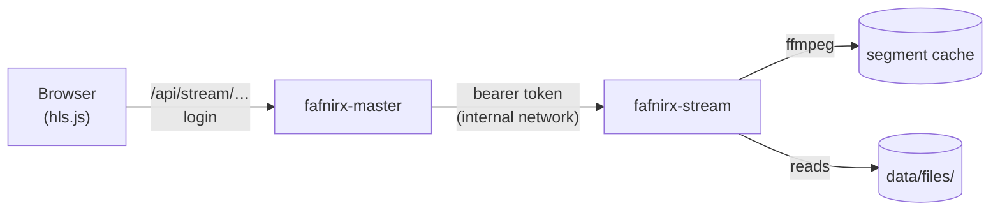

# Video streaming

Videos can be played in the web app in several qualities, chosen by the connection (or by hand), without making a
copy of every video first. It is for **whoever can see the file**: it is behind the same login and the same rules as everything else in
the web app, and there are no share links.

It is a separate service, `fafnirx-stream` (`crates/stream`), that runs next to the master, reads the videos from the
master's `files/` folder and never changes them. It is optional and off until you set it up.



## How it works

* The master gives the browser one address, `/api/stream/<file id>/…`, and checks the login on it, and that the user may see the file. It looks up which
  file and which content the id is now, and asks the service for that, with a token only the two of them know.
* The service answers with an **HLS** playlist: the qualities the video is offered in (1080p, 720p, 480p, 360p, none
  taller than the video itself) and, for each, the list of its 6-second segments. The playlists are complete at once,
  because every segment is a fixed stretch of the video.
* A segment is made **when the player asks for it**, with one `ffmpeg` run (H.264 and AAC in MPEG-TS), then kept. Only
  what is watched is ever made, and watching again, or seeking back, costs nothing.
* A changed video has a new content hash and so new segments; a stale segment is never served. A video's segments are
  removed after 7 days without being watched.
* The player is hls.js (or the browser's own, in Safari). When the service is set up, the viewer plays every video from it
  by itself. The player has its own controls: play, a seek bar that shows what is buffered and the time under the pointer,
  volume, speed, picture in picture and full screen. The gear holds **Quality** (*Auto*, each height, or *Original*, the
  file as it is) and **Speed**. If streaming fails, the original plays.
* **Subtitles.** Nothing to set up: every subtitle track a video has is offered, whichever way it comes.
  * *Inside the video file* (MKV, MP4): the text tracks (SubRip, ASS/SSA, WebVTT, `mov_text`) are listed by `ffprobe`
    the first time the video is opened and taken out with `ffmpeg` when a track is chosen. A track is named by its title
    in the file, else by its language, and a forced one is marked. Picture tracks (PGS, VobSub, DVB) cannot be turned into
    text and are left out. Taking a track out reads through the file once, so the first use of a big file takes a few seconds;
    after that it is kept.
  * *Files next to the video*: `Movie.srt`, `Movie.en.srt`, `Movie.ar.vtt`, `Movie.es.forced.srt` for `Movie.mp4`
    (SubRip, WebVTT and SSA/ASS; the name before the extension may carry a language code or name and `forced`/`sdh`),
    also when they are in a `Subs`, `Sub`, `Subtitles` or `Subtitle` folder next to the video, loose or in a folder
    named like the video (`Subs/Movie/2_English.srt`). When a video is the only one in its folder, subtitle files there
    that are named differently (a release tag or checksum in the video's name only) still belong to it.

  Tracks inside the file come first, then the files. The **CC** button turns subtitles on and off, and the gear opens **Subtitles**: the tracks,
  **Load from a file…** (a `.srt` or `.vtt` from your computer), the look (size, text color, background, edge, font
  and height) and a **Delay** in tenths of a second for a file that is out of step. The track and the look are
  remembered in the browser; a `forced` track in the language of the page starts on by itself. Files
  should be UTF-8 or UTF-16; an older file in a code page is read in the one that fits its language code (Windows-1256 for
  `ar`, 1251 for `ru`, and so on, else 1252). The cues are timed by the video's own position, so they stay in step whichever
  quality plays, and they also show when the player falls back to the original. ASS styling (fonts, colours, positions,
  karaoke) is not kept: the text, line breaks, italics and bold are.
* Keys in the viewer: space or `k` plays and pauses, `j` and `l` skip 10 seconds, `m` mutes, `c` turns subtitles on and off, the arrows go to the previous
  and next file. Double-click the picture for full screen.

## Turning it on

With Docker Compose (the service is in the `stream` profile):

```sh
# .env
FAFNIRX_STREAM_URL=http://stream:8090
FAFNIRX_STREAM_TOKEN=<a long secret: openssl rand -hex 24>
```

```sh
mkdir stream-cache && chown 1000:1000 stream-cache      # FAFNIRX_STREAM_CACHE_DIR; must be writable by FAFNIRX_UID
docker compose --profile stream up -d
```

To have `docker compose up` start it every time, add `COMPOSE_PROFILES=stream` to `.env` (the development setup does).

The service publishes no port: it has no login of its own and must stay reachable only from the master. The web app
shows the streaming entry only when `FAFNIRX_STREAM_URL` and `FAFNIRX_STREAM_TOKEN` are both set on the master.

| Variable | Default | Where | Meaning |
|---|---|---|---|
| `FAFNIRX_STREAM_URL` | none | master | Where the service is (`http://stream:8090`). Streaming is off without it |
| `FAFNIRX_STREAM_TOKEN` | none | both | Shared secret, at least 16 characters (the service refuses to start with less) |
| `FAFNIRX_DATA` | `data` (`/data`) | service | The master's data directory; videos are read from `files/` in it, read-only |
| `FAFNIRX_STREAM_LISTEN` | `0.0.0.0:8090` | service | Listen address |
| `FAFNIRX_STREAM_CACHE` | `<data>/cache/stream` (`/cache` in Compose) | service | Probes and segments |
| `FAFNIRX_STREAM_KEEP_DAYS` | `7` | service | Days a video's segments are kept after the last request |
| `FAFNIRX_STREAM_JOBS` | `2` | service | Segments made at the same time; each is an `ffmpeg` run |
| `FAFNIRX_STREAM_VCODEC` | `libx264` | service | The encoder; a hardware one such as `h264_nvenc` (NVIDIA) lowers the load, if `ffmpeg` and the container can use the card |
| `FAFNIRX_FFMPEG`, `FAFNIRX_FFPROBE` | from `PATH` | service | The programs |

## What it costs

Software encoding is CPU work: one segment of 720p takes a second or two on a modern core, so a first play of a new
video keeps up with real time only if the machine can encode faster than it plays (`FAFNIRX_STREAM_JOBS` segments at a
time). The cache grows with what is watched (roughly 1-3 MB per segment-quality). A slow server is better served by a
hardware encoder, or by the playable copies the master already makes for videos browsers cannot play
(`FAFNIRX_FFMPEG`, see [Usage](usage.md)).

## Not there yet

Share links; audio files; several audio tracks; styled (ASS) subtitles and picture subtitles; HEVC or AV1 output; trick-play
thumbnails; pre-making the segments in the background; hardware acceleration beyond choosing the encoder.

## Testing it

`cargo test -p fafnirx-stream` covers the playlists, the segment arithmetic, the `ffmpeg` arguments, the cache and the
refusal of paths outside the file tree. `node tests/e2e-stream.mjs` runs the real master in front of the real service with
stand-in `ffmpeg`/`ffprobe` programs, to check everything around them (login, token, proxy, which stretch each segment asks
for, caching, changed and deleted files). The transcoding itself needs a real `ffmpeg`: with one installed, start a stream
in the viewer and watch it, and seek around.
