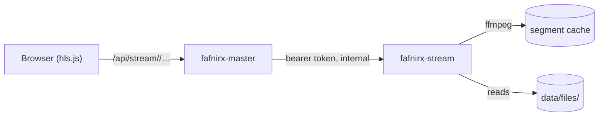

# Video streaming

Optional adaptive playback: several qualities, chosen by connection or by hand, made as a video is watched. Same login and
rules as the web app; no share links. `fafnirx-stream` (`crates/stream`) runs next to the master, reads `files/` read-only.



## How it works

- The master checks the login and the user's right to the file, resolves the id to path and content hash, and asks the service
  with a shared token.
- HLS: qualities 1080p, 720p, 480p, 360p (none above the video's size), 6-second segments; playlists are complete at once.
- A segment is made when asked for (one `ffmpeg` run, H.264 + AAC in MPEG-TS) and kept; a changed video has a new hash, so
  segments are never stale. Unwatched segments go after 7 days.
- The gear menu has **Quality** (Auto, a height, Original) and **Speed**; if streaming fails the original plays. Keys: space/`k`,
  `j`/`l` ±10 s, `m`, `c` subtitles, arrows previous/next file, double-click full screen.
- **Subtitles:** all offered. *Inside the file* (MKV, MP4): text tracks (SubRip, ASS/SSA, WebVTT, `mov_text`); picture tracks
  (PGS, VobSub, DVB) are left out; extracted on first use. *Beside the video:* `Movie.srt`, `Movie.en.srt`, `Movie.es.forced.srt`
  (SubRip, WebVTT, SSA/ASS), also in `Subs`, `Sub`, `Subtitles`, `Subtitle` (loose or in a folder named like the video); a video
  alone in its folder takes every subtitle file there. Embedded tracks come first. **CC** toggles; the gear has tracks, **Load
  from a file…**, the look (size, color, background, edge, font, height) and **Delay** (tenths of a second). Choices are kept in
  the browser; a `forced` track in the page's language starts on. Files should be UTF-8/16; older ones are read in the code page
  of their language code (1256 `ar`, 1251 `ru`, else 1252). ASS styling is dropped; text, breaks, italics, bold stay.

## Turn it on

```sh
# .env
FAFNIRX_STREAM_URL=http://stream:8090
FAFNIRX_STREAM_TOKEN=<openssl rand -hex 24>

mkdir stream-cache && chown 1000:1000 stream-cache     # FAFNIRX_STREAM_CACHE_DIR, writable by FAFNIRX_UID
docker compose --profile stream up -d                   # or COMPOSE_PROFILES=stream in .env
```

The service publishes no port and has no login: keep it reachable only from the master. The web app offers streaming only
when both variables are set on the master.

| Variable | Default | Where | Meaning |
|---|---|---|---|
| `FAFNIRX_STREAM_URL` | none | master | Service address; off without it |
| `FAFNIRX_STREAM_TOKEN` | none | both | Shared secret, 16+ characters |
| `FAFNIRX_DATA` | `data` (`/data`) | service | The master's data directory |
| `FAFNIRX_STREAM_LISTEN` | `0.0.0.0:8090` | service | Listen address |
| `FAFNIRX_STREAM_CACHE` | `<data>/cache/stream` (`/cache`) | service | Probes and segments |
| `FAFNIRX_STREAM_KEEP_DAYS` | `7` | service | Days segments stay |
| `FAFNIRX_STREAM_JOBS` | `2` | service | Segments made at once |
| `FAFNIRX_STREAM_VCODEC` | `libx264` | service | Encoder (`h264_nvenc` etc. lowers load) |
| `FAFNIRX_FFMPEG`, `FAFNIRX_FFPROBE` | `PATH` | service | The programs |

**Cost.** Software encoding is CPU work (~1-2 s per 720p segment per core); a first play keeps up only if encoding is faster
than playback. The cache grows with what is watched (~1-3 MB per segment and quality). Slow servers: use a hardware encoder or
the playable copies the master already makes ([Processing](usage.md#processing)).

**Observe.** The **Processing** page lists the segments and subtitle tracks in progress and recent failures (the service's
`GET /tasks`, [API](../crates/stream/README.md)). A slow start is usually a segment waiting for a free slot.

**Not built:** share links, audio files, several audio tracks, styled or picture subtitles, HEVC/AV1 output, trick-play
thumbnails, pre-made segments.

**Tests:** `cargo test -p fafnirx-stream` (playlists, arithmetic, arguments, cache, path refusal); `node tests/e2e-stream.mjs`
(real master and service with stand-in ffmpeg). Transcoding itself needs a real ffmpeg: play and seek in the viewer.
