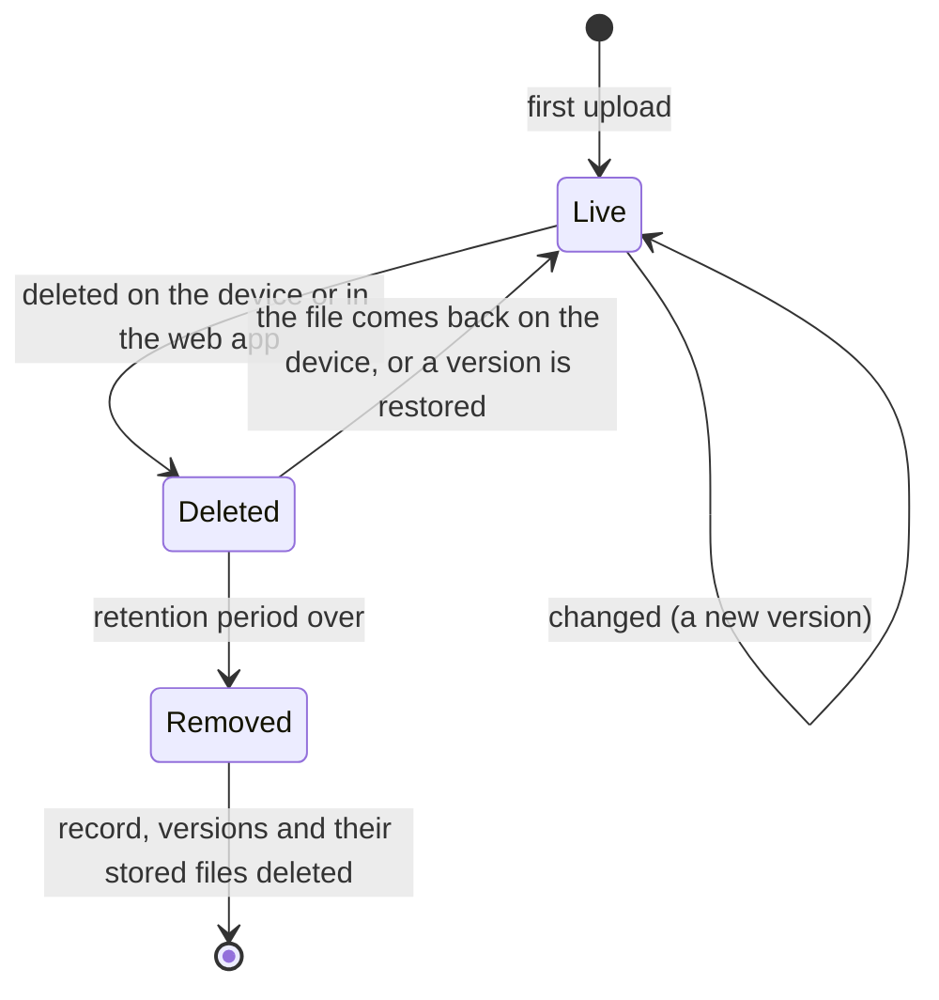

# Usage

## The web app

Log in at `http://<master>:8080` with your user name and password. A new master has one user, `admin`, whose password is
`FAFNIRX_ADMIN_PASSWORD`; change it with the key icon in the top bar. The page title bar shows **Live** when changes are
being pushed to you; pages refresh by themselves.

## Users and roles

Every device, album, tag and favorite belongs to a user, and each user has a folder of their own on the master. Files that
belong to nobody are the **master files**; everybody can see those.

| Role | Own devices, sources and files | Master files | Other users' files | Users, settings, mirrors |
|---|---|---|---|---|
| **Administrator** | read and write | read and write | read and write | yes |
| **Normal** | read and write | read and write | no | no |
| **Read only** | none: no devices, sources, albums, tags or favorites | read | no | no |

An administrator adds users on the **Users** page (name, role, password), changes a role, sets a new password, or disables a
user. A user can be neither deleted nor renamed: their name is their folder, and what they sent stays. Disabling ends their logins at once
and their devices stop sending. The master keeps at least one administrator.

* A device belongs to the user who adds it; the same device name can be used by two users (`bob/laptop` and `alice/laptop`).
  An administrator can add a device for another user. Devices cannot be added without a user, and a read-only user has none.
* In the file browser the master files are the first entry (**Master files**), then your devices. An administrator also sees
  the devices of all users, named `user/device`. Uploads go to your local folders and to the master files.
* Favorites, archive, ratings, descriptions, tags, albums and corrected dates and places are your own, also on master files:
  what one user says about a master file is not seen by another.
* The master files cannot be called like a user: a path in the master files that starts with a user's name is refused, and a
  user whose name the master files already use cannot be added.

| Page | Use it to |
|---|---|
| **Timeline**, **Favorites**, **Archive** | Look at every photo and video, by month and day, with a scrubber to jump through time ([Photos](#photos)) |
| **Albums** | Group photos and videos |
| **Map** | See where photos were taken |
| **Trash** | Bring back what was deleted, until the retention period ends |
| **Dashboard** | See alerts, what is stored (totals are brought up to date when a device finishes syncing), disk usage, who is online and uploading right now, changes of the last two weeks, recent activity, and the state of sources and mirrors |
| **Files** | Browse, search, preview, download, upload and delete (below) |
| **Devices** | Add a device, see its status and progress; open one to rotate its token, revoke it, or see its recent changes |
| **Sources** | Collect your own Google Drive folders on a schedule (each user has their own; an administrator sees all) |
| **Mirrors** | Copy everything offsite |
| **Video streaming** | In the photo viewer, a video's menu offers adaptive quality streaming when the [streaming service](streaming.md) is on |
| **Settings** | Versions kept per file and the retention period |

### Photos

The **Timeline** shows the photos and videos of every device together, newest first, by month and day. Nothing is
copied or moved: it is another view of the same files.

- **Move through time** by scrolling, or with the **scrubber** at the right edge: it shows the years, and dragging it (or
  touching it on a phone) jumps to any month, with the month named beside your finger. With the scrubber focused, the up
  and down arrow keys move a month at a time.
- **Filter** by device, by photos or videos, and by tag, above the grid.
- **Open** a picture to see it large. Arrow keys or a swipe move to the next one, `Esc` closes, `i` shows or hides the
  info panel and `f` marks a favorite. Videos play in the browser; a video that browsers cannot play as it is gets a
  converted copy made in the background, and says so until it is ready (the original is always kept and downloadable).
- **Info** shows and edits: a description, a rating (one to five stars; click the same star again to clear it), tags,
  the **date** and the **place**. Changing the date moves the photo in the timeline; changing the place moves it on the
  map. Both are only corrections noted beside the file, and **Use the original** takes them back. Dates are read as UTC
  because cameras do not record a time zone, so a photo shows the same time everywhere.
- **Select** with the circle in a picture's corner (or the box next to a day, to take the whole day). The bar offers
  **Favorite**, **Add to album**, **Add tags**, **Archive**, **Download** and **Delete**.
- **Archive** hides pictures from the timeline without deleting them; they are on the Archive page. **Delete** moves them
  to the **Trash**, where they stay until the [retention period](#settings-and-retention) ends and can be restored with
  their albums, tags and favorite.
- **Albums** group pictures without moving them. Select pictures, choose **Add to album**, and pick an album or type a new
  name. On an album's page you can rename it, set a cover (select one picture), remove pictures from it, or delete it
  (the pictures stay). An album shows the cover you chose; without one, a picked-files album shows its newest picture and
  a folder album shows its first video (see below).
  - In **Files**, select files or folders and choose **Add to album**: a folder adds the photos and videos below it.
  - **Use folder as album** (in **Files**, for the folder you are in or one you selected) makes an album that *is* the
    folder: whatever is in it, and below it, is in the album, and a new episode or photo that arrives later shows up by
    itself. It is made for things like a TV show: the files come in the order of their names (`Episode 2` before
    `Episode 10`), under a heading for each season folder, with the name under each one. There is one such album per
    folder; asking again opens it. Files cannot be removed from it, only from the folder.
  - **The cover of a folder album** is, unless you chose one, the picture of its **first video** in that same name order
    (episode 1 of the first season), or its first photo when the folder has no video. It follows the folder: if an earlier
    episode arrives, it becomes the cover. This is the only thing chosen automatically; nothing else about an album is.
- **Artwork and episode details** next to a video are used when they exist, with the names Jellyfin, Kodi and Plex use, so
  a library organised for them looks right here. Nothing has to be set up, and nothing is downloaded from the internet:
  fafnirx only reads files that are in the folder. Without them a video's picture is a frame taken a second into it.
  - *Picture of a video* (first match wins; `.jpg`, `.jpeg`, `.png` or `.webp`): `<video name>-thumb`,
    `<video name>-landscape`, `<video name>-poster`, `<video name>`, all in the same folder as the video. A video that is
    **alone in its folder** (a film in its own folder) also takes `poster`, `folder`, `cover` or `thumb` there. In a folder with
    several videos those names belong to the show, so they are *not* used for an episode.
  - *Details*: `<video name>.nfo` (or `movie.nfo` for a video alone in its folder), Kodi's XML. The `title`, `showtitle`,
    `season`, `episode`, `aired` (or `premiered`, `year`) and `plot` are shown in the **Info** panel of the video. Nothing else
    in the file is used, and the video's name and place in the library do not change.
  - They are looked up when a picture is asked for, among the files the folder has *now*: a picture that arrives after the
    video is used from then on. The picture is a file like any other (it is also in **Files**).
- **Processing** (in the menu) shows the background work after files arrive, live: reading details, making the small and
  large pictures, and making playable copies of videos, each with how many are running, waiting, failed and done in the last
  day, and a list of the jobs with the file and, for a failure, why. When streaming is set up it also lists what the
  streaming service is making now (video segments, subtitle tracks) and what failed lately. You see the jobs of the devices you
  can see (a read-only user sees those of the master files). An administrator can also **Pause** the queue (what runs finishes, nothing new starts; it stays paused after a
  restart until resumed), **Retry** or **Clear** failed jobs, **Cancel** waiting ones, and **Process missing**, which queues the
  photos and videos that were never read. A job that fails is tried 3 times, a little later each time, before it shows as
  failed. The same work is never queued twice.
- The **Map** shows pictures that have a place, grouped in numbered bubbles that open as you zoom. The strip below lists what
  is in view.

### Files

The top level lists every device, local folder and source as a folder. Open one and browse like in any file manager.
Each has its own icon: a server for the **master files**, a monitor for a **computer** that sends its files, a drive for a
**local folder** and a cloud for a **source**. A badge says whether the web app can change what is inside:
**Changeable** (the master files and local folders, if your role may write) or **Read-only** (a computer's or a source's
files, which nothing can be uploaded to or edited in; they can still be browsed, downloaded and hidden by deleting). The badge is also
shown next to the path inside a folder.
Every folder shows how many files it holds and how much space they take (the current versions, not the older ones).

- **Search** looks in the current folder and everything below it. **Type** filters by images, videos, audio, documents or
  archives. **Sort** by name, modified, recorded, date taken (photos), size or type; the arrow flips the order.
  **Deleted** also lists deleted files, struck through, with the date they will be removed for good.
- **List or grid**: the grid shows photo thumbnails. Long folders load as you scroll and in pages of 1000 files.
- **Select** files and folders with the checkboxes. The bar offers **Download** (a zip when it is more than one
  file or a folder; it streams, so size is no limit), **Add to album** (a folder adds the photos and videos below it),
  **Use folder as album** (for one selected folder; the toolbar has it for the folder you are in) and **Delete**.
- **Open a file** to see a preview (photos, video, audio), its size, type, dimensions, when it was taken, the
  photo's EXIF data (camera, lens, exposure, GPS), its content hash, and its **history**: every version with its date
  and size, each downloadable and restorable. Restoring makes that content the newest version; nothing is lost. A video
  there plays in the same player as in the photo viewer (click the picture to start it): qualities when
  [streaming](streaming.md) is set up, subtitles from inside the file or next to it, and the subtitle look and delay in
  the gear menu.
- **Upload** into a **local folder**: drag files or folders onto the page, or use the buttons. Uploads run in
  parallel in 8 MiB pieces, resume after a network hiccup, and appear in a panel in the corner. Create a local folder
  from the top level with **New local folder**. Devices and sources are filled by their own sending, so they are
  read-only for uploads (deleting is still possible).

A file deleted here that a device sent is hidden and goes to the Trash, and the device is not asked for it again: its own
file is left exactly as it is. Restoring it from the Trash brings it back; a file a device sent cannot otherwise be
changed here (download a version instead). A file deleted on the device is marked deleted too, and comes back if the
device has it again.

Deleting never erases at once: the file leaves the listing and its data stays, recoverable, until the
[retention period](#settings-and-retention) has passed.

### Devices

**Add device** gives a name and a token. The token is shown once, with the exact command to run on the device.
**Rotate token** replaces the token (the old one stops working immediately) and re-enables a revoked device.
**Revoke** stops a device from sending; its data stays.
**Release** lets the next computer that connects with the token take the device over (see below).

**One computer per device.** A device is used by one computer at a time: the first to connect holds it, and a second
computer that uses the same token (a copied config, a restored backup that is still running) is refused while the first is
heard from. The second one waits, sends nothing and says so in `fafnirx status` and the tray, and the owner gets an alert
(**Device used by two computers**) so that two views of the same folders can never be mixed up. If the first computer
goes quiet for 90 seconds the second takes over by itself, as when a computer is replaced or reinstalled; **Release** does
it at once, and **Rotate token** frees it too. The computer that lost the device is the one refused from then on.

A device that is uploading shows what it is doing, with a progress bar, speed and time left, on the Dashboard, the
Devices list and its own page. Local folders and sources have no status; they are just folders.

## The client

```sh
fafnirx enroll --server http://nas.lan:7443                    # asks for the token, connects, and runs in the background from now on
fafnirx add-folder ~/Documents --name documents                # name inside the device folder (default: folder name)
fafnirx remove-folder documents                                # stops collecting; what is on the master stays
fafnirx folders                                                # list collected folders
fafnirx status | pause | resume                                # talk to the running client
fafnirx release-deletes                                        # send the deletions the delete guard holds back, now
fafnirx sync                                                   # one cycle in the foreground, then exit
fafnirx run                                                    # the client itself, in the foreground
fafnirx update                                                 # check for a new release now and install it
fafnirx install-service | uninstall-service                    # start at login, or stop doing that
fafnirx tray                                                   # the tray icon (a separate process)
```

Use `--config <file>` to point at a different config file. `fafnirx --help` lists everything.

### Configuration file

TOML, created by `enroll`. Default: `%APPDATA%\fafnirx\config.toml` (Windows), `~/Library/Application Support/fafnirx/config.toml`
(macOS), `~/.config/fafnirx/config.toml` (Linux).

```toml
server = "http://nas.lan:7443"  # https://... behind a TLS proxy
bandwidth_limit_kbps = 0        # upload limit in KiB/s, 0 = unlimited
watch = true                    # react to file changes
scan_interval_secs = 3600       # full scan interval, 0 disables periodic scans
delete_hold_hours = 12          # how long a mass deletion is held back, see "When many files disappear"
auto_update = true               # look for a new release now and then and install it, see Client updates
update_public_key = "..."       # only for your own signed builds, see Client updates
web_url = "http://nas.lan:8080" # opened from the tray menu (default: port 8080 on the master's host)

[[folders]]
# written by add-folder
```

The token is not in the file; it is in the OS keychain (`FAFNIRX_TOKEN_STORE=file` forces a `token` file next to it).

### What is collected

- Everything under the folders you add, except what a `.fafnirxignore` file excludes. It sits in a collected folder and
  uses gitignore syntax.
- Skipped and logged: symlinks, locked files, names that conflict by case. Empty directories are ignored.
- A collected folder that is gone (an unmounted drive, a mistake) is not believed: what the master holds from it stays,
  and nothing is marked deleted.
- The client only reads your files. It never writes, renames, moves or deletes anything in a collected folder, and it
  does not collect its own state folder if that lies inside one.
- A file that becomes a folder of the same name, or the other way round, is handled: the old path is marked deleted
  first.
- Kept: size and modification time always, permission bits best effort. No extended attributes.
- The web app speaks English, Spanish, Chinese, Arabic, Russian and Japanese: pick one with the language icon in the top bar (the first visit follows the browser's language).
- Files and folders can be named in any script (Arabic, Chinese, emoji...): paths are UTF-8, stored normalized (NFC) with `/` separators. Only the names of users, devices and sources are limited to lowercase letters, digits, `.`, `_` and `-`, because they are folders of their own.
- A file that keeps changing during upload is retried after 10 minutes, then 1 hour, then 1 day.
- While the master is unreachable, changes queue on the device and flow when it returns.

### When many files disappear

On the device, the client is the source of truth: a file it changes, renames or deletes is changed, renamed or marked
deleted on the master too (the master keeps its data for the retention period). To protect against accidents, a **large**
deletion is not passed on at once. When at least 10 files of a collected folder are gone and they are more than 20% of
the files sent from that folder (a drive that is not mounted, a folder emptied by mistake, a runaway script), the client
holds those deletions back, reports it as an alert in the web app and in `fafnirx status`, and keeps uploading everything
else. Then:

- If the files come back (the drive is mounted again), the hold ends and nothing was deleted.
- If they stay gone for `delete_hold_hours` (default 12), it was meant, and the deletions are sent.
- `fafnirx release-deletes` sends them now.

Smaller deletions are never held. The master's copy of a file deleted in the web app is not touched by this.

### The first sync

When a device is set up with folders that already hold files, everything in them is collected, with no extra step:

1. `enroll` starts the client, and `add-folder` wakes it at once, so the first cycle begins within a second or two (not
   at the next scheduled scan).
2. The client lists every folder, then takes the files one at a time: it **hashes a file and uploads it before moving to
   the next**, so data starts flowing immediately instead of after the whole folder has been read.
3. Each file goes in 4 MiB chunks over parallel streams, within the bandwidth limit (`bandwidth_limit_kbps`). Content the
   master already has for this device is not sent again.
4. A file is recorded as done once the master has verified it. If the client stops (a reboot, the network, `pause`, a
   crash), the next cycle skips what is done, and a half-sent file continues with its missing chunks.
5. Progress shows in the tray, in `fafnirx status`, and live on the Dashboard and the device page: file number, percent,
   speed and time left for the whole cycle.
6. Files that cannot be read (locked, changing, no permission) are skipped, reported as upload errors in the web app,
   and retried at 10 minutes, then 1 hour, then 1 day. They never hold up the rest.

The client keeps a local record of what it has sent, so an unchanged file is not offered again. That record belongs to one
master: if you wipe the master's database, recreate it, or enroll the device with another master, the client notices
(every cycle starts by asking the master for its id) and collects everything again. The tray's "On the server: N files"
line comes from that record, so after such a change it drops to 0 and counts up as files go out.

The master is never asked to send anything back; a device that was already full of data is a one-way copy.

### The tray icon

`fafnirx tray` shows a drive icon: green online, red error, amber paused, grey not running. The menu shows what the
client is doing (scanning, hashing, uploading with percent, speed and time left), the last sync, totals and the last
error, and has pause and resume, sync now, check for updates, start and stop, and an **open** submenu (config, log,
collected folders, the web app). `enroll` and `install-service` start it at login too.

## Settings and retention

| Setting | Default | Meaning |
|---|---|---|
| Versions kept per file | 5 | Older versions are marked expiring, then removed after the retention period |
| Retention (days) | 30 | How long deleted files and expired versions stay before they are removed for good |

Every version is a whole copy of the file, so a large file that changes often takes about *versions kept* times its size.



The change log (the activity lists) is kept 90 days.

## Local folders and the network drive

`data/files/` is a plain tree: `files/<user>/<device>/<path>` for the devices of every user, and the **master files** straight
in `files/<path>`: whatever is in `files/` and is not the folder of a user. You can share it over SMB or NFS and use it like a drive;
everything dropped into `files/` outside the folders of the users becomes a master file.

- Write as the user the master runs as (`FAFNIRX_UID`), or it cannot move or delete what the share creates.
- A **new folder** `files/<user>/<name>` with a valid name becomes a local folder (a device of that user) by itself. A new
  folder directly under `files/` is just a folder of the master files.
- The folders of the users hold their private files. Share them read-only (or not at all): anyone who can write to the share
  as the user the master runs as can change them, and anyone who can read the share can read all of them. The share has its
  own logins; they are not the users of fafnirx.
- Only local folders are written to in place. The folder of a device or a source is the copy of theirs: share it read-only,
  because what is written inside it directly is not recorded.
- Files you add, change or delete in a local folder are recorded as versions of that folder's files within seconds (the master
  watches the folder), or within 5 minutes on mounts that do not report changes.
- A file overwritten in place has no previous copy to keep, so only versions replaced through a client or the web
  app are kept as history. Deleting a file moves it to `versions/`, so it can be restored.
- Files being copied in are recorded once they have been quiet for a few seconds.
- To look right away instead of waiting, an administrator can press **Scan now** (on the Files page, and under **Settings → File
  store**). It compares the whole of `files/` with the database in the background; a scan already running is not started twice.
- Names that a Mac writes decomposed (accents as separate characters) are renamed to the composed form, which is how
  every path is stored.

## Sources: Google Drive

1. In Google Cloud, create a **service account**, download its JSON key, and enable the Drive API for the project.
2. Share each Drive folder you want with the service account's email address (viewer is enough).
3. **Sources → Add Google Drive source**: a name, the folder ids or URLs (one per line), the key, and how often to collect.

A source belongs to the user who adds it (an administrator sees and manages all of them). Its name only has to be unique among
your own sources, so two users can both have one called `photos`: the web app names it `<user>/<name>`. Files appear under
the folder `<user>/source-<name>`, with the same versions and retention as any device's. The key is stored in the database and
is never shown in the web app again.

- A file you delete in the web app stays deleted, even after the retention period has removed it, until it changes on
  Drive.
- Only raw files are collected. Google Docs, Sheets, Slides, forms and shortcuts are skipped and counted in the run message.
- File names are made safe for all platforms (`/ \ : * ? " < > |` become `_`); duplicates get a ` (<id prefix>)` suffix.
- Renamed or moved files with the same content are not downloaded again.
- A file you delete in the web app stays deleted until it changes on Drive.
- Files that disappear from Drive are marked deleted. If listing Drive fails, the run fails and deletes nothing.
- A failed or partial run raises an alert for the owner of the source (and the administrators); the next good run clears it.

## Mirrors: offsite copies

**Mirrors → Add mirror**: a name, an rclone backend type, its options, a path on the remote, the interval (default 72 hours)
and how many runs of history to keep (default 3). Or, if you already have rclone remotes, the name of one (`remote`,
as `name:path`, from the `rclone.conf` of the [config folder](#mirrors-that-use-an-rclone-remote)). Mirrors are for
administrators only, and they push **all** the data (every user's files and the master files) offsite.

> **Remember 3-2-1.** A mirror is the "offsite" copy of a good backup plan: keep **3** copies of your data, on **2** different
> kinds of storage, with **1** copy offsite. The master is the first copy, a second storage (a snapshot or another disk, see
> [Deployment](deployment.md#backups)) is the second, and a mirror is the offsite one. A mirror is not a backup of the database,
> and a single mirror is one copy: add a second one on a different provider if the data matters.

```text
# type: s3
provider = Other
endpoint = https://s3.example.com
access_key_id = ...
secret_access_key = ...
# path: my-bucket/fafnirx
```

Options are rclone's backend options as `key = value` lines (any backend from <https://rclone.org/overview/> works).
Passwords for backends that need them (SFTP, WebDAV) must be in rclone's obscured form: `rclone obscure <password>`.
Values are never displayed again; only the option names are.

### Mirrors that use an rclone remote

If you already have rclone remotes (an encrypted `crypt` remote, a `b2` bucket with an application key, an OAuth login that
`rclone config` made), use them: put `rclone.conf` in the config folder (`./config`; `FAFNIRX_RCLONE_CONFIG` names another
file) and give the remote's name in the **rclone remote** field of **Add mirror**.

```ini
# config/rclone.conf
[b2]
type = b2
account = ...
key = ...

[b2crypt]
type = crypt
remote = b2:my-bucket/fafnirx
password = ...      # from: rclone obscure
```

`remote` is `name:path` (here `b2crypt:`). Keep `rclone.conf` writable by the master: rclone refreshes tokens in it. It holds
credentials, so keep it readable by its owner only.

### What a mirror holds

In the same layout as the master:

```text
files/<user>/<device>/...       the current tree of each device, local folder and source
files/<path>                    the master files
versions/<UTC time>/...         what that run replaced or removed (same relative paths)
meta/stats.json                 run statistics
meta/<user>_<device>.json       file list (path, size, mtime, root hash) per device
meta/_master.json               the same for the master files
meta/library.json               albums, tags, favorites, ratings, descriptions, corrected dates and places
```

Each run uploads only files whose content changed. Every file is hashed again before it is staged, so a corrupt stored
file makes the run **partial** (and raises an alert) instead of being mirrored. The newest `keep` version directories
are kept; older ones are purged. **Run now** starts a run; the circular arrow forgets what was uploaded so the next run
sends everything (use it after emptying the remote).

## Alerts

| Alert | Raised when | Clears |
|---|---|---|
| Device offline | No heartbeat for 60 s | The device is seen again |
| Upload error | A client reports an error | 48 h after the client last reported it |
| Disk usage | The data disk is over 80% full | Usage drops |
| Source failed | A source run fails or is partial | A good run |
| Mirror failed | A mirror run fails or is partial | A good run |

Any alert can be dismissed by hand. Collection is never paused automatically. There are no email or webhook alerts.

## Restoring data

Use the web app: open the file, pick a version, **Download** it or **Restore** it. Or take it from disk: the current
version of a path is `<data>/files/<user>/<device>/<path>` (`<data>/files/<path>` for a master file); a replaced or deleted
version is `<data>/versions/<version id>/<user>/<device>/<path>` (the version ids are in the web app and in the database). Or copy from a
[mirror's `files/` tree](#mirrors-offsite-copies), which needs nothing from fafnirx.

## Client updates

A client updates itself from this project's **GitHub releases**. Every 6 hours (and on `fafnirx update`, or **Check for
updates** in the tray) it asks GitHub for the latest release, and when that is newer than the running client it downloads
the plain executable for its platform (`fafnirx-<version>-<os>-<arch>`, `.exe` on Windows), checks it against the `.sha256`
published beside it, replaces its own program file and restarts. A damaged or incomplete download is refused and the old
client keeps running. Set `auto_update = false` in the config to stop the automatic checks; `fafnirx update` still works.

**The device stays the same.** Only the program file is replaced. The config, the token (in the OS keychain) and the state
directory (the installation id and the list of what was sent) are not touched, so the updated client is the same device, with
the same folders, and carries on from where the old one stopped: nothing is sent twice and nothing is missed, and the master
sees no new device or "device in use" conflict. The same holds when you install a newer installer over an old one, and when
you uninstall and install again on the same computer; only enrolling with *another* device's token makes it another device.

The checksum comes from the same release, so it protects against a bad download, not against someone who can publish releases
of the project. If you run your own builds, or want updates only you can sign, sign them and let the master offer them:

```sh
fafnirx-sign keygen --out update.key        # once. Keep update.key off the master.
# put the printed  update_public_key = "..."  in each client's config.toml

cargo build --profile client -p fafnirx
fafnirx-sign publish --key update.key --platform linux-x86_64 --version <version> \
    --bin target/client/fafnirx --out /path/to/data/updates
```

A client with `update_public_key` no longer looks at GitHub: it takes updates from the master, only if the signature verifies
and the version is higher than its own. The signing key never leaves your machine, so a compromised master cannot ship a
client update, and that channel needs no TLS. The platform is `<os>-<arch>` as Rust reports it: `windows-x86_64`,
`linux-x86_64`, `linux-aarch64`, `macos-aarch64`, `macos-x86_64`.
