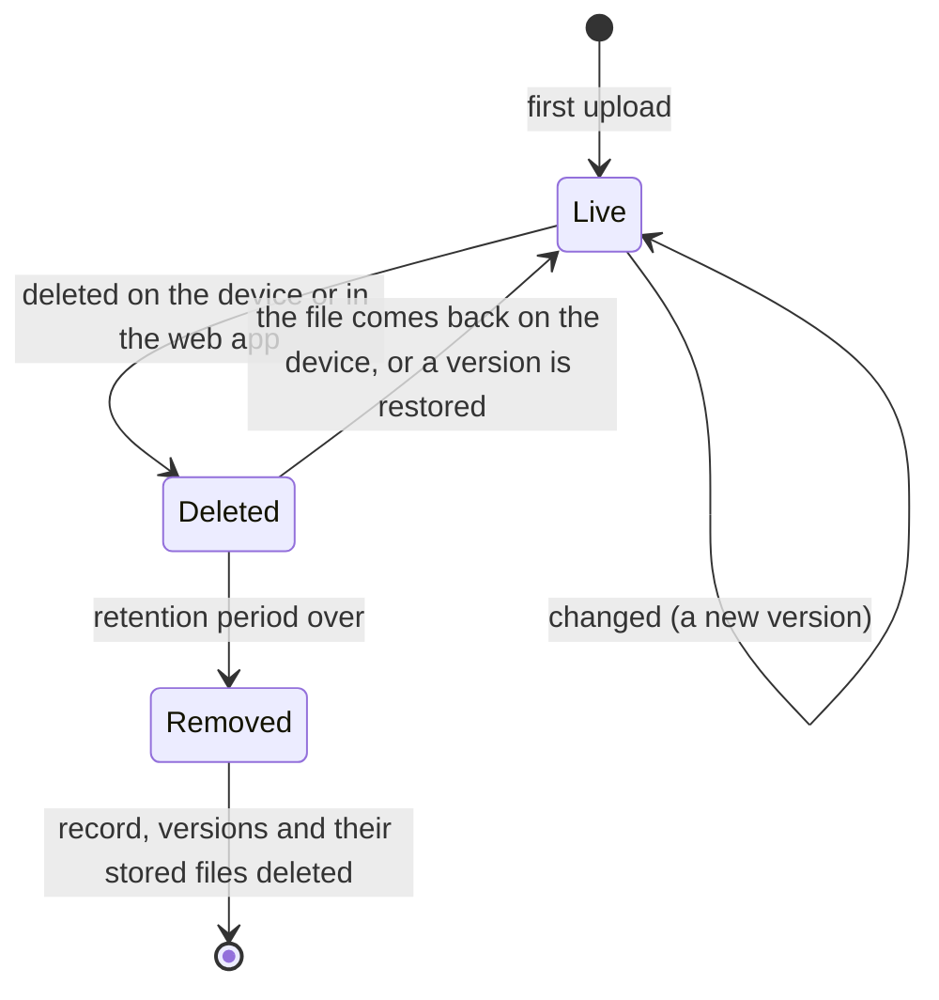

# Usage

## The web app

Log in at `http://<master>:8080` with the admin password. The page title bar shows **Live** when changes are being
pushed to you; pages refresh by themselves.

| Page | Use it to |
|---|---|
| **Timeline**, **Favorites**, **Archive** | Look at every photo and video, by month and day, with a scrubber to jump through time ([Photos](#photos)) |
| **Albums** | Group photos and videos |
| **Map** | See where photos were taken |
| **Trash** | Bring back what was deleted, until the retention period ends |
| **Dashboard** | See alerts, what is stored (totals are brought up to date when a device finishes syncing), disk usage, who is online and uploading right now, changes of the last two weeks, recent activity, and the state of sources and mirrors |
| **Files** | Browse, search, preview, download, upload and delete (below) |
| **Devices** | Add a device, see its status and progress; open one to rotate its token, revoke it, or see its recent changes |
| **Sources** | Collect Google Drive folders on a schedule |
| **Mirrors** | Copy everything offsite |
| **Settings** | Versions kept per file and the retention period |

### Photos

The **Timeline** shows the photos and videos of every device together, newest first, by month and day. Nothing is
copied or moved: it is another view of the same files.

- **Move through time** by scrolling, or with the **scrubber** at the right edge: it shows the years, and dragging it (or
  touching it on a phone) jumps to any month, with the month named beside your finger. With the scrubber focused, the up
  and down arrow keys move a month at a time.
- **Filter** by device, by photos or videos, and by tag, above the grid.
- **Open** a picture to see it large. Arrow keys or a swipe move to the next one, `Esc` closes, `i` shows or hides the
  info panel and `f` marks a favorite. Videos play in the browser; a video that browsers cannot play as it is gets a
  converted copy made in the background, and says so until it is ready (the original is always kept and downloadable).
- **Info** shows and edits: a description, a rating (one to five stars; click the same star again to clear it), tags,
  the **date** and the **place**. Changing the date moves the photo in the timeline; changing the place moves it on the
  map. Both are only corrections noted beside the file, and **Use the original** takes them back. Dates are read as UTC
  because cameras do not record a time zone, so a photo shows the same time everywhere.
- **Select** with the circle in a picture's corner (or the box next to a day, to take the whole day). The bar offers
  **Favorite**, **Add to album**, **Add tags**, **Archive**, **Download** and **Delete**.
- **Archive** hides pictures from the timeline without deleting them; they are on the Archive page. **Delete** moves them
  to the **Trash**, where they stay until the [retention period](#settings-and-retention) ends and can be restored with
  their albums, tags and favorite.
- **Albums** group pictures without moving them. Select pictures, choose **Add to album**, and pick an album or type a new
  name. On an album's page you can rename it, set a cover (select one picture), remove pictures from it, or delete it
  (the pictures stay).
- The **Map** shows pictures that have a place, grouped in numbered bubbles that open as you zoom. The strip below lists what
  is in view.

### Files

The top level lists every device, local folder and source as a folder. Open one and browse like in any file manager.
Every folder shows how many files it holds and how much space they take (the current versions, not the older ones).

- **Search** looks in the current folder and everything below it. **Type** filters by images, videos, audio, documents or
  archives. **Sort** by name, modified, recorded, date taken (photos), size or type; the arrow flips the order.
  **Deleted** also lists deleted files, struck through, with the date they will be removed for good.
- **List or grid**: the grid shows photo thumbnails. Long folders load as you scroll and in pages of 1000 files.
- **Select** files and folders with the checkboxes. The bar offers **Download** (a zip when it is more than one
  file or a folder; it streams, so size is no limit) and **Delete**.
- **Open a file** to see a preview (photos, video, audio), its size, type, dimensions, when it was taken, the
  photo's EXIF data (camera, lens, exposure, GPS), its content hash, and its **history**: every version with its date
  and size, each downloadable and restorable. Restoring makes that content the newest version; nothing is lost.
- **Upload** into a **local folder**: drag files or folders onto the page, or use the buttons. Uploads run in
  parallel in 8 MiB pieces, resume after a network hiccup, and appear in a panel in the corner. Create a local folder
  from the top level with **New local folder**. Devices and sources are filled by their own sending, so they are
  read-only for uploads (deleting is still possible).

A file deleted here that a device sent is hidden and goes to the Trash, and the device is not asked for it again: its own
file is left exactly as it is. Restoring it from the Trash brings it back; a file a device sent cannot otherwise be
changed here (download a version instead). A file deleted on the device is marked deleted too, and comes back if the
device has it again.

Deleting never erases at once: the file leaves the listing and its data stays, recoverable, until the
[retention period](#settings-and-retention) has passed.

### Devices

**Add device** gives a name and a token. The token is shown once, with the exact command to run on the device.
**Rotate token** replaces the token (the old one stops working immediately) and re-enables a revoked device.
**Revoke** stops a device from sending; its data stays.

A device that is uploading shows what it is doing, with a progress bar, speed and time left, on the Dashboard, the
Devices list and its own page. Local folders and sources have no status; they are just folders.

## The client

```sh
fafnirx enroll --server http://nas.lan:7443                    # asks for the token, connects, and runs in the background from now on
fafnirx add-folder ~/Documents --name documents                # name inside the device folder (default: folder name)
fafnirx remove-folder documents                                # stops collecting; what is on the master stays
fafnirx folders                                                # list collected folders
fafnirx status | pause | resume                                # talk to the running client
fafnirx sync                                                   # one cycle in the foreground, then exit
fafnirx run                                                    # the client itself, in the foreground
fafnirx update                                                 # check for a signed update now
fafnirx install-service | uninstall-service                    # start at login, or stop doing that
fafnirx tray                                                   # the tray icon (a separate process)
```

Use `--config <file>` to point at a different config file. `fafnirx --help` lists everything.

### Configuration file

TOML, created by `enroll`. Default: `%APPDATA%\fafnirx\config.toml` (Windows), `~/Library/Application Support/fafnirx/config.toml`
(macOS), `~/.config/fafnirx/config.toml` (Linux).

```toml
server = "http://nas.lan:7443"  # https://... behind a TLS proxy
bandwidth_limit_kbps = 0        # upload limit in KiB/s, 0 = unlimited
watch = true                    # react to file changes
scan_interval_secs = 3600       # full scan interval, 0 disables periodic scans
update_public_key = "..."       # see Signed client updates
web_url = "http://nas.lan:8080" # opened from the tray menu (default: port 8080 on the master's host)

[[folders]]
# written by add-folder
```

The token is not in the file; it is in the OS keychain (`FAFNIRX_TOKEN_STORE=file` forces a `token` file next to it).

### What is collected

- Everything under the folders you add, except what a `.fafnirxignore` file excludes. It sits in a collected folder and
  uses gitignore syntax.
- Skipped and logged: symlinks, locked files, names that conflict by case. Empty directories are ignored.
- A collected folder that is gone (an unmounted drive, a mistake) is not believed: what the master holds from it stays,
  and nothing is marked deleted.
- The client only reads your files. It never writes, renames, moves or deletes anything in a collected folder, and it
  does not collect its own state folder if that lies inside one.
- A file that becomes a folder of the same name, or the other way round, is handled: the old path is marked deleted
  first.
- Kept: size and modification time always, permission bits best effort. No extended attributes.
- Paths are stored normalized (NFC) with `/` separators.
- A file that keeps changing during upload is retried after 10 minutes, then 1 hour, then 1 day.
- While the master is unreachable, changes queue on the device and flow when it returns.

### The first sync

When a device is set up with folders that already hold files, everything in them is collected, with no extra step:

1. `enroll` starts the client, and `add-folder` wakes it at once, so the first cycle begins within a second or two (not
   at the next scheduled scan).
2. The client lists every folder, then takes the files one at a time: it **hashes a file and uploads it before moving to
   the next**, so data starts flowing immediately instead of after the whole folder has been read.
3. Each file goes in 4 MiB chunks over parallel streams, within the bandwidth limit (`bandwidth_limit_kbps`). Content the
   master already has for this device is not sent again.
4. A file is recorded as done once the master has verified it. If the client stops (a reboot, the network, `pause`, a
   crash), the next cycle skips what is done, and a half-sent file continues with its missing chunks.
5. Progress shows in the tray, in `fafnirx status`, and live on the Dashboard and the device page: file number, percent,
   speed and time left for the whole cycle.
6. Files that cannot be read (locked, changing, no permission) are skipped, reported as upload errors in the web app,
   and retried at 10 minutes, then 1 hour, then 1 day. They never hold up the rest.

The client keeps a local record of what it has sent, so an unchanged file is not offered again. That record belongs to one
master: if you wipe the master's database, recreate it, or enroll the device with another master, the client notices
(every cycle starts by asking the master for its id) and collects everything again. The tray's "On the server: N files"
line comes from that record, so after such a change it drops to 0 and counts up as files go out.

The master is never asked to send anything back; a device that was already full of data is a one-way copy.

### The tray icon

`fafnirx tray` shows a drive icon: green online, red error, amber paused, grey not running. The menu shows what the
client is doing (scanning, hashing, uploading with percent, speed and time left), the last sync, totals and the last
error, and has pause and resume, sync now, check for updates, start and stop, and an **open** submenu (config, log,
collected folders, the web app). `enroll` and `install-service` start it at login too.

## Settings and retention

| Setting | Default | Meaning |
|---|---|---|
| Versions kept per file | 5 | Older versions are marked expiring, then removed after the retention period |
| Retention (days) | 30 | How long deleted files and expired versions stay before they are removed for good |

Every version is a whole copy of the file, so a large file that changes often takes about *versions kept* times its size.



The change log (the activity lists) is kept 90 days.

## Local folders and the network drive

`data/files/` is a plain tree: `files/<name>/<path>`. You can share it over SMB or NFS and use it like a drive.

- Write as the user the master runs as (`FAFNIRX_UID`), or it cannot move or delete what the share creates.
- A **new folder** directly under `files/` with a valid name becomes a local folder (a device of its own) by itself.
- Only local folders are written to in place. The folder of a device or a source is the copy of theirs: share it read-only,
  because what is written inside it directly is not recorded.
- Files you add, change or delete in a local folder are recorded as versions of that folder's files within seconds (the master
  watches the folder), or within 5 minutes on mounts that do not report changes.
- A file overwritten in place has no previous copy to keep, so only versions replaced through a client or the web
  app are kept as history. Deleting a file moves it to `versions/`, so it can be restored.
- Files being copied in are recorded once they have been quiet for a few seconds.
- Names that a Mac writes decomposed (accents as separate characters) are renamed to the composed form, which is how
  every path is stored.

## Sources: Google Drive

1. In Google Cloud, create a **service account**, download its JSON key, and enable the Drive API for the project.
2. Share each Drive folder you want with the service account's email address (viewer is enough).
3. **Sources → Add Google Drive source**: a name, the folder ids or URLs (one per line), the key, and how often to collect.

Files appear under the folder `source-<name>`, with the same versions and retention as any device's. The key is stored in
the database and is never shown again.

- Only raw files are collected. Google Docs, Sheets, Slides, forms and shortcuts are skipped and counted in the run message.
- File names are made safe for all platforms (`/ \ : * ? " < > |` become `_`); duplicates get a ` (<id prefix>)` suffix.
- Renamed or moved files with the same content are not downloaded again.
- Files that disappear from Drive are marked deleted. If listing Drive fails, the run fails and deletes nothing.
- A failed or partial run raises an alert; the next good run clears it.

## Mirrors: offsite copies

**Mirrors → Add mirror**: a name, an rclone backend type, its options, a path on the remote, the interval (default 72 hours)
and how many runs of history to keep (default 3).

```text
# type: s3
provider = Other
endpoint = https://s3.example.com
access_key_id = ...
secret_access_key = ...
# path: my-bucket/fafnirx
```

Options are rclone's backend options as `key = value` lines (any backend from <https://rclone.org/overview/> works).
Passwords for backends that need them (SFTP, WebDAV) must be in rclone's obscured form: `rclone obscure <password>`.
Values are never displayed again; only the option names are.

What a mirror holds, in the same layout as the master:

```text
files/<device>/...              the current tree of each device, local folder and source
versions/<UTC time>/...         what that run replaced or removed (same relative paths)
meta/stats.json                 run statistics
meta/<device>.json              file list (path, size, mtime, root hash) per device
meta/library.json               albums, tags, favorites, ratings, descriptions, corrected dates and places
```

Each run uploads only files whose content changed. Every file is hashed again before it is staged, so a corrupt stored
file makes the run **partial** (and raises an alert) instead of being mirrored. The newest `keep` version directories
are kept; older ones are purged. **Run now** starts a run; the circular arrow forgets what was uploaded so the next run
sends everything (use it after emptying the remote).

## Alerts

| Alert | Raised when | Clears |
|---|---|---|
| Device offline | No heartbeat for 60 s | The device is seen again |
| Upload error | A client reports an error | 48 h after the client last reported it |
| Disk usage | The data disk is over 80% full | Usage drops |
| Source failed | A source run fails or is partial | A good run |
| Mirror failed | A mirror run fails or is partial | A good run |

Any alert can be dismissed by hand. Collection is never paused automatically. There are no email or webhook alerts.

## Restoring data

Use the web app: open the file, pick a version, **Download** it or **Restore** it. Or take it from disk: the current
version of a path is `<data>/files/<device>/<path>`; a replaced or deleted version is
`<data>/versions/<version id>/<device>/<path>` (the version ids are in the web app and in the database). Or copy from a
[mirror's `files/` tree](#mirrors-offsite-copies), which needs nothing from fafnirx.

## Signed client updates

Clients update themselves from the master, but only to builds you signed. The signing key never leaves your machine,
so a compromised master cannot ship a client update, and the update channel needs no TLS.

```sh
fafnirx-sign keygen --out update.key        # once. Keep update.key off the master.
# put the printed  update_public_key = "..."  in each client's config.toml

cargo build --release -p fafnirx
fafnirx-sign publish --key update.key --platform linux-x86_64 --version 0.2.0 \
    --bin target/release/fafnirx --out /path/to/data/updates
```

Clients install an update only if the signature verifies and the version is higher than theirs. They check every 6
hours; `fafnirx update` checks now. The platform is `<os>-<arch>` as Rust reports it: `windows-x86_64`, `linux-x86_64`,
`linux-aarch64`, `macos-aarch64`, `macos-x86_64`. After an update the client restarts itself.
