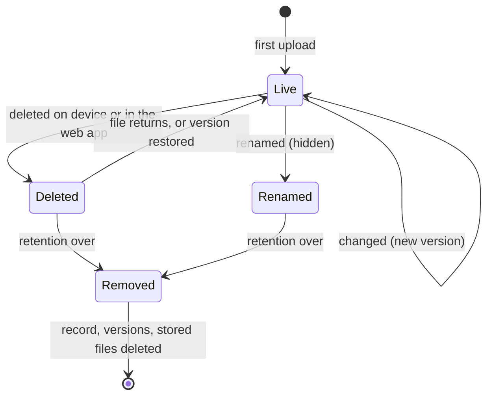

# Usage

Log in at `http://<master>:8080`. A new master has the user `admin` with `FAFNIRX_ADMIN_PASSWORD`; change it with the key
icon in the top bar. Pages update live.

| Page | Purpose |
|---|---|
| Dashboard | Alerts, totals (as of each device's last finished sync), disk, online devices, 2-week activity, recent changes |
| Timeline, Favorites, Archive | Photos and videos by month and day |
| Albums, Map, Trash | Group media; where it was taken; deleted files until retention ends |
| Files | Browse, search, preview, download, upload, move, delete; open media in the viewer |
| Processing | Background work ([details](#processing)) |
| Devices, Sources, Mirrors | Computers that send; Google Drive folders; offsite copies |
| Users, Settings | Administrators only |

## Users and roles

| Role | Own devices and files | Master files | Others' files | Users, settings, mirrors |
|---|---|---|---|---|
| Administrator | read, write | read, write | read, write | yes |
| Normal | read, write | read, write | no | no |
| Read only | none | read | no | no |

- Master files belong to nobody; everyone sees them. Users are added on **Users** (name, role, password); they cannot be
  deleted or renamed (the name is the folder). Disabling ends their logins and device uploads. One administrator always remains.
- A device belongs to the user who adds it; names are unique per user (`bob/laptop`, `alice/laptop`).
- Favorites, archive, ratings, descriptions, tags, albums, corrected dates and places are per user, also on master files.
- A master path cannot start with a user's name, and a user cannot take a name a master path uses.

## IDs and links

Files, albums, tags, jobs and alerts have UUIDs in the database and appear as 22 URL-safe Base64 characters
(`B5v1k9yXQ2eQm0GmXH3xwg`) in the UI, API and URLs (the hyphenated UUID is accepted). Devices, users, sources and mirrors
use their names.

| URL | Opens |
|---|---|
| `/albums/<id>` | An album |
| `/watch/<id>` | A photo or video in the viewer, with the media of its folder |
| `/files?device=<user/device>&path=<folder>&file=<path>` | A file's details |

Anyone who cannot see a file gets 404 for it.

## Files

The top level lists devices, local folders, sources and the master files. A badge shows **Changeable** (master files and
local folders, if your role may write) or **Read-only** (computers and sources: browse, download, hide only).

- **Search** (current folder and below), **Type**, **Sort**, **Deleted** (also list deleted files with their removal date), list or grid.
- **Select** → Download (zip for several), Add to album, Use folder as album, Move or rename, Delete.
- **Details** of a file: preview, EXIF, content hash, **history** (each version downloadable and restorable; restoring adds a
  new newest version and loses nothing).
- **Photos and videos** also have **Open in viewer** (or the play icon in the list) and **In the library**: favorite, archive,
  albums, rating, description, tags, date, place: the same data as the Timeline. Read-only users can view, not change.
- **Move or rename** (one file or folder): local folders and master files only, to any path on the same device. A folder
  moves with its contents; nothing moves if a name is in the way. One `rename` event, no Trash; albums showing the folder
  follow it. Files a computer or source sent return 409: they are theirs to move.
- **Still processing:** a photo or video whose details are unread shows a spinner (Timeline, albums, viewer, file list); its
  details say waiting, running or failed, linking to Processing.
- **Upload** into a local folder or the master files by drag and drop (8 MiB pieces, parallel, resumable). **New local folder** is on the top level.

Delete in the web app moves a file to the Trash and keeps its data until retention ends. For a file a device sent, the
device's own file is untouched and it is not asked for it again.

## Photos and videos

A view of the same files; originals are never changed.

- **Timeline:** by month and day; drag the scrubber at the right edge. Filter by device, kind and tag. Dates are read as UTC.
- **Viewer:** arrows or swipe, `Esc` closes, `i` info, `f` favorite. A video browsers cannot play gets a converted copy in the background.
- **Info:** description, rating (click a star again to clear), tags, date, place. Corrections are notes beside the file;
  **Use the original** reverts.
- **Select** (circle on a picture, box by a day): Favorite, Add to album, Add tags, Archive, Download, Delete.
- **Archive** hides from the Timeline. **Delete** goes to the Trash, restorable with albums, tags and favorite.
- **Map:** pictures with a place, grouped in bubbles.

### Albums

Files picked by hand, a folder, or both.

- **Folder album** (Use folder as album): everything in the folder and below is in the album, new files included, in natural
  name order (`Episode 2` before `Episode 10`) with a heading per season folder. One per folder and user.
- **It follows the folder:** when a folder is renamed in place (same parent) or moved, by a computer, a source, a local
  folder or Move or rename, the album moves to the new path once the old folder is empty, and an album still named after the
  folder takes the new name. A renamed album keeps its name. A folder emptied into an unrelated place, or whose new path
  already has an album, is not followed.
- **Cover**, first match: the file you chose; a poster image in the album (`poster`, `cover`, `folder`, `thumb` or
  `thumbnail`; `.jpg .jpeg .png .webp`; nearest the top first); for a folder album its first video, else first photo; for a
  picked album its newest file.

### Artwork and episode details

Read from the files beside a video (Jellyfin/Kodi/Plex names); nothing is downloaded. Without them a video shows a frame from
one second in.

| Picture of a video, first match (`.jpg .jpeg .png .webp`) | |
|---|---|
| Its own | `<video>-thumb`, `-landscape`, `-poster`, or `<video>`, in the video's folder |
| Its folder's | `poster`, `folder`, `cover`, `thumb`, `thumbnail` in the video's folder, else the folder above, else the one above that |

Details come from `<video>.nfo` (or `movie.nfo` for a lone video): `title`, `showtitle`, `season`, `episode`, `aired`
(`premiered`, `year`), `plot`, shown in the video's Info. Lookups happen on request, so a poster that arrives later is used.

## Processing

A live queue of the background work started after files arrive. It handles **photos and videos only** (by extension; images
`jpg jpeg png gif webp bmp tif tiff heic heif avif`, videos `mp4 mov mkv avi webm m4v wmv mts 3gp mpg mpeg`). Other files are
never read. Originals are not modified; nothing is sent outside.

| Job | Does | Reads | Result |
|---|---|---|---|
| `meta` | Reads details | Image: size, EXIF (camera, exposure, date, GPS). Video: duration, size, codec (`ffprobe`) | One `file_meta` row per content |
| `artwork` | Looks for the picture and `.nfo` beside a video | File names in its folder and two above | Nothing stored; the note says what was found |
| `thumb` | Draws 320 px and 1600 px JPEGs | The photo, a video frame, or the artwork picture | `cache/thumbs/`, removed after 30 days unused |
| `proxy` | Converts a video browsers cannot play to MP4 (`ffmpeg`) | The video | `cache/video/` |

Order: `meta` → `artwork` (videos) → `thumb` → `proxy` (own slow lane). HEIC/AVIF get pictures only if ffmpeg can make them.

**Logged per job:** kind, state (queued, running, failed, done), device and path, attempts, error, note, created, started
and finished times. Counts per kind show waiting, running, failed and done in the last 24 h; done jobs stay a day. A job is
tried 3 times, later each time, then fails. The same work is never queued twice. Streaming ([streaming](streaming.md)) adds
the segments and subtitle tracks it is making and its recent failures.

Users see the jobs of devices they can see. Uploads are not jobs: a file is received, verified and recorded first
([change log](#the-change-log)). Administrators can **Pause** (survives restart), **Retry**/**Clear** failed, **Cancel**
waiting, and **Process missing** (queue media never read).

## The change log

Dashboard and device pages list what happened to files. Nothing else is logged; events are kept 90 days.

| Event | When | Detail |
|---|---|---|
| `add` | A path is recorded first (or again after deletion) | |
| `update` | A live path gets new content | |
| `rename` | A computer or source renames/moves a file; a file is moved in a local folder or the web app | Old path |
| `delete` | A path is marked deleted: by a device, source, the web app, or its file leaving the store | |

A rename is one event on the new path. The old path is not a delete: no event, no Trash, not counted as deleted or listed
with **Deleted**; it is hidden until retention removes it with its old versions. The chart counts the four events separately.
Metadata/picture work, retention and sign-ins are not events. Upgrading corrected old renames (wrong deletes removed from the log and Trash).

## Devices

**Add device** gives a name and a token (shown once). **Rotate token** replaces it and re-enables a revoked device.
**Revoke** stops uploads, keeping data. **Release** lets the next computer with the token take over.

One computer holds a device at a time. A second one with the same token is refused while the first is heard from, says so in
`fafnirx status`/tray, and the owner gets an alert. After 90 s of silence it takes over; Release or Rotate does it at once.
Progress, speed and time left show on the Dashboard, Devices and the device page.

## The client

```sh
fafnirx enroll --server http://nas.lan:7443     # asks for the token; runs in background and at login
fafnirx add-folder ~/Documents --name documents
fafnirx remove-folder documents                 # stops collecting; the master keeps its data
fafnirx folders | status | pause | resume
fafnirx sync                                    # one cycle in the foreground
fafnirx run                                     # the client in the foreground
fafnirx release-deletes                         # send held-back deletions now
fafnirx update                                  # install the newest release now
fafnirx install-service | uninstall-service | tray
```

Config (TOML, made by `enroll`; `--config` selects another): `%APPDATA%\fafnirx\config.toml`, `~/Library/Application Support/fafnirx/config.toml`, `~/.config/fafnirx/config.toml`.

```toml
server = "http://nas.lan:7443"  # https://... behind a TLS proxy
bandwidth_limit_kbps = 0        # KiB/s, 0 = unlimited
watch = true                    # react to file changes
scan_interval_secs = 3600       # full scan, 0 disables
delete_hold_hours = 12          # delete guard
auto_update = true              # check GitHub releases every 6 hours
update_public_key = "..."       # only for your own signed builds
web_url = "http://nas.lan:8080" # tray link
[[folders]]                     # written by add-folder
```

The token is in the OS keychain (`FAFNIRX_TOKEN_STORE=file` uses a file beside the config).

**Collected:** everything under added folders except `.fafnirxignore` matches (gitignore syntax). Skipped and logged:
symlinks, locked files, case-only name clashes; empty directories ignored. A vanished folder (unmounted drive) deletes
nothing. The client never writes to collected folders. A file turning into a folder (or back) marks the old path deleted
first. Kept: size, mtime, permission bits (best effort). Paths are UTF-8 NFC; only user, device and source names are limited
to `a-z 0-9 . _ -`. Unstable files retry after 10 min, 1 h, 1 day. While the master is down, changes queue.

### The delete guard

If at least 10 files of a folder are gone and they are over 20% of what was sent from it, the client holds the deletions,
raises an alert and keeps uploading. If the files return, nothing is deleted; after `delete_hold_hours` they are sent;
`fafnirx release-deletes` sends them now. Smaller deletions pass at once.

### The first sync

`add-folder` wakes the client. It lists folders, then hashes and uploads one file at a time in 4 MiB chunks over parallel
streams within the bandwidth limit. A file is done once verified; after a stop the next cycle skips done files and resumes
partial ones. Unreadable files are skipped, reported, and retried. The client's record of what it sent belongs to one
master: if the master's database is replaced it notices (every cycle asks the master's id) and collects everything again.

### The tray

`fafnirx tray`: green online, red error, amber paused, grey not running. The menu shows phase, last sync, totals, last error;
pause/resume, sync now, **Check for updates** (GitHub releases, or the master if `update_public_key` is set), **Downloads on
GitHub** (latest release page), config/log/folder/web links.

## Settings and retention

| Setting | Default | Meaning |
|---|---|---|
| Versions kept per file | 5 | Older versions expire, then go after the retention period |
| Retention (days) | 30 | How long deleted files and expired versions stay |

A large file that changes often takes about *versions kept* times its size.



## Local folders and the network drive

`data/files/` is a plain tree: `files/<user>/<device>/<path>`, master files in `files/<path>`. Share it over SMB/NFS.

- Write as `FAFNIRX_UID`. A new `files/<user>/<name>` becomes a local folder of that user; a new folder directly under
  `files/` is master files.
- Share user folders read-only or not at all (the share has its own logins). Only local folders are written in place; share
  device and source folders read-only (writes there are not recorded).
- Changes are recorded within seconds (the master watches), or 5 minutes on mounts without events. Administrators can press
  **Scan now** (Files, Settings → File store).
- A moved file is recorded as a `rename` if it keeps size and mtime and is the only vanished file that matches; otherwise
  as `delete` + `add`.
- A file overwritten in place has no previous copy; deleting moves it to `versions/`.
- Decomposed (Mac) names are renamed to composed form.

## Sources: Google Drive

1. Create a Google Cloud **service account**, download its JSON key, enable the Drive API.
2. Share each Drive folder with its email (viewer is enough).
3. **Sources → Add Google Drive source:** name, folder ids or URLs, key, interval.

A source belongs to its user (`<user>/<name>`); files appear under `<user>/source-<name>` with the usual versions and
retention. The key is never shown again.

- Raw files only; Docs, Sheets, Slides, forms, shortcuts are skipped and counted.
- Names are made safe (`/ \ : * ? " < > |` → `_`); duplicates get ` (<id prefix>)`.
- A Drive rename/move is a `rename` without a download. A file deleted in the web app stays deleted until it changes on Drive.
- Files gone from Drive are marked deleted; if listing fails nothing is deleted. Failed or partial runs raise an alert.

## Mirrors: offsite copies

**Mirrors → Add mirror** (administrators): name, rclone backend type, options, remote path, interval (72 h), runs kept (3).
A mirror pushes everything: all users' files and master files.

```text
# type: s3
provider = Other
endpoint = https://s3.example.com
access_key_id = ...
secret_access_key = ...
# path: my-bucket/fafnirx
```

Options are rclone `key = value` lines, never shown again; SFTP/WebDAV passwords must be obscured (`rclone obscure`). To use
existing remotes (`crypt`, `b2`, OAuth), put `rclone.conf` in `./config` (or `FAFNIRX_RCLONE_CONFIG`; writable by the
master, readable by its owner only) and enter `name:path` as **rclone remote**.

```text
files/<user>/<device>/...       current tree per device, local folder, source
files/<path>                    master files
versions/<UTC time>/...         what that run replaced or removed
meta/stats.json, meta/<user>_<device>.json, meta/_master.json   run stats; file lists (path, size, mtime, root hash)
meta/library.json               albums, tags, favorites, ratings, descriptions, corrected dates and places
```

Each run uploads only changed files, re-hashing each; a corrupt file makes the run **partial** (alert) instead of being
mirrored. The newest `keep` runs are kept. **Run now** starts one; the circular arrow forgets what was uploaded. A mirror is
the offsite copy of 3-2-1 and does not contain the database ([backups](deployment.md#backups)).

## Alerts

| Alert | Raised when | Clears |
|---|---|---|
| Device offline | No heartbeat for 60 s | Seen again |
| Upload error | A client reports one | 48 h after the last report |
| Disk usage | Data disk over 80% | Usage drops |
| Source / Mirror failed | Run fails or is partial | A good run |
| Device used by two computers | A second computer uses the token | It stops |

Dismiss by hand. Collection never pauses automatically. No email or webhook.

## Restoring data

Web app: open the file, pick a version, **Download** or **Restore**. Disk: current version
`<data>/files/<user>/<device>/<path>` (`<data>/files/<path>` for master files); replaced or deleted version
`<data>/versions/<version id>/<user>/<device>/<path>`. Or copy from a mirror's `files/` tree.

## Client updates

Every 6 hours, on `fafnirx update`, or from the tray, the client asks the project's GitHub releases for the latest version; if
newer it downloads `fafnirx-<version>-<os>-<arch>` (`.exe` on Windows), checks the `.sha256` beside it, replaces its own file
and restarts. A bad download is refused. `auto_update = false` stops the automatic checks. Config, token and state directory
are untouched, so the device stays the same and nothing is resent or missed (also after a new installer or a reinstall).

The checksum comes from the same release: it guards against bad downloads, not against someone who can publish releases. For
your own signed builds:

```sh
fafnirx-sign keygen --out update.key        # keep off the master
# put the printed  update_public_key = "..."  in each client's config.toml
cargo build --profile client -p fafnirx
fafnirx-sign publish --key update.key --platform linux-x86_64 --version <version> \
    --bin target/client/fafnirx --out /path/to/data/updates
```

A client with `update_public_key` takes updates only from the master, only with a valid signature and a higher version.
Platforms: `windows-x86_64`, `linux-x86_64`, `linux-aarch64`, `macos-aarch64`, `macos-x86_64`.
