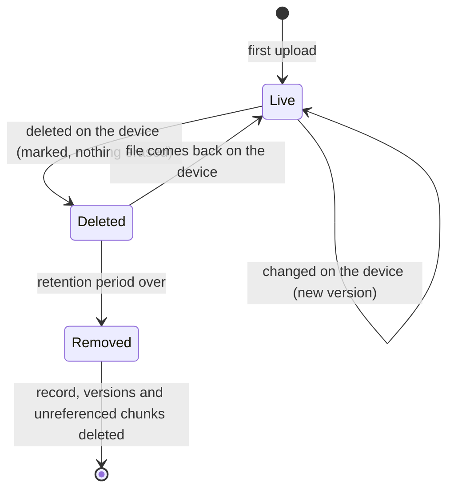

# Usage

## The web UI

Log in at `http://<host>:8080` with the admin password. The top bar has **Devices**, **Sources**, **Mirrors**,
**Settings** and the **CA certificate** download.

| Page | What you do there |
|---|---|
| Devices | See every device with status, OS, IP, data collected, file count and last collection. Add a device. Open one to see its recent activity, rotate or revoke its token. |
| Sources | Add Google Drive sources, **Run now**, **Pause**/**Resume**, delete. |
| Mirrors | Add offsite mirrors, **Run now**, **Pause**/**Resume**, **Resync**, delete. |
| Settings | Versions kept per file, retention for deleted files. |
| Home alerts | Open alerts, each dismissible by hand. |

The web UI is plain HTTP and has one shared password. Keep it on the LAN or behind a VPN.

## Devices

### Add a device

On **Devices**, type a name and press **Add device** (lowercase letters, digits, `.`, `_`, `-`; up to 63 characters). The name becomes the
device's namespace, `devices/<name>/`, and cannot change. The token is shown once on the next page together with the
exact `enroll` command.

### Token rotation and revocation

- **Rotate token** (shown as **New token (re-enables device)** on a revoked device) replaces the token and un-revokes the device. The old token stops working immediately.
- **Revoke** stops the device from uploading. Its data stays untouched.

### Offline

A device that sent no heartbeat for 60 seconds is shown offline and raises an alert; the alert resolves itself when it
comes back.

## The client

```sh
fafnirx enroll --server https://nas.lan:7443 --token <token> --ca fafnirx-ca.pem
fafnirx add-folder ~/Documents --name documents    # name inside the device namespace (default: folder name)
fafnirx remove-folder documents                    # stops collecting; what is on the server stays
fafnirx folders                                    # list collected folders
fafnirx run                                        # foreground: watch, upload, stay connected
fafnirx sync                                       # one cycle, then exit
fafnirx status | pause | resume                    # talk to the running client
fafnirx update                                     # check for a signed update now
fafnirx install-service | uninstall-service        # start at login
fafnirx tray                                       # tray icon (separate process)
```

Use `--config <file>` to point at a different config file. Run `fafnirx --help` for everything.

### Configuration file

TOML, created by `enroll`. Default location: `%APPDATA%\fafnirx\config.toml` (Windows), `~/Library/Application Support/fafnirx/config.toml` (macOS), `~/.config/fafnirx/config.toml` (Linux).

```toml
server = "https://nas.lan:7443"
ca_cert = "/home/me/.config/fafnirx/ca.pem"
bandwidth_limit_kbps = 0        # upload limit in KiB/s, 0 = unlimited
watch = true                    # react to file changes
scan_interval_secs = 3600       # full scan interval, 0 disables periodic scans
update_public_key = "..."       # see Signed client updates
web_url = "http://nas.lan:8080" # opened from the tray menu (default: port 8080 on the server host)

[[folders]]
# written by add-folder
```

The token is not in the file; it is in the OS keychain. Set `FAFNIRX_TOKEN_STORE=file` to force the file fallback.

### What is collected

- Everything under the folders you add, except what a `.fafnirxignore` file excludes. It sits in a collected folder and
  uses gitignore syntax.
- Skipped and logged: symlinks, locked files, names that conflict by case. Empty directories are ignored.
- Kept: size and mtime always, mode bits best effort. No extended attributes.
- Paths are stored normalized (NFC) with `/` separators.
- A file that keeps changing during upload is retried after 10 minutes, then 1 hour, then 1 day.

### Tray icon

`fafnirx tray` shows a drive icon: green online, red error, amber paused, grey not running. The menu shows what the client
is doing (scanning, hashing, uploading), the last sync, totals and the last error, and has pause/resume, sync now,
check for updates, start/stop and an **open** submenu (config, log, collected folders, web dashboard).
`install-service` also starts it at login.

## Settings and retention

| Setting | Default | Meaning |
|---|---|---|
| Versions kept per file | 5 | Older versions are marked pruned, then removed after the retention period |
| Retention (days) | 30 | How long deleted files and pruned versions stay before they are removed for good |

The life of a file:



Chunks are only deleted when no remaining version references them and they are more than 24 hours old. The change
log (the activity list on the device page) is kept 90 days.

## Sources: Google Drive

1. In Google Cloud, create a **service account**, download its JSON key, and enable the Drive API for the project.
2. Share each Drive folder you want with the service account's email address (viewer is enough).
3. **Sources → Add source**: a name, the folder ids or URLs (one per line), the key, and how often to collect.

Files appear under `sources/<name>/` and follow the same versions and retention as device files. The key is stored in
the database and is never shown again.

- Only raw files are collected. Google Docs, Sheets, Slides, forms and shortcuts are skipped and counted in the run
  message.
- File names are made safe for all platforms (`/ \ : * ? " < > |` become `_`); duplicates get a ` (<id prefix>)` suffix.
- Renamed or moved files with the same content are not downloaded again.
- Files that disappear from Drive are marked deleted. If listing Drive fails, the run fails and deletes nothing.
- A failed or partial run raises an alert; the next good run clears it.

## Mirrors: offsite copies

**Mirrors → Add mirror**: a name, an rclone backend type, its options, a path on the remote, the interval (default 72 hours)
and how many runs of history to keep (default 3).

```text
# type: s3
provider = Other
endpoint = https://s3.example.com
access_key_id = ...
secret_access_key = ...
# path: my-bucket/fafnirx
```

Options are rclone's backend options as `key = value` lines (any backend from <https://rclone.org/overview/> works).
Passwords for backends that need them (SFTP, WebDAV) must be in rclone's obscured form: `rclone obscure <password>`.
Values are never displayed again; only the option names are.

What a mirror holds:

```text
files/devices/<name>/...        the current tree of each device
files/sources/<name>/...        the current tree of each source
versions/<UTC time>/...         what that run replaced or removed (same relative paths)
meta/stats.json                 run statistics
meta/<namespace>.json           file list (path, size, mtime, root hash) per namespace
```

Each run uploads only files whose content changed. Files are rebuilt from the chunk store and every chunk is hashed
again, so a corrupt chunk makes the run **partial** (and raises an alert) instead of being mirrored. The newest
`keep` version directories are kept; older ones are purged. **Run now** starts a run; **Resync** forgets what was
uploaded so the next run sends everything (use it after emptying the remote).

## Alerts

| Alert | Raised when | Clears |
|---|---|---|
| Device offline | No heartbeat for 60 s | The device is seen again |
| Upload error | A client reports an error | 48 h after the client last reported it |
| Disk usage | The data disk is over 80% full | Usage drops |
| Source failed | A source run fails or is partial | A good run |
| Mirror failed | A mirror run fails or is partial | A good run |

Any alert can be dismissed by hand. Collection is never paused automatically. There are no email or webhook alerts.

## Restoring data

fafnirx never sends data back, so restores are manual.

**From a mirror** (simplest): `files/` is a plain tree. Copy it with rclone or any S3/SFTP client.

**From the orchestrator**: the chunk store is content addressed (`chunks/ab/cd/<hash>`), so a file is rebuilt by
concatenating the chunks listed in its manifest:

```python
# restore.py <data dir> <device name> <path> <output file>   (run with the web venv: needs psycopg)
import os, sys
import psycopg

data, device, path, out = sys.argv[1:5]
with psycopg.connect(os.environ["FAFNIRX_DATABASE_URL"]) as db:
    row = db.execute(
        """SELECT v.manifest FROM files f
           JOIN devices d ON d.id = f.device_id
           JOIN versions v ON v.id = f.current_version_id
           WHERE d.name = %s AND f.path = %s""",
        (device, path),
    ).fetchone()
manifest = bytes(row[0])
with open(out, "wb") as f:
    for i in range(0, len(manifest), 32):
        h = manifest[i : i + 32].hex()
        f.write(open(os.path.join(data, "chunks", h[:2], h[2:4], h), "rb").read())
```

For a *deleted* file (still within retention) or an older version, query `versions` for the version you want instead
of `current_version_id` (`SELECT id, created_at FROM versions WHERE file_id = ...`). Source files use the device name
`source:<source name>`.

## Signed client updates

Clients update themselves from the orchestrator, but only to builds you signed. The signing key never leaves your
machine.

```sh
fafnirx-sign keygen --out update.key        # once. Keep update.key off the orchestrator.
# put the printed  update_public_key = "..."  in each client's config.toml

cargo build --release -p fafnirx
fafnirx-sign publish --key update.key --platform linux-x86_64 --version 0.2.0 \
    --bin target/release/fafnirx --out /path/to/data/updates
```

Clients install an update only if the signature verifies and the version is higher than theirs. They check
every 6 hours; `fafnirx update` checks now. The platform is `<os>-<arch>` as Rust reports it: `windows-x86_64`, `linux-x86_64`, `linux-aarch64`, `macos-aarch64`, `macos-x86_64`.
