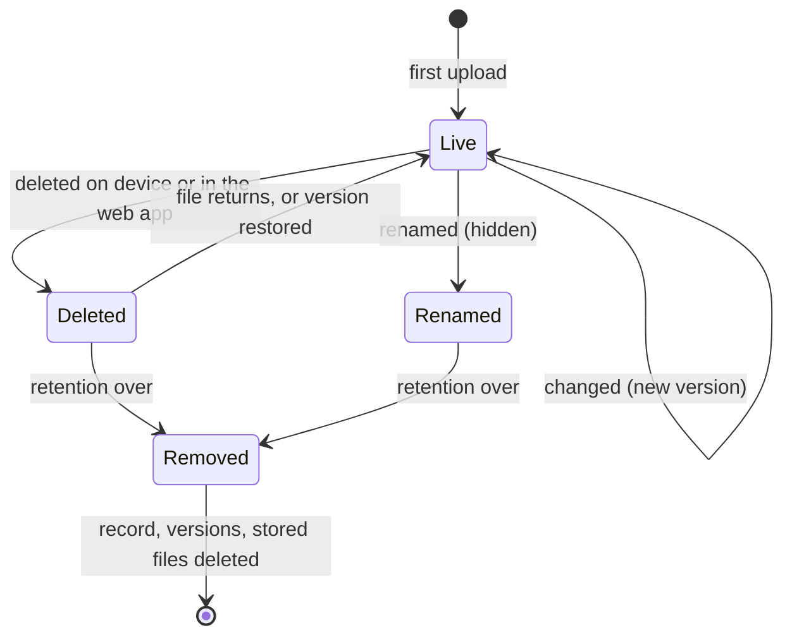

# Usage

Log in at `http://<master>:8080`. A new master has the user `admin` with `FAFNIRX_ADMIN_PASSWORD`; change it with the key
icon in the top bar. Pages update live.

| Page | Purpose |
|---|---|
| Dashboard | Alerts, totals (as of each device's last finished sync), disk, online devices, 2-week activity, recent changes |
| Timeline, Favorites, Archive | Photos and videos by month and day |
| Albums, Map, Trash | Group media; where it was taken; deleted files until retention ends |
| Files | Browse, search, preview, download, upload, move, delete; open media in the viewer |
| Processing | Background work ([details](#processing)) |
| Devices, Sources, Mirrors | Computers that send; Google Drive and other storage; offsite backups and replicas |
| Shared folders | Make, share with users, delete (not for read-only users) |
| Users, Settings | Administrators only |

## Users and roles

| Role | Own devices and files | Master files | Others' files | Users, settings, mirrors |
|---|---|---|---|---|
| Administrator | read, write | read, write | read, write | yes |
| Normal | read, write | read, write | no | no |
| Read only | none | read | no | no |

- Master files belong to nobody; everyone sees them. Users are added on **Users** (name, role, password); they cannot be
  deleted or renamed (the name is the folder). Disabling ends their logins and device uploads. One administrator always remains.
- A device belongs to the user who adds it; names are unique per user (`bob/laptop`, `alice/laptop`).
- Favorites, archive, ratings, descriptions, tags, albums, corrected dates and places are per user, also on master files.
- Master path `users/...` is refused: `files/users/` holds the user folders. User names and master folders may be equal.

## IDs and links

Files, albums, tags, jobs and alerts have UUIDs in the database and appear as 22 URL-safe Base64 characters
(`B5v1k9yXQ2eQm0GmXH3xwg`) in the UI, API and URLs (the hyphenated UUID is accepted). Devices, users, sources and mirrors
use their names.

| URL | Opens |
|---|---|
| `/albums/<id>` | An album |
| `/watch/<id>` | A photo or video in the viewer, with the media of its folder |
| `/files?device=<user/device>&path=<folder>&file=<path>` | A file's details |

Anyone who cannot see a file gets 404 for it.

## Files

The top level lists devices, local folders, sources and the master files. A badge shows **Changeable** (master files and
local folders, if your role may write) or **Read-only** (computers and sources: browse, download, hide only).

- **Search** (current folder and below), **Type**, **Sort**, **Deleted** (also list deleted files with their removal date), list or grid.
- **Select** → Download (zip for several), Add to album, Use folder as album, Move or rename, Delete.
- **Details** of a file: preview, EXIF, content hash, **history** (each version downloadable and restorable; restoring adds a
  new newest version and loses nothing).
- **Photos and videos** also have **Open in viewer** (or the play icon in the list) and **In the library**: favorite, archive,
  albums, rating, description, tags, date, place: the same data as the Timeline. Read-only users can view, not change.
- **Move or rename** (one file or folder): local folders, shared folders and master files only, to any path on the same device. A folder
  moves with its contents; nothing moves if a name is in the way. One `rename` event, no Trash; albums showing the folder
  follow it. Files a computer or source sent return 409: they are theirs to move.
- **Still processing:** a photo or video whose details are unread shows a spinner (Timeline, albums, viewer, file list); its
  details say waiting, running or failed, linking to Processing.
- **Upload** into a local folder or the master files by drag and drop (8 MiB pieces, parallel, resumable). **New local folder** is on the top level.

Delete in the web app moves a file to the Trash; data stays until retention ends. Computer or source files: theirs stay
untouched and are not re-fetched. Shared folders: deleted on every computer ([Deletes](#shared-folders-sync-both-ways)).

## Photos and videos

A view of the same files; originals are never changed.

- **Timeline:** by month and day; drag the scrubber at the right edge. Filter by device, kind and tag. Dates are read as UTC.
- **Viewer:** arrows or swipe, `Esc` closes, `i` info, `f` favorite. A video browsers cannot play gets a converted copy in the background.
- **Info:** description, rating (click a star again to clear), tags, date, place. Corrections are notes beside the file;
  **Use the original** reverts.
- **Select** (circle on a picture, box by a day): Favorite, Add to album, Add tags, Archive, Download, Delete.
- **Archive** hides from the Timeline. **Delete** goes to the Trash, restorable with albums, tags and favorite.
- **Map:** pictures with a place, grouped in bubbles.

### Albums

Files picked by hand, a folder, or both.

- **Folder album** (Use folder as album): everything in the folder and below is in the album, new files included, in natural
  name order (`Episode 2` before `Episode 10`) with a heading per season folder. One per folder and user.
- **It follows the folder:** when a folder is renamed in place (same parent) or moved, by a computer, a source, a local
  folder or Move or rename, the album moves to the new path once the old folder is empty, and an album still named after the
  folder takes the new name. A renamed album keeps its name. A folder emptied into an unrelated place, or whose new path
  already has an album, is not followed.
- **Cover**, first match: the file you chose; a poster image in the album (`poster`, `cover`, `folder`, `thumb` or
  `thumbnail`; `.jpg .jpeg .png .webp`; nearest the top first); for a folder album its first video, else first photo; for a
  picked album its newest file.

### Artwork and episode details

Read from the files beside a video (Jellyfin/Kodi/Plex names); nothing is downloaded. Without them a video shows a frame from
one second in.

| Picture of a video, first match (`.jpg .jpeg .png .webp`) | |
|---|---|
| Its own | `<video>-thumb`, `-landscape`, `-poster`, or `<video>`, in the video's folder |
| Its folder's | `poster`, `folder`, `cover`, `thumb`, `thumbnail` in the video's folder, else the folder above, else the one above that |

Details come from `<video>.nfo` (or `movie.nfo` for a lone video): `title`, `showtitle`, `season`, `episode`, `aired`
(`premiered`, `year`), `plot`, shown in the video's Info. Lookups happen on request, so a poster that arrives later is used.

## Processing

Live queue of background work, **photos and videos only** (by extension; images `jpg jpeg png gif webp bmp tif tiff heic heif
avif`, videos `mp4 mov mkv avi webm m4v wmv mts 3gp mpg mpeg`). Other files are never read; originals never modified;
nothing leaves the host.

| Job | Does | Reads | Result |
|---|---|---|---|
| `meta` | Reads details | Image: size, EXIF (camera, exposure, date, GPS). Video: duration, size, codec (`ffprobe`) | One `file_meta` row per content |
| `artwork` | Looks for the picture and `.nfo` beside a video | File names in its folder and two above | Nothing stored; the note says what was found |
| `thumb` | Draws 320 px and 1600 px JPEGs | The photo, a video frame, or the artwork picture | `cache/thumbs/`, removed after 30 days unused |
| `proxy` | Converts a video browsers cannot play to MP4 (`ffmpeg`) | The video | `cache/video/` |

Order: `meta` → `artwork` (videos) → `thumb` → `proxy` (own slow lane). HEIC/AVIF get pictures only if ffmpeg can make them.

**Logged per job:** kind, state (queued, running, failed, done), device and path, attempts, error, note, created, started
and finished times. Counts per kind show waiting, running, failed and done in the last 24 h; done jobs stay a day. A job is
tried 3 times, later each time, then fails. The same work is never queued twice. Streaming ([streaming](streaming.md)) adds
the segments and subtitle tracks it is making and its recent failures.

Users see the jobs of devices they can see. Uploads are not jobs: a file is received, verified and recorded first
([change log](#the-change-log)). Administrators can **Pause** (survives restart), **Retry**/**Clear** failed, **Cancel**
waiting, and **Process missing** (queue media never read).

## The change log

Dashboard and device pages list what happened to files. Nothing else is logged; events are kept 90 days.

| Event | When | Detail |
|---|---|---|
| `add` | A path is recorded first (or again after deletion) | |
| `update` | A live path gets new content | |
| `rename` | A computer or source renames/moves a file; a file is moved in a local folder or the web app | Old path |
| `delete` | A path is marked deleted: by a device, source, the web app, or its file leaving the store | |

A rename is one event on the new path. The old path is not a delete: no event, no Trash, not counted as deleted or listed
with **Deleted**; it is hidden until retention removes it with its old versions. The chart counts the four events separately.
Metadata/picture work, retention and sign-ins are not events.

## Devices

**Add device** gives a name and a token (shown once). **Rotate token** replaces it and re-enables a revoked device.
**Revoke** stops uploads, keeping data. **Release** lets the next computer with the token take over.

One computer holds a device at a time. A second one with the same token is refused while the first is heard from, says so in
`fafnirx status`/tray, and the owner gets an alert. After 90 s of silence it takes over; Release or Rotate does it at once.
Progress, speed and time left show on the Dashboard, Devices and the device page.

## The client

```sh
fafnirx enroll --server http://nas.lan:7443     # asks for the token; installs the service (boot, all users)
fafnirx add-folder ~/Documents --name documents
fafnirx remove-folder documents                 # stops collecting; the master keeps its data
fafnirx folders | pause | resume
fafnirx status [--json]                         # what the client is doing, shared folders included (also when stopped)
fafnirx sync                                    # one cycle in the foreground
fafnirx run                                     # the client in the foreground
fafnirx release-deletes                         # apply held-back deletions now, in every folder
fafnirx update [--check]                        # install the newest release and restart on it, or only look
fafnirx restart                                # restart the service (the client)
fafnirx shared list | create | attach | detach | keep   # shared folders, below
fafnirx install-service | uninstall-service | tray
```

Config (TOML, made by `enroll`; `--config` selects another): `%LocalAppData%\fafnirx\config.toml` (Windows, yours), `/Library/Application Support/fafnirx/config.toml`, `/etc/fafnirx/config.toml`. On macOS and Linux commands that change it or read the token ask for administrator rights (`sudo`); on Windows they do not. A Windows computer that still has `%ProgramData%\fafnirx\config.toml` from an older version keeps using it, with administrator rights (UAC), until that version is removed.

### The service

On Windows the client is a program of your user: `fafnirx install-service` (the setup and `enroll` do it) adds it and the tray to your login (`HKCU\...\Run`) and starts it; `uninstall-service` removes them. Failures of the client are not restarted by the system. On Linux and macOS the client is a service of the computer (systemd `fafnirx.service`, launchd `io.fafnirx.client`), run as root: one device per machine, and it reads the folders of every user. Config, token and databases are administrator-only; the tray and CLI of any user talk to it through `<data>/control` (markers, `status.json`, log). Failures restart it. The tray starts at login (`/etc/xdg/autostart`, `/Library/LaunchAgents`).

```toml
server = "http://nas.lan:7443"  # https://... behind a TLS proxy
bandwidth_limit_kbps = 0        # KiB/s, 0 = unlimited
watch = true                    # react to file changes
scan_interval_secs = 3600       # full scan, 0 disables
delete_hold_hours = 12          # delete guard
auto_update = true              # check GitHub releases every 6 hours
update_public_key = "..."       # only for your own signed builds
web_url = "http://nas.lan:8080" # tray link
[[folders]]                     # written by add-folder
[[shared]]                      # written by shared attach: name = "<owner>/<name>", path = "..."
```

The token is in the OS keychain (`FAFNIRX_TOKEN_STORE=file` uses a file beside the config).

**Collected:** everything under added folders except `.fafnirxignore` matches (gitignore syntax). Skipped and logged:
symlinks, locked files, case-only name clashes; empty directories ignored. A vanished folder (unmounted drive) deletes
nothing. The client never writes to collected folders. A file turning into a folder (or back) marks the old path deleted
first. Kept: size, mtime, permission bits (best effort). Paths are UTF-8 NFC; only user, device and source names are limited
to `a-z 0-9 . _ -`. Unstable files retry after 10 min, 1 h, 1 day. While the master is down, changes queue.

### The delete guard

If at least 10 files of a folder are gone and they are over 20% of what was sent from it, the client holds the deletions,
raises an alert and keeps uploading. If the files return, nothing is deleted; after `delete_hold_hours` they are sent;
`fafnirx release-deletes` sends them now. Smaller deletions pass at once. `fafnirx status` lists held deletions (also with
the client stopped).

### The first sync

`add-folder` wakes the client. It lists folders, then hashes and uploads one file at a time in 4 MiB chunks over parallel
streams within the bandwidth limit. A file is done once verified; after a stop the next cycle skips done files and resumes
partial ones. Unreadable files are skipped, reported, and retried. The client's record of what it sent belongs to one
master: if the master's database is replaced it notices (every cycle asks the master's id) and collects everything again.

### The tray

`fafnirx tray`: green online, red error, amber paused, grey not running. The menu shows phase, last sync, totals and last
error, and has pause/resume, sync now, the **Folders** and **Shared folders** submenus, and links to the config, log, client
data folder and web app. **Check for updates** looks for a newer version; when there is one the entry becomes
**Update to `<version>`** (see [Client updates](#client-updates)).

## Shared folders: sync both ways

`add-folder` folders are backup: up only, never written by the client. A **shared folder** belongs to a user, not a
computer: any computer of that user attaches a local folder, changes reach the others. Android and `add-folder` stay one-way.

Make and attach from the tray (**Shared folders**) or the CLI:

```sh
fafnirx shared list                          # <owner>/<name>, your own marked "own"
fafnirx shared create family                 # made as <you>/family
fafnirx shared attach ana/family ~/Family    # --create makes it first; the folder is made if it is not there
fafnirx shared detach ana/family             # keeps the files, here and on the master
fafnirx shared keep ana/family               # keep files whose deletion on the master is held back (see Deletes)

A folder is named `<owner>/<name>` everywhere: tray, config (`[[shared]] name`), `status`, Files and the web page. The commands
also take the short name when only one attached folder has it.
```

Tray: **Shared folders** lists every usable folder as `<owner>/<name>`; **New shared folder from a folder...** names it
after the picked folder. Stored on the master as `files/users/<owner>/<name>/` with versions, trash,
mirrors. The attached folder is not also backed up to the computer's device.

- **Cycle.** Receive, then send. The master notifies a running client of changes (syncs within seconds); fallback poll every
  minute. Same on both sides: untouched; changed on one: copied; rename: rename.
- **Names.** Rules of the most limited computer. Paths differing only in case or Unicode form are one name (folders too).
  Names Windows cannot store (`: ? * " < > |`, trailing dot/space, `CON`, `NUL`, `COM1`...) are neither sent nor received.
  The master refuses a new path breaking either rule and tells the sender. Same two rules for web upload/move into local
  folders and master files (SMB-visible); watcher and computer backups are taken as is. Case-only rename of a file or folder
  is a rename. Existing clashes: a computer keeps the first in sorted order, skips the rest with a message.
- **Conflicts.** Changed on both sides: nothing overwritten. This computer's version becomes
  `name (conflict <computer> <date>).ext` and is sent as a new file; the master's takes the name. Edited here but deleted on
  the master, or edited while it is received or deleted: same. Replaced versions stay in history.
- **Deletes.** Web app deletes apply on every computer at once; Trash keeps a version (restore returns it everywhere).
  Deletes by other computers pass the [delete guard](#the-delete-guard) both ways. A large one is held on this computer,
  no timeout: `fafnirx release-deletes` deletes here, `fafnirx shared keep <name>` keeps the files and re-sends them. A held
  deletion raises **Deletions held back** (see Alerts). A computer offline longer than trash retention gets the full file
  list: in-step paths not listed count as deleted (same guard); changed files become conflict copies.
- **Status.** `fafnirx status` "shared folders" section (works with the client stopped; `--json` key `shared`): per folder
  in step or not, files, last sync, held deletions, last problem. Tray: a line per folder. Web: computer page; the owner's
  folder page lists every attached computer.
- **Web page.** **Shared folders** lists yours and those shared with you (filter, search): files, size, last change, the
  computers that have it and how each is doing, and the command to attach it. The owner adds users (read-only or read and
  change), changes their access and removes them; a member can **Leave**.
- **Other users.** Own folders work on all your computers. Members see `<owner>/<name>` in tray and Files (read-only: browse,
  download). Only the owner manages access. Removing a member or leaving ends access at once; local files stay.
- **Deleting a folder.** Delete its files first; deleting the folder then removes trash, history and disk copy. Attached
  computers are told and keep their files; `detach` them.
- Receiving writes `.fafnirx-part-*` beside the target, renamed once verified; never uploaded.

## Settings and retention

| Setting | Default | Meaning |
|---|---|---|
| Versions kept per file | 5 | Older versions expire, then go after the retention period |
| Retention (days) | 30 | How long deleted files and expired versions stay |

A large file that changes often takes about *versions kept* times its size.



## Local folders and the network drive

`data/files/` is a plain tree: `files/users/<user>/<device>/<path>`, master files in `files/<path>`. Share it over SMB/NFS.

- Write as `FAFNIRX_UID`. A new `files/users/<user>/<name>` becomes a local folder of that user; a new folder directly under
  `files/` is master files (`users` is reserved).
- Share user folders read-only or not at all (the share has its own logins; `deploy/samba/` does this). Only local folders are written in place; share
  device and source folders read-only (writes there are not recorded).
- Changes are recorded within seconds (the master watches), or 5 minutes on mounts without events. Administrators can press
  **Scan now** (Files, Settings → File store).
- A moved file is recorded as a `rename` if it keeps size and mtime and is the only vanished file that matches; otherwise
  as `delete` + `add`.
- A file overwritten in place has no previous copy; deleting moves it to `versions/`.
- Decomposed (Mac) names are renamed to composed form.

## Sources and mirrors

**Sources** pull files in from Google Drive and other storage; **mirrors** keep offsite copies, as encrypted backups or as
plain replicas. See [Sources](sources.md) and [Mirrors](mirrors.md).

## Alerts

| Alert | Raised when | Clears |
|---|---|---|
| Device offline | No heartbeat for 60 s | Seen again |
| Upload error | A client reports one | 48 h after the last report |
| Disk usage | Data disk over 80% | Usage drops |
| Source / Mirror failed | Run fails or is partial | A good run |
| Device used by two computers | A second computer uses the token | It stops |
| Deletions held back | A computer holds a large deletion (delete guard, shared folders) | Dealt with (`release-deletes`, `shared keep`), or 15 min without a heartbeat reporting it |
| Files outside a device folder | Files in `files/users/` not under `<user>/<device>/` (not recorded) | Moved or removed |
| Master files in a reserved folder | Master files under `users/` | Renamed in the web app |

Dismiss by hand. Collection never pauses automatically. No email or webhook.

## Restoring data

Web app: open the file, pick a version, **Download** or **Restore**. Disk: current version
`<data>/files/users/<user>/<device>/<path>` (`<data>/files/<path>` for master files); replaced or deleted version
`<data>/versions/<version id>/<user>/<device>/<path>`. Or copy from a replica's `files/` tree (it has the same layout as the disk), or restore a backup with its restore kit ([Mirrors](mirrors.md#restore)).

## Client updates

The client checks GitHub releases every 6 h. If newer: downloads `fafnirx-<version>-<os>-<arch>` (`.exe` on Windows),
verifies the `.sha256` beside it, replaces its own file, restarts. Bad download: refused. `auto_update = false` disables the
check. Config, token and state stay: same device, nothing resent.

- **Tray:** **Check for updates** only looks; when newer the entry becomes **Update to `<version>`** (download, install,
  restart client and tray). A tray that finds a newer file on disk restarts too.
- **CLI:** `fafnirx update --check` prints `available <version>` or `current <version>` (no token needed); `fafnirx update` asks the service to install, then waits until it runs again on the new version. `fafnirx restart` restarts it.

The file is replaced by the client, which may write it (Windows `%LocalAppData%\Programs\fafnirx`, macOS/Linux script `/usr/local/bin`; there other users cannot).

`.deb` (under `/usr`): updated through the package. **Update** / `fafnirx update` downloads the release `.deb` for this arch,
verifies `.sha256`, runs `dpkg -i` via `sudo` (terminal) or `pkexec` (tray). If neither can ask: keeps the file and prints
`sudo dpkg -i <file>`. The background check only reports.

Restart ends the client and starts it again on Windows (a client of the user); on macOS it is `launchctl kickstart -k`, on Linux `systemctl restart`.

The checksum comes from the same release: it guards against bad downloads, not against someone who can publish releases. For
your own signed builds:

```sh
fafnirx-sign keygen --out update.key        # keep off the master
# put the printed  update_public_key = "..."  in each client's config.toml
cargo build --profile client -p fafnirx
fafnirx-sign publish --key update.key --platform linux-x86_64 --version <version> \
    --bin target/client/fafnirx --out /path/to/data/updates
```

A client with `update_public_key` takes updates only from the master, only with a valid signature and a higher version.
Platforms: `windows-x86_64`, `linux-x86_64`, `linux-aarch64`, `macos-aarch64`, `macos-x86_64`.
