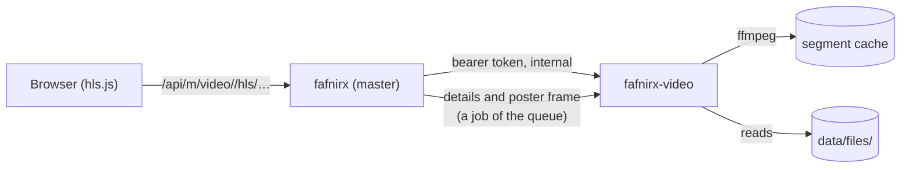

# Video module

The [module](modules.md) that plays videos. Without it the master has no ffmpeg: a video plays as the original in the browser's own player
(if the browser can decode it), with no details, no frame for its thumbnail and no qualities or subtitles. With it:

- **Playback** in the web app, adaptive: several qualities, chosen by connection or by hand, made as a video is watched.
  Same login and rules as the web app; no share links.
- **Details** of each new video (length, size, codec, date, place) and a **poster frame** for its thumbnail, which the master
  asks for while it processes the file. A picture beside the video (see [Usage](usage.md#processing)) is still used first.
- **Subtitles**, listed and converted for the player.

`fafnirx-video` (`modules/video/service`) runs next to the master (as a plugin the master starts, or as a container) and reads
`files/` read-only; the web part is `frontend/src/modules/video`, loaded by the browser from the service.



## How it works

- The master checks the login and the user's right to the file, resolves the id to path and content hash, and asks the service
  with a shared token.
- HLS: qualities 1080p, 720p, 480p, 360p (none above the video's size), 6-second segments; playlists are complete at once.
- A segment is made when asked for (one `ffmpeg` run, H.264 + AAC in MPEG-TS) and kept; a changed video has a new hash, so
  segments are never stale. Unwatched segments go after 7 days.
- The gear menu has **Quality** (Auto, a height, Original) and **Speed**; if streaming fails the original plays (a browser plays
  the formats it knows). Keys: space/`k`,
  `j`/`l` ±10 s, `m`, `c` subtitles, arrows previous/next file, double-click full screen.
- **Subtitles:** all offered. *Inside the file* (MKV, MP4): text tracks (SubRip, ASS/SSA, WebVTT, `mov_text`); picture tracks
  (PGS, VobSub, DVB) are left out; extracted on first use. *Beside the video:* `Movie.srt`, `Movie.en.srt`, `Movie.es.forced.srt`
  (SubRip, WebVTT, SSA/ASS), also in `Subs`, `Sub`, `Subtitles`, `Subtitle` (loose or in a folder named like the video); a video
  alone in its folder takes every subtitle file there. Embedded tracks come first. **CC** toggles; the gear has tracks, **Load
  from a file…**, the look (size, color, background, edge, font, height) and **Delay** (tenths of a second). Choices are kept in
  the browser; a `forced` track in the page's language starts on. Files should be UTF-8/16; older ones are read in the code page
  of their language code (1256 `ar`, 1251 `ru`, else 1252). ASS styling is dropped; text, breaks, italics, bold stay.

## Turn it on

**Plugin:** `FAFNIRX_PLUGINS=video` in the master env (compose: `.env`). At start the master pulls the bundle of its own version
(service, web part, static ffmpeg, ~60 MB) and runs it. Undo: see [modules](modules.md#plugins). Settings = `FAFNIRX_VIDEO_*` in the master env (compose: add to master `environment:`). Cache:
`<data>/cache/video-module`.

**Container:**

```sh
# .env
FAFNIRX_MODULE_VIDEO_URL=http://video:8090
FAFNIRX_MODULE_VIDEO_TOKEN=<openssl rand -hex 24>

mkdir video-cache && chown 1000:1000 video-cache       # FAFNIRX_VIDEO_CACHE_DIR, writable by FAFNIRX_UID
docker compose --profile video up -d                    # or COMPOSE_PROFILES=video
```

**Watch out:** the cache dir must be writable by uid 1000 (`FAFNIRX_UID`). Otherwise the service starts, then logs `cache: Permission denied`
and nothing plays. Fix: `chown -R 1000:1000` the dir (ZFS/NFS ACLs: check `acltype`), or use a named volume (`video-cache:/cache`; Docker sets the owner).

Image `jameelh99/fafnirx-video` (`FAFNIRX_VIDEO_IMAGE` pins). No published port, no login: reachable from the master only. Use for
other host, limits, GPU.

Files that arrived before the module: **Processing → Process missing** reads them again.

| Variable | Default | Where | Meaning |
|---|---|---|---|
| `FAFNIRX_MODULE_VIDEO_URL` | none | master | Container only: service address; the module is off without it |
| `FAFNIRX_MODULE_VIDEO_TOKEN` | none | master | Container only: shared secret, 16+ characters |
| `FAFNIRX_MODULE_TOKEN` | none | service | The same secret (compose passes it; a plugin gets its own) |
| `FAFNIRX_MODULE_UI` | none (`/usr/share/fafnirx-video/ui`) | service | The built web part the service serves |
| `FAFNIRX_DATA` | `data` (`/data`) | service | The master's data directory |
| `FAFNIRX_MODULE_LISTEN` | `0.0.0.0:8090` | service | Listen address |
| `FAFNIRX_VIDEO_CACHE` | `<data>/cache/video-module` (`/cache`) | service | Probes and segments |
| `FAFNIRX_VIDEO_KEEP_DAYS` | `7` | service | Days segments stay |
| `FAFNIRX_VIDEO_JOBS` | `2` | service | Files worked on at once |
| `FAFNIRX_VIDEO_VCODEC` | `libx264` | service | Encoder (`h264_nvenc` etc. lowers load) |
| `FAFNIRX_FFMPEG`, `FAFNIRX_FFPROBE` | `PATH` | service | The programs |

**Cost.** Software encoding is CPU work (~1-2 s per 720p segment per core); a first play keeps up only if encoding is faster
than playback. The cache grows with what is watched (~1-3 MB per segment and quality). Slow servers: use a hardware encoder.

**Observe.** The **Processing** page lists the segments and subtitle tracks in progress and recent failures (the service's
`GET /status`, [API](../modules/video/service/README.md)). A slow start is usually a segment waiting for a free slot. If the
module is down, details and frames wait in the queue and are tried again.

**Not built:** share links, audio files, several audio tracks, styled or picture subtitles, HEVC/AV1 output, trick-play
thumbnails, pre-made segments.

**Tests:** `cargo test -p fafnirx-video` (playlists, arithmetic, arguments, cache, path refusal, the details a probe gives);
`node tests/e2e-video.mjs` (real master and module with stand-in ffmpeg). Transcoding itself needs a real ffmpeg: play and seek
in the viewer.
